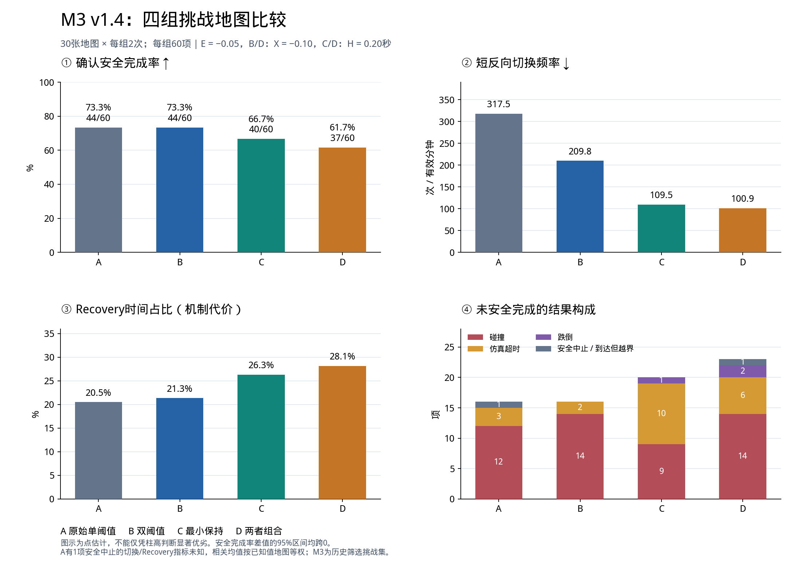

> 历史归档：2026-10-23文档整理前的内容。原位置：`docs/thesis_project/PROJECT_STATUS_AND_EXPERIMENT_DECISIONS_20261023.md`。仅修正归档后的相对链接；旧计划和状态不代表当前指令。

# 四足机器人风险驱动策略切换：项目现状与下一步实验思考

日期：2026年10月23日。用途：供本人、导师或外部审阅者了解当前项目，再决定后续研究方向。

本文件依据仓库当前任务、实验报告和现有分析结果整理。它是状态说明与讨论材料，不新增任务或实验授权，不修改已接受的参数，不把待验证的解释写成事实。

## 1. 当前最重要的判断

基础仿真、四组切换机制、地图、批量运行和分析系统已经建立；退出阈值与最小保持时间的开发选参已完成。原M1测试批次和M3挑战批次各完成240项四组比较。

目前较明确的正向结果是：双阈值和最小保持能够降低短时间反向切换频率。尚未得到稳定证据表明它们能够提高安全任务完成率、减少碰撞或加快到达；最小保持和组合机制反而表现出Recovery占用、耗时和超时方面的代价。

**当前核心研究缺口：减少的切换是否原本有害？减少切换是否带来了可测量的运动或任务收益？仅凭切换次数下降，还不能回答这两个问题。**

当前唯一Active Task仍为 **S7-02**，两批运行已经完成，任务等待审阅与收尾；尚未在文档中标记整个S7完成。实机保持 **NO-GO**。下一轮实验尚未确定。

## 2. 原研究目标与已有实现

课题为《面向复杂障碍环境的四足机器人风险驱动安全策略切换方法研究》。研究重点是Agile与Recovery之间的风险驱动切换，使用Unitree Go2、MuJoCo及ROS 2。

研究期望包括：减少无意义的反复切换，并考察其对碰撞、跌倒、任务到达、时间效率和风险响应的影响。不能在结果产生后，把这些目标全部缩减成“切换次数越少越好”。

当前闭环：

机器人状态与障碍射线 → Agile动作与RA风险评价 → A/B/C/D切换器 → Recovery接管或返回Agile → 仿真运动 → 记录与分析。

| 部分 | 当前情况 |
|---|---|
| Agile、RA、Recovery模型接入 | 已接入并用于多轮运行；本阶段复用已有模型，未重新训练策略 |
| 单阈值、双阈值、最小保持、组合 | 已实现，并进行过配置消费、边界和保持语义检查 |
| 模型与关节接口 | 维度、关节顺序、单位等关键接口已有阶段验证 |
| 策略运行频率 | 约50 Hz；仿真/策略时间与记录周期已有定向修正与验证 |
| 批量运行 | 支持独立组配置、固定顺序、断点恢复、失败记录、进程收尾 |
| 分析 | 可区分原始终局、记录有效性、安全任务完成及UNKNOWN；可做地图等权对比和区间估计 |
| 人工查看地图 | 有交互式地图观看脚本，可选组别；临时观看记录不当作正式样本 |
| 实机 | 当前不具备已通过的运行授权与完整准备结论，保持NO-GO |

### 2.1 当前四组研究参数

| 组别 | 进入阈值E | 退出阈值 | Recovery最小保持H | 研究作用 |
|---|---:|---|---|---|
| A | −0.05 | RA低于E时允许退出 | 关闭 | 原始单阈值参考 |
| B | −0.05 | X=−0.10 | 关闭 | 双阈值的独立作用 |
| C | −0.05 | RA低于E时允许退出 | 0.20仿真秒 | 最小保持的独立作用 |
| D | −0.05 | X=−0.10 | 0.20仿真秒 | 两种机制的组合及交互 |

进入Recovery的条件为RA达到或超过E。C/D在H到期后仍需满足各自退出阈值；H不是固定驻留时间上限。保持从每次Recovery入口开始计时，风险再次升高不重置入口时间；安全停止可以覆盖保持。

X=−0.10于2026年10月18日被接受为研究代表值；H=0.20秒随T2收尾于10月19日被接受。此前−0.07是扫描候选和参考值，当前正式B/D使用的是−0.10。这些是机制研究设置，不是全局最优或部署最优参数。

### 2.2 策略与感知边界

- RA值是风险评价信号，不是校准后的碰撞概率。
- 仿真障碍观测使用前方约90°的11束平面几何射线，不是全向感知，也不是实测雷达或深度相机。
- 地图中的参考路径只是几何说明，不输入策略；当前策略没有按该参考线执行的全局规划器。
- Recovery不能被当作任意复杂布局都能求解的通用导航器。
- 几何连通、保守包络检查通过，不等于已有策略一定能通过，也不等于实机步态可达。

## 3. 地图集现状与关系

| 地图集 | 当前规模及作用 | 独立性与限制 |
|---|---|---|
| M1 | 60张：开发30、原留出30；已冻结命名dev01–30、holdout01–30 | 原留出30张在首次正式240项之前未用于选参；布局仍具有生成模板相似性 |
| M2 selected_v2 | 18张开发图：e01–03、m01–06、d01–09；用于最终T1/T2研究 | 部分来源是M1开发图，部分是原M2及人工修改图；难度是开发标签，不是精确风险概率 |
| M3 v1.4 | 30张challenge01–30；已人工审阅，并完成240项挑战比较 | 利用历史失败表现筛选，部分源地图与M1重合；不是新的独立留出集 |

M3曾出现相邻地图过于相似，随后替换部分布局，并调整02/04/06的前向开口及04的局部障碍。当前报告使用v1.4，不能把旧源图的失败率直接当作修改后地图的真实难度。

M1与M3分别呈现。两批不能合并为60个相互独立的新地图样本，也不能只凭两批总体率差异就证明“地图难度导致某种机制效果变化”。后来选取M1来源图构造M3，不会追溯改变首次M1实验在选参时的留出状态，但会影响M3的新颖性与独立性。

资料位置：

- M1：`docs/thesis_project/designs/M1/`
- M2：`docs/thesis_project/designs/M2/selected_v2/`
- M3：`docs/thesis_project/designs/M3/`
- 可运行XML：`unitree_mujoco/unitree_robots/go2/`

## 4. 已完成的主要开发实验

下表是历史批次概览，条件和代码阶段并不完全一致。它们用于开发选参，不与后续测试结果混作同一统计样本；运行次数也不等于独立地图数。

| 工作 | 规模 | 作用及结果概况 |
|---|---:|---|
| M1开发图A组验证 | 90项 | 30图各3次；78到达、8碰撞、2仿真限时、2墙钟保护；不作为正式成功率结论 |
| T1早期退出阈值粗扫 | 96项 | 65到达、19碰撞、11仿真限时、1跌倒；跨过多次基础设施修正阶段 |
| T1扩大重复 | 400项 | 10张开发图×8档×5次；328到达、50碰撞、21仿真限时、1跌倒 |
| T1原M2第二轮 | 144项 | 6图×8档×3次；98到达、26碰撞、20仿真限时 |
| T1两档36图比较 | 144项 | 比较−0.07与−0.12；121到达、18碰撞、5仿真限时；原始逐帧后来已清理，保留部分历史汇总 |
| T1最终局部扫描 | 216项 | 当前M2的18图×6档×2次；172到达、33碰撞、8仿真限时、3跌倒；选定X=−0.10 |
| T2保持功能检查 | 4项 | 确认A/C配置与保持语义；均到达，只有单图单次，不能比较性能 |
| T2保持扫描 | 180项 | 18图×A及四档C×2次；142到达、18碰撞、19仿真限时、1跌倒；选定H=0.20秒 |
| T2四组组合检查 | 48项 | 6图×四组×2次；36到达、5碰撞、7仿真限时；发现D的驻留和超时代价 |

B1等工作另外补强了记录顺序、周期0、任务与收尾边界、安全历史、保持审计及分析一致性。它们是测量与实现准备，不直接证明提出的方法改善了导航表现。

### 4.1 选参证据为何没有直接延续为测试收益

T1最终开发扫描中，X=−0.10相对−0.07为31/36对27/36到达、4/36对8/36非足端碰撞，短反向频率约167.0对293.3次/有效分钟；但任务和碰撞的差值区间触及0，且不是对A的完整独立验证。

T2扫描中，C的H=0.20相对A为32/36对28/36到达，碰撞终止1次对8次，短反向频率92.1对355.2；同时增加超时和驻留。48项组合检查又显示D在m06、d07上有推进退化。

这些结果足以解释研究代表参数的选择，不能保证它们在别的地图分布上保持优势。开发阶段的正向点估计并未被后续两批结果稳定复现为安全完成收益。

## 5. 已完成的两批主要四组对照

### 5.1 共同设置与指标

- 每批30图×2区组×四组=240项，每组60项。
- 目标(7.5,0)m，半径0.5m；20仿真秒/120墙钟秒；到达后站立观察2仿真秒。
- 隐藏MuJoCo窗口、关闭RViz；隐藏窗口仍依赖X11/OpenGL。
- 原始碰撞、跌倒、超时和安全中止作为结果，不因成绩不好而重跑。
- 主要比较B−A、C−A、D−B、D−C，以及交互(D−C)−(B−A)。
- 重复先在图内汇总，再地图等权；10,000次地图簇bootstrap。
- 未执行确认性p值检验。UNKNOWN情景界不是置信区间；区间跨0不能解释成等效或非劣效。
- 安全任务完成要求时限内到达且规定安全维度支持清楚；VALID只表示记录校验通过，ARRIVED不自动等于安全完成。
- 0.5秒短反向窗口统计两个方向的相反模式切换；它是运行前定义的切换行为指标，不直接等于有害动作或事故。

### 5.2 原M1测试集：240项

实际场景启动241次，包含1次GLFW初始化失败及其获批唯一替代。240项计划完成；187项确认安全完成、51项确认未完成、2项UNKNOWN。

| 组别 | 确认安全完成 | 确认未完成 | UNKNOWN | 安全完成率情景范围 |
|---|---:|---:|---:|---:|
| A | 49/60 | 11 | 0 | 81.7% |
| B | 48/60 | 12 | 0 | 80.0% |
| C | 43/60 | 15 | 2 | 71.7%–75.0% |
| D | 47/60 | 13 | 0 | 78.3% |

共31次碰撞终止、20次仿真限时、2次墙钟保护，没有跌倒终局。

主要观察：B对A没有明确安全完成收益；C对A短反向频率下降113.9次/有效分钟，95%区间[−177.9,−61.2]，同时任务耗时增加。D对C的额外切换改善区间跨0，安全完成交互区间也跨0。

**数据限制：**实验结束后原始策略JSONL和详细ROS日志曾被清理。汇总、台账、终局和部分压缩上下文/指标仍在，但现在不能完整重算时间序列，也不能将当前分析器的后续修正完整追溯应用于该批。不能用新运行冒充已删除的历史原始记录。

### 5.3 M3 v1.4挑战集：240项

实际启动240次、替代0次。首次运行到104项后暂停；修正终止时间关联后从105续跑，前104项未重跑。全批由当前分析器从原始记录重算。

| 指标 | A | B | C | D |
|---|---:|---:|---:|---:|
| 确认安全完成 | 44/60 | 44/60 | 40/60 | 37/60 |
| 安全完成率 | 73.3% | 73.3% | 66.7% | 61.7% |
| ARRIVED | 44 | 44 | 40 | 38 |
| 碰撞终止 | 12 | 14 | 9 | 14 |
| 仿真限时 | 3 | 2 | 10 | 6 |
| 确认跌倒 | 0 | 0 | 1 | 2 |
| 系统安全中止 | 1 | 0 | 0 | 0 |
| 短反向/有效分钟 | 317.5 | 209.8 | 109.5 | 100.9 |
| Recovery时间占比 | 20.5% | 21.3% | 26.3% | 28.1% |
| 到达耗时均值，仅ARRIVED子集 | 7.74s | 8.03s | 9.26s | 9.63s |

合计166次ARRIVED，但只有165次安全完成：D组M3-148到达时存在base_link越界。75项确认未完成，安全完成UNKNOWN为0；这不等于所有字段都已知。A有1次安全中止使切换等部分指标覆盖不完整，相关均值按分析器的已知值地图等权计算。到达耗时的成功子集不同，不能直接当作整体效率对比。

M3-104为确认跌倒。旧分析器混用了末策略帧12.202秒与附带物理样本6106步；监督器实际依据该样本12.212秒确认跌倒后停止。修正只关联这一检测事实，保留策略指标边界，排除收尾事件；旧派生结果保留。

| M3对比 | 点估计差值 | 地图簇95%区间 |
|---|---:|---|
| B−A安全完成率 | 0.0个百分点 | [−13.3,+11.7] |
| C−A安全完成率 | −6.7个百分点 | [−20.0,+5.0] |
| D−B安全完成率 | −11.7个百分点 | [−26.7,+3.3] |
| D−C安全完成率 | −5.0个百分点 | [−18.3,+6.7] |
| B−A短反向频率 | −107.7次/有效分钟 | [−159.3,−58.4] |
| C−A短反向频率 | −207.9次/有效分钟 | [−276.1,−147.7] |
| D−B短反向频率 | −108.9次/有效分钟 | [−155.9,−66.8] |
| D−C短反向频率 | −8.6次/有效分钟 | [−23.1,+6.6] |

安全完成交互为−5.0个百分点，区间[−21.7,+11.7]，没有确定协同证据。短反向交互为+99.0次/有效分钟，区间[+50.1,+149.2]；按当前差值定义，组合的额外切换下降小于两种机制各自改善的简单相加，不能解释为正向协同。

C相对A任务窗口耗时增加2.77秒，D相对B增加2.13秒；这类耗时包括按其真实终局结束的任务，不能单独用来宣布导航效率优劣，需要结合完成和失败构成。

## 6. 现在能够说明什么，不能说明什么

| 问题 | 当前结论 |
|---|---|
| 切换机制是否真实实现、按参数工作？ | 已有配置与语义验证，以及多轮运行支持 |
| 双阈值是否减少短反向？ | M3中有下降证据；原M1批次B−A差值区间跨0，不能概括为所有分布均确定改善 |
| 最小保持是否减少短反向？ | 两批均支持下降；其中部分下降是保持机制直接限制退出的结果 |
| 降低切换是否提高安全完成？ | 现有两批未给出稳定正向证据；C/D有明显任务代价信号 |
| 方法是否减少碰撞？ | 不支持普遍减少；M3中B/D碰撞终止次数高于A，C较少但超时和跌倒增加 |
| 方法是否加快到达？ | 当前不支持；条件到达均值和任务耗时总体显示成本 |
| D是否优于B/C、具有协同？ | 未得到确定证据；减少切换的边际收益可能小于增加的任务代价 |
| 方法是否更平顺、更省能、更少冲击或磨损？ | 尚未完成相应分析，不能从模式次数直接推断 |
| 是否适合真实机器人？ | 尚未验证，不能由仿真推断实机安全 |

最准确的阶段表述是：**提出并实现了两类切换约束，验证其对切换行为的影响，并观察到稳定性指标与任务表现之间的权衡；尚未验证预期的普遍安全或效率收益。**

这不是证明“方法在任何情况下无效”，也不是证明“方法已全面有效”。实际收益的范围和原因仍待解释。

## 7. 当前最需要思考的研究问题

### 7.1 被减少的切换到底是否有害

一种合理假设是：短时间接管与退出打断了恢复动作，或导致两种策略输出不连续。然而目前没有完成“短反向 → 动作/姿态或推进异常 → 任务损失”的实证链条。

也存在其他可能：部分短切换是合理的快速风险响应；减少它们主要延长了Recovery，并没有改善运动。一直停留Recovery也能降低切换次数，因此次数不能独立代表质量。

### 7.2 碰撞原因是否由退出规则能够影响

需区分尚未触发Recovery、正在Recovery内碰撞、退出后不久碰撞，以及感知/既有策略能力限制。时间邻接只能说明先后关系，不能直接证明退出导致碰撞。

如果主要失败源于进入触发或Recovery本身的行为能力，继续调整退出阈值和H可能收益很小。当前尚未对全批作完这种机制解释。

### 7.3 两种约束是否存在过度限制

H是在C条件下选的，X是在B条件下选的，分别合适不保证组合合适。D的较长驻留和超时值得解释，但共同参数四组对照本身成立；D不必最优才能研究交互。

若日后另做D的组合优化，须与当前共同参数机制对照分开标记，不能换参数后回写现有结果。

### 7.4 成功之外需要什么实际收益指标

若要论证动作连续性，可考虑关节目标相邻变化（rad）、动作变化及扭矩输出变化；但这些是控制器记录值，不能直接等同于实际机械冲击或能耗。需先核对采样覆盖及字段含义。

若要论证恢复有效，可考察模式退出前后的姿态、目标距离推进和再接管行为；RA降低仍是内部评价信号，不能单独当作真实安全恢复的证据。

## 8. 后续工作的可选方向，均尚未启动

以下是供选择的方向，不是全部必须做的任务。

| 方向 | 要回答的问题 | 可执行范围 | 能避免的问题 |
|---|---|---|---|
| A：现有M3数据的机制分析 | 短反向是否伴随动作/姿态/推进异常？失败与切换是什么关系？ | 使用已有240项原始记录，先固定分析定义，再做事件对齐和代表案例 | 不必先新增仿真，也避免只挑正向片段 |
| B：有明确假设的小规模开发诊断 | 如果A发现一个具体问题，能否通过受控对比检验？ | 事先固定少量开发场景、变量、指标和停止条件，原模型及正式数据保留 | 避免继续广泛改图、盲目加重复或改参数求胜 |
| C：把当前结果作为机制权衡研究收尾 | 若实际收益仍不明确，如何诚实回答开题研究问题？ | 完成失败原因、代价、适用边界和论文图表；与导师确认结论范围 | 不把负面结果隐藏，也不无限扩展工作量 |
| D：D专用参数组合探索 | X与H的搭配能否减轻过度保守？ | 可选开发研究，单独记录为调参版本；需要新方案 | 不混淆共同参数因子对照与各组单独最优化 |

当前建议优先考虑A。它的完成条件应是形成一组能够回答“切换减少的实际意义”的分析结果，而不是再建设日志、门禁或验证平台。若没有发现明确收益，就报告没有发现；事后新增指标属于探索性分析，不能包装成运行前确认的主要终点。

之后只有在发现具体、可检验的问题时才考虑B或D。研究目的不是保证B/C/D胜过A，而是查清机制在哪些条件下有收益、在哪些条件下有代价。

## 9. 尚未完成的项目工作

| 工作 | 状态 |
|---|---|
| S7-02最终文档关闭 | 运行与分析完成，当前仍ACTIVE、待收尾 |
| 切换减少的动作/任务意义分析 | 尚未完成，是目前主要解释缺口 |
| 全批失败机制归因 | 有部分案例和碰撞时序，尚无完整因果结论 |
| 论文级结果与讨论 | 已有表格及部分图，需要统一成论文论证 |
| 实机安全准备与代表性验证 | 尚未取得通过结论，NO-GO |
| 新训练、D专用联合优化、新地图或新增大批次 | 未作为当前下一任务授权 |
| 完整复现和数据归档 | M3原始资料可用，仍需保留；M1原始缺失需在复现说明中如实披露 |

## 10. 现有数据能支持哪些后续分析

| 数据 | 当前可用性 | 适合用途 |
|---|---|---|
| 原M1正式批次汇总、台账、终局、部分上下文 | 保留 | 既有四组统计、当时结果和局限说明 |
| 原M1逐帧JSONL和详细ROS日志 | 已清理 | 不能再做完整时序重算或新的逐帧机制分析 |
| M3 v1.4完整原始帧、ROS、context、terminal、配置、台账 | 保留 | 事件对齐、动作/姿态/推进关系、失败案例及新派生分析 |
| M3旧冲突分析和M3-104修正记录 | 保留 | 说明分析版本变化及原始数据未被改写 |
| T1/T2开发记录 | 以各批实际保留情况为准 | 解释参数选择及探索性背景，不当作新独立测试样本 |
| 旧两档36图和若干人工观看记录 | 原始记录部分已清理 | 仅使用现存历史汇总；不假设全部可恢复 |

M3原始帧包含RA、模式、射线、速度/位姿、动作、关节目标和扭矩输出等字段；可用性按字段及实际覆盖判断。姿态等物理样本独立于策略帧采样，不伪称严格同时，也不能据这些字段证明MuJoCo实际消费了某条命令。

主要目录：

- 原M1：`logs/08_formal_experiment/S7_ABCD_240/s7-abcd240-20261023/`
- M3：`logs/08_formal_experiment/M3_ABCD_240/m3-abcd240-20261023/`
- M3分析：上述目录的 `analysis/formal_summary/`

当前磁盘约196 GiB，可用约56 GiB；M3批次约2.3 GiB。后续优先压缩/备份，不删除不可重建的原始记录。GitHub提交不会自动备份被忽略的logs。

## 11. 需要接受的限制

1. 每图每组只有两次，独立地图簇约30个；不能把240次全部视为独立环境样本。
2. 调度平衡不等于实际初态严格一致；重复号和调度种子不代表确定性物理重放。
3. 地图存在模板和来源关联，M3有历史筛选；不能宣布一般环境泛化。
4. 多轮开发筛选可能有选择偏差；开发优势不能替代测试验证。
5. 无碰撞终止不等于整体更安全，超时与碰撞是不同的竞争终局。
6. base_link点界内不等于整机足迹始终界内；当前不扩展成完整安全认证。
7. MuJoCo命令实际消费仍UNKNOWN；不能把控制器确认当作执行器确认。
8. M1数据清理限制了复核能力；当前M3则完整保留，不能用两者原始可用性相同的说法描述。
9. 仿真结果没有替代真实传感、动力学和硬件安全验证。

## 12. 可直接交给导师或外部审阅者的问题

1. 当安全完成和效率没有改善时，降低短反向是否足以构成有价值的切换机制研究？还需要什么实际收益证据？
2. 优先分析关节目标连续性、姿态扰动还是任务推进，更贴合开题目标且能由现有记录可靠支持？
3. 若C/D主要代价是Recovery推进不足，应报告其适用边界，还是值得另做一个规模受控的保持/组合诊断？
4. 后续新增实验怎样预先定义问题和成功条件，避免根据已有结果改地图或筛选赢家？
5. 在本科时间预算内，仿真机制分析、低速实机准备和论文写作应如何排序？

## 13. 主要材料入口

- [项目目标](../../../../../docs/thesis_project/OVERVIEW.md)、[路线图](../../../../../docs/thesis_project/ROADMAP.md)、[当前状态](CURRENT_STATE.md)、[实验计划](../../../../../docs/thesis_project/EXPERIMENT_PLAN.md)
- [当前任务S7-02](tasks/S7-02.md)
- [T1退出阈值选择](../../../../../docs/thesis_project/designs/T1/EXIT_THRESHOLD_SELECTION.md)
- [T2代表参数](../../../../../docs/thesis_project/designs/T2/HOLD_TIME_SELECTION.md)
- [T1最终216项扫描](../../../../../docs/thesis_project/evidence/T1/m2_local_scan_216/T1_M2_LOCAL_SCAN_216_EXECUTION_REPORT.md)
- [T2保持180项扫描](../../../../../docs/thesis_project/evidence/T2/hold_scan_180/T2_HOLD_SCAN_180_EXECUTION_REPORT.md)
- [T2四组48项组合](../../../../../docs/thesis_project/evidence/T2/combined_check_48/T2_COMBINED_CHECK_48_EXECUTION_REPORT.md)
- [原M1正式报告](../../../../../docs/thesis_project/evidence/S7-02/S7-02_EXECUTION_REPORT_20261023.md)、[数据保留限制](../../../../../docs/thesis_project/evidence/S7-02/DATA_RETENTION_20261023.md)
- [M3最终报告](../../../../../docs/thesis_project/evidence/S7-02/M3_ABCD_240_FINAL_REPORT_20261023.md)、[M3结果索引](../../../../../docs/thesis_project/evidence/S7-02/M3_ABCD_240_RESULT_INDEX.md)
- [M3比较图](../../../../../docs/thesis_project/evidence/S7-02/M3_ABCD_COMPARISON.png)、[M3-104修正](../../../../../docs/thesis_project/evidence/S7-02/M3_104_TERMINAL_BOUNDARY_REPAIR.md)

本次整理只读现有结果并新增本Markdown，没有启动实验、改变任务状态或提交Git。当前分支为`feat/ray-pred-source-switch`，HEAD为`26e7b53`（2026-10-21），10月23日的相关结果、代码和文档仍有未提交改动；该HEAD本身不代表全部当前工作内容已经备份。
