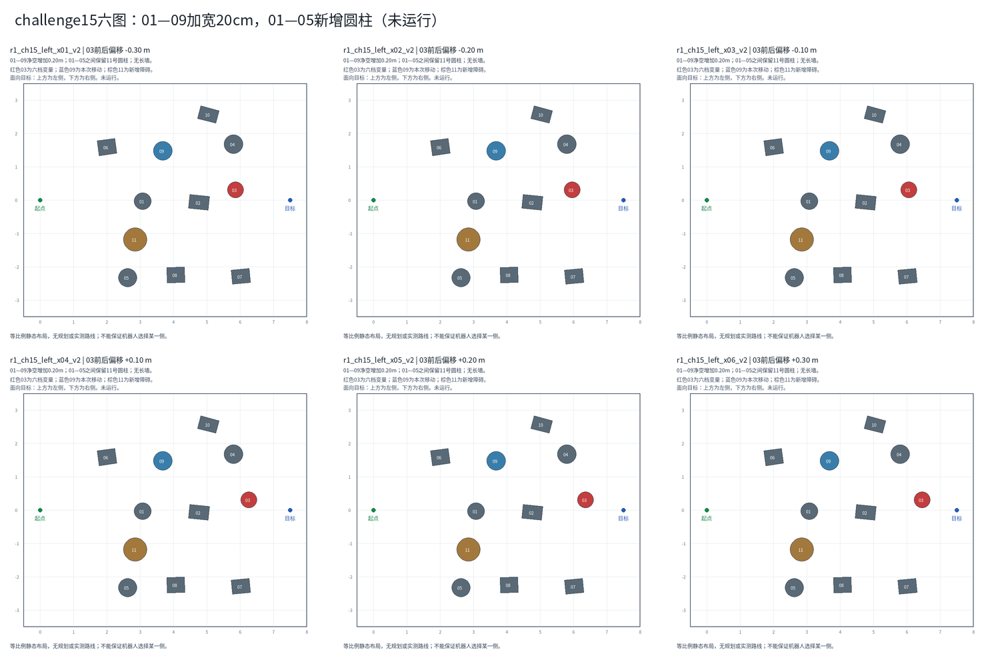

# challenge15六图：01与05之间新增一个障碍

日期：2026-11-02。状态：**六张地图已接入并完成A/C保持时间比较；等待审阅**。

六图×A H=0/C H=0.02×每图每设置10次，共120项全部启动并记录有效。同期到达率为A 13/60、C 14/60，差+1.7个百分点，95%区间跨0；各布局方向有增有减。该图集是同源开发布局。查看[完整结果与图表](../../../evidence/R1/CH15_AC_120/20261102_r1_ch15_ac_120/RESULTS_SUMMARY.md)及[批次运行清单](../../../../../logs/09_R1_switch_constraints/ch15_ac_120/20261102_r1_ch15_ac_120/run_plan.json)。

## 最新改动

用户取消长挡板，改为仅在01与05之间增加一个11号圆柱。六张图同步替换，不再包含长墙。

- 11号中心：(2.854525, −1.182043)m，位于01与05中心连线的中点附近。
- 圆柱直径0.70m，高0.55m；与01、05的轮廓间距分别约0.564m、0.542m，没有重叠。
- 09号沿远离01的中心连线方向移动0.20m，新中心为(3.683290, 1.473857)m；01—09轮廓净空从0.895256m变为1.095257m，增加0.20m。09的尺寸和高度不变。
- 03仍按−0.30/−0.20/−0.10/+0.10/+0.20/+0.30m六档前后移动；03的横向位置、尺寸和除09外的其他原障碍不变。
- 面向目标沿+X前进时，左侧为图上方（+Y），右侧为图下方（−Y）。新增圆柱收窄右侧空隙，但没有完全封死右侧，不保证机器人一定选择左侧。
- 原challenge15未覆盖；本目录是尚未运行的提案，直接替换了取消的长挡板布局。

## 预览

红色03为六档变量，棕色11为共同新增圆柱。没有规划或实测路线。

- [r1_ch15_left_x01_v2单图](r1_ch15_left_x01_v2.png)：03的x=5.862843m。
- [r1_ch15_left_x02_v2单图](r1_ch15_left_x02_v2.png)：03的x=5.962843m。
- [r1_ch15_left_x03_v2单图](r1_ch15_left_x03_v2.png)：03的x=6.062843m。
- [r1_ch15_left_x04_v2单图](r1_ch15_left_x04_v2.png)：03的x=6.262843m。
- [r1_ch15_left_x05_v2单图](r1_ch15_left_x05_v2.png)：03的x=6.362843m。
- [r1_ch15_left_x06_v2单图](r1_ch15_left_x06_v2.png)：03的x=6.462843m。

## 检查和边界

六份XML解析、差异和障碍无重叠检查通过。相对最初十障碍六图，共同增加11号圆柱、共同外移09以增加20cm净空，并使用独立模型名称；其余原始参数保留。09位置变化也会改变局部射线观测。没有验证策略可达或实际绕行方向。

旧下侧参考折线不再作为本版通行证明。加入圆柱会改变射线观测和接近01的行为，新成绩不能直接套用历史challenge15结果；不能预设C获胜。历史负面结果保留。

执行前的边界记录：布局核对阶段没有启动MuJoCo、ROS或策略；之后为正式比较新增独立场景登记并完成必要构建，未改控制逻辑。正式比较复用现有模型和A/C运行逻辑，不提交Git。实际路线以本批代表轨迹为准，不能仅凭几何图预判。

## 后续范围

已完成A H=0与C H=0.02仿真秒比较，E=有效X=−0.05、关闭滞回；六图每组每图10次，共120项。结果、安全完成、碰撞、推进、耗时与路线摘要见上方报告；不按A/C胜负删图，切换仅解释行为。

[位置表](positions.csv) · [元数据](layouts.json) · [修改前六图](../challenge15_x_variants/README.md)

[120项执行器提示词](../CH15_AC_120_EXECUTOR_PROMPT.md)
