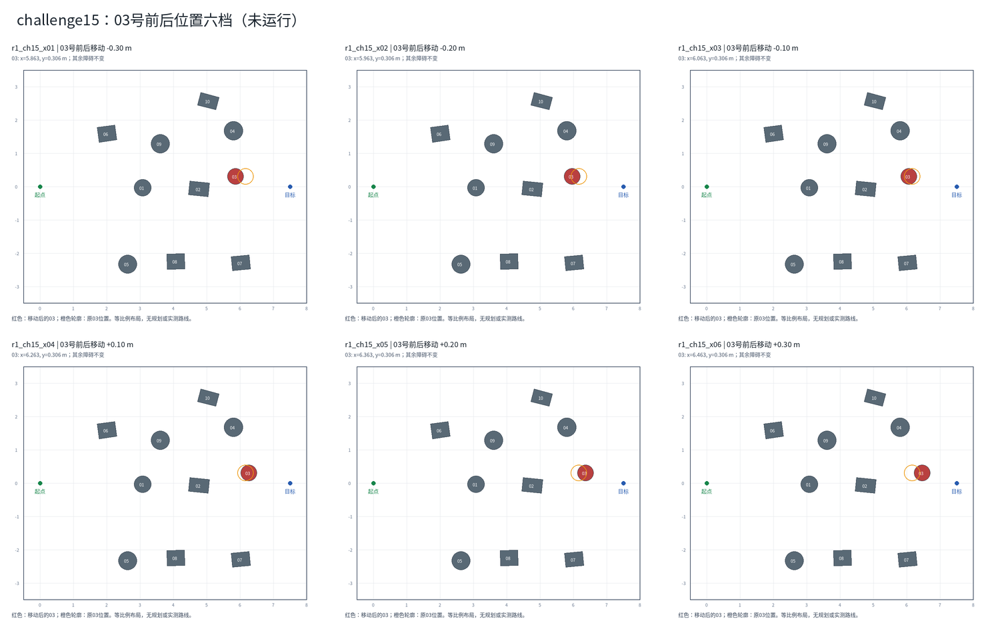

# challenge15：03号前后位置六档

日期：2026-11-02。状态：**未运行的历史布局提案，当前已被01—05新增圆柱版替代**。

用户随后要求在01与05之间增加一个障碍。当前应审阅[01—05新增圆柱版](../challenge15_left_route_v2/README.md)，本页十障碍布局和下侧参考通道仅保留为修改前记录。

## 本轮范围

只移动03号圆柱的x；y=0.305638m、z、半径、高度和其他九个障碍保持不变。原challenge15未覆盖。负偏移靠近起点，正偏移靠近目标。

| 地图 | x偏移(m) | 03的x(m) | 02—03轮廓最近距离(m) |
|---|---:|---:|---:|
| [r1_ch15_x01](r1_ch15_x01.png) | -0.30 | 5.862843 | 0.565 |
| [r1_ch15_x02](r1_ch15_x02.png) | -0.20 | 5.962843 | 0.662 |
| [r1_ch15_x03](r1_ch15_x03.png) | -0.10 | 6.062843 | 0.760 |
| [r1_ch15_x04](r1_ch15_x04.png) | +0.10 | 6.262843 | 0.956 |
| [r1_ch15_x05](r1_ch15_x05.png) | +0.20 | 6.362843 | 1.055 |
| [r1_ch15_x06](r1_ch15_x06.png) | +0.30 | 6.462843 | 1.154 |

## 预览

红色是移动后的03，橙色轮廓是原位置。没有绘制策略路线或沿用原图的示意通道。每图另有完整尺寸预览。

## 检查与限制

- 六份XML解析通过；比较确认仅修改顶层模型名称和03的x位置，其他几何未变。障碍未重叠。
- 复用现有几何函数检查同一条下侧参考折线：中心线到障碍轮廓的最小距离为0.768～0.813m。折线记录在layouts.json中，不输入策略，不代表机器人一定选择下侧或一定安全通过。
- 起点/目标、03横向位置不变；前后距离变化也会改变相对目标的位置和射线观测，不能把结果单独解释为Recovery过程变化。
- 这些是围绕已有收益地图设计的局部变体，不是完全独立地图分布；原challenge08长保持退化、m02改善未重复等限制继续保留。
- 本轮不安装生产地图、不修改场景登记或控制代码、不运行MuJoCo/ROS。XML沿用`include file="go2.xml"`的现有场景约定；在此资料目录内不能直接用手动入口运行。布局接受后，需将六份小XML安装到Go2场景目录并复用现有最小接入方式，共用模型资源，不复制六套模型。

## 待执行的比较方案

布局审阅后，拟比较A（H=0）与C（H=0.02仿真秒），E=有效X=−0.05、滞回关闭；每图每组10次，共120项。目标、时限及到达后2秒观察沿用既有条件。120项尚未启动，用户本轮只授权生成与预览；不按A/C运行胜负删改地图。

比较安全完成、碰撞、超时、任务推进和耗时，切换只解释行为。不追加其他H、D或地图。

[精确位置与几何表](positions.csv) · [布局元数据](layouts.json) · [R1计划](../PLAN.md)
