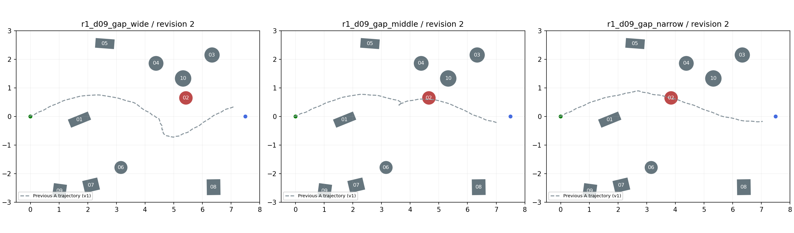
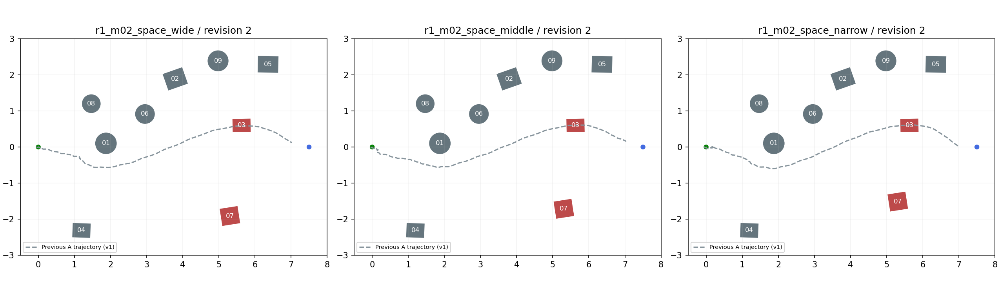

# R1地图第二版：阻挡已观察到的钻空路线

日期：2026-10-31。用户同意根据实际轨迹修改地图，可以堵住钻空位置。六张v2地图和预览已生成；随后完成生产接入、A组观看及72项分层比较，当前等待R1结果审阅。

## 改了什么

- **d09三档**：02号圆柱y从0.043324改为0.650000m，x保留各档原值。原中、窄档从上侧绕过02的轨迹现在穿过新圆柱位置；下侧仍保留绕行空间。01及起始区域不动，前后投影净间距仍是3.072070、2.300000、1.500000m。
- **m02三档**：03号箱体y从−0.091551改为0.600000m，移到此前三次都经过的上侧路线附近。07号同向移动0.691551m，使03—07的真实轮廓最近距仍保持2.052634、1.852670、1.652705m；07的新y分别为−1.912166、−1.712166、−1.512166m。其他障碍不动，初始开口保留。
- 不增加障碍数量，不改变障碍尺寸、朝向或高度，不覆盖v1、M1、M2、M3或旧实验记录。

## 预览

红色为本轮移动的障碍。灰色虚线为v1单次A组实际轨迹，用于展示旧路线被怎样改变；它不是v2参考路线，更不是v2实测结果。各档另有单图预览与XML。

## 已确认与尚未确认

六份XML解析和已有C++加载工具的静态模型加载通过。随后按本地已登记身份完成A组观看和72项分层比较。逐项比较确认只改变指定障碍的位置与顶层模型名称。

新版阻挡旧轨迹，但不保证所有替代路线封闭。d09宽档02与10之间的空隙变小；m02上方仍可能存在新的绕行方式。不能仅凭图片宣称机器人必然按某条路线走、难度提高或某组将受益。布局变化也会改变射线观测，因此这是新的开发地图版本，旧成绩不套用。

实际运行结果与布局路径核对见[R1v2观看报告](../../../evidence/R1/layout_watch_v2_6_20261031/观看报告.md)及[72项比较报告](../../../evidence/R1/R1v2_threshold_72/分析报告.md)。参数筛查显示d09的B设置未超过A，m02中B_E04_X07有局部改善线索；各格3次，仅作开发筛查，不据此认定通用难度或最优设置。不要为使某组获胜反复移动障碍。

## 运行文件

六份小XML同时放在本目录与`unitree_mujoco/unitree_robots/go2/`，后者共用已有go2.xml与模型资源。没有复制六套模型。目录中XML的相对include沿用生产场景目录约定，静态加载检查使用Go2目录下的副本。

新文件名为原名加`_v2.xml`。六份地图已加入独立`r1v2_*`身份、真实模型指纹及诊断器元数据；R1-6的72次运行使用这些身份，旧v1登记和旧运行不变。本批精确设置、顺序、结果和存储见[72项批次报告](../../../evidence/R1/R1v2_threshold_72/分析报告.md)及[run_plan.json](../../../../logs/09_R1_switch_constraints/r1_v2_threshold_72/20261031_r1_v2_threshold72/run_plan.json)。

[逐图改动](changes.json) · [v1观看报告](../../../evidence/R1/layout_watch_6_20261031/观看报告.md)
