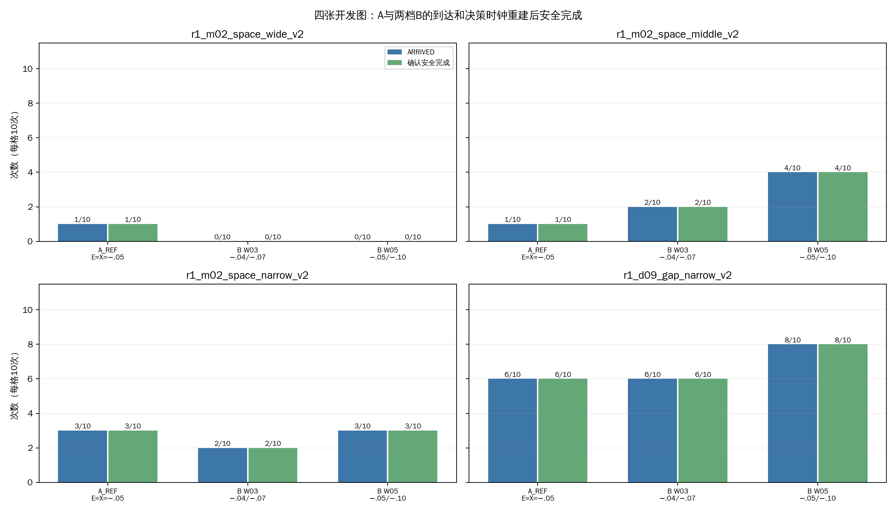
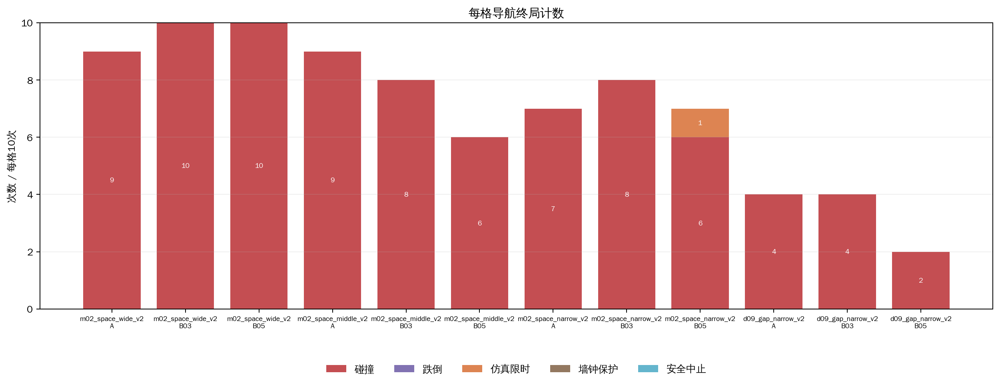
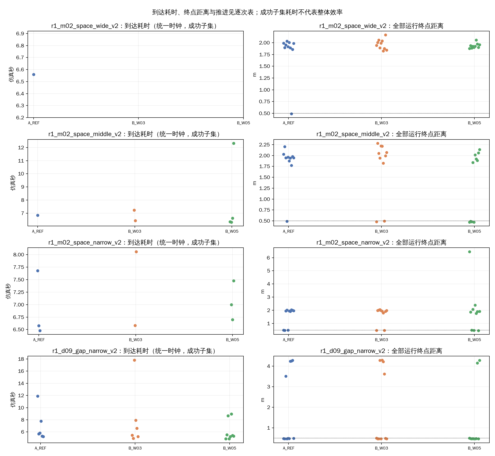
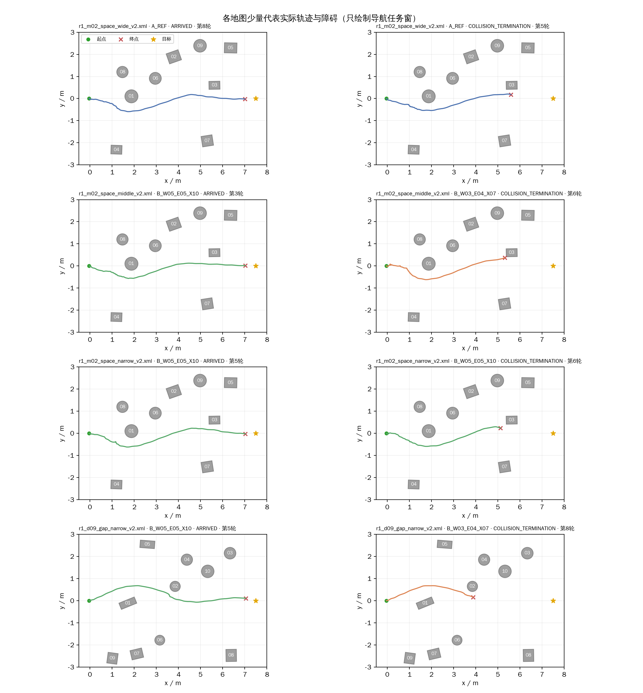

# R1-11：A与两档B在四张开发图上的同期比较（120项）

本批比较四张已接入开发图上的A_REF、B_W03_E04_X07与B_W05_E05_X10。m02宽/中/窄三档同源，d09只有窄档；不视为四个独立场景，也不把120次混合数称作一般成功率。B与A共同E=-0.05的对照只在该同E设置下讨论滞回；E=-0.04/X=-0.07相对A同时改变进入与退出阈值。

## 执行情况与口径

- 计划120项；完成120项；有效记录120；实际场景启动120，非场景调用0，补做0。终局：到达36、碰撞83、跌倒0、仿真限时1、墙钟保护0、安全中止0、其他/UNKNOWN 0。
- 统一决策时钟口径安全完成T/F/U=36/84/0；默认/原始重算口径为T/F/U=36/84/0。重建应用0项，安全分类变化0项，耗时字段变化0项。原始JSONL、context、terminal和metrics未修改；逐次原始/统一状态见`决策时钟敏感性.csv`。
- 运行实际参数由controller证据逐项匹配：A_REF E=X=-0.05、滞回关闭；B_W03_E04_X07 E/X=-0.04/-0.07；B_W05_E05_X10 E/X=-0.05/-0.10；全部H=0且保持关闭。目标(7.5,0)m、到达半径0.5m、20/120秒、到达后观察2仿真秒。
- 排程为10轮、每轮12个地图×设置组合各一次，种子2026103106。每轮随机交错，不代表同轮A/B具有物理初态重放。隐藏MuJoCo、RViz关闭、无截图录像；同环境GLFW预检PASS。清理三份临时overlay（共约84.0MiB）后，批次目录磁盘占用约884MiB；约0.14MiB绘图缓存也已清理。版本与每次关闭记录见`run_plan.json`、`run_schedule.csv`。

## 12格地图×设置结果

| 地图 | 设置 | 有效/10 | 安全完成T/F/U | 到达/10（Wilson 95%） | 碰撞 | 跌倒/U | 仿真限时 | 墙钟保护 | 安全中止 | 成功耗时中位数（n） | 推进中位数m | 终点距离中位数m | 研究区进入/碰撞对象 |
|---|---|---:|---:|---:|---:|---:|---:|---:|---:|---:|---:|---:|---|
| r1_m02_space_wide_v2 | A_REF | 10/10 | 1/9/0 | 1/10 (10.0%; 1.8–40.4%) | 9 | 0/0 | 0 | 0 | 0 | 6.56s (n=1) | 5.61 | 1.93 | 03—07中心近似区 10/10; ppt_obstacle_03:9 |
| r1_m02_space_wide_v2 | B_W03_E04_X07 | 10/10 | 0/10/0 | 0/10 (0.0%; 0.0–27.8%) | 10 | 0/0 | 0 | 0 | 0 | UNKNOWNs (n=0) | 5.57 | 1.97 | 03—07中心近似区 10/10; ppt_obstacle_03:10 |
| r1_m02_space_wide_v2 | B_W05_E05_X10 | 10/10 | 0/10/0 | 0/10 (0.0%; 0.0–27.8%) | 10 | 0/0 | 0 | 0 | 0 | UNKNOWNs (n=0) | 5.61 | 1.93 | 03—07中心近似区 10/10; ppt_obstacle_03:10 |
| r1_m02_space_middle_v2 | A_REF | 10/10 | 1/9/0 | 1/10 (10.0%; 1.8–40.4%) | 9 | 0/0 | 0 | 0 | 0 | 6.84s (n=1) | 5.59 | 1.95 | 03—07中心近似区 10/10; ppt_obstacle_03:9 |
| r1_m02_space_middle_v2 | B_W03_E04_X07 | 10/10 | 2/8/0 | 2/10 (20.0%; 5.7–51.0%) | 8 | 0/0 | 0 | 0 | 0 | 6.84s (n=2) | 5.52 | 2.02 | 03—07中心近似区 9/10; ppt_obstacle_03:8 |
| r1_m02_space_middle_v2 | B_W05_E05_X10 | 10/10 | 4/6/0 | 4/10 (40.0%; 16.8–68.7%) | 6 | 0/0 | 0 | 0 | 0 | 6.48s (n=4) | 5.67 | 1.86 | 03—07中心近似区 10/10; ppt_obstacle_03:6 |
| r1_m02_space_narrow_v2 | A_REF | 10/10 | 3/7/0 | 3/10 (30.0%; 10.8–60.3%) | 7 | 0/0 | 0 | 0 | 0 | 6.58s (n=3) | 5.58 | 1.96 | 03—07中心近似区 10/10; ppt_obstacle_03:7 |
| r1_m02_space_narrow_v2 | B_W03_E04_X07 | 10/10 | 2/8/0 | 2/10 (20.0%; 5.7–51.0%) | 8 | 0/0 | 0 | 0 | 0 | 7.32s (n=2) | 5.58 | 1.96 | 03—07中心近似区 10/10; ppt_obstacle_03:8 |
| r1_m02_space_narrow_v2 | B_W05_E05_X10 | 10/10 | 3/7/0 | 3/10 (30.0%; 10.8–60.3%) | 6 | 0/0 | 1 | 0 | 0 | 7.00s (n=3) | 5.65 | 1.89 | 03—07中心近似区 8/10; ppt_obstacle_03:6 |
| r1_d09_gap_narrow_v2 | A_REF | 10/10 | 6/4/0 | 6/10 (60.0%; 31.3–83.2%) | 4 | 0/0 | 0 | 0 | 0 | 5.76s (n=6) | 7.05 | 0.49 | 轨迹图核对d09障碍01/02绕行; ppt_obstacle_02:4 |
| r1_d09_gap_narrow_v2 | B_W03_E04_X07 | 10/10 | 6/4/0 | 6/10 (60.0%; 31.3–83.2%) | 4 | 0/0 | 0 | 0 | 0 | 6.03s (n=6) | 7.05 | 0.49 | 轨迹图核对d09障碍01/02绕行; ppt_obstacle_02:4 |
| r1_d09_gap_narrow_v2 | B_W05_E05_X10 | 10/10 | 8/2/0 | 8/10 (80.0%; 49.0–94.3%) | 2 | 0/0 | 0 | 0 | 0 | 5.36s (n=8) | 7.06 | 0.48 | 轨迹图核对d09障碍01/02绕行; ppt_obstacle_02:2 |

## 同期率差：B减A

率差以百分点解释，区间使用独立二项比例的Newcombe-Wilson 95%区间；安全完成率的分母只含T/F，UNKNOWN单列，不作False处理。A与B运行次序交错，但没有严格物理初态配对。区间重叠或包含0不等于证明等效。
| 场景层 | B设置 | 指标 | A分子/已知分母 | B分子/已知分母 | B−A率差百分点 | Newcombe-Wilson 95%区间百分点 |
|---|---|---|---:|---:|---:|---:|
| m02_three_layouts | B_W03_E04_X07 | safe_completion | 5/30 | 4/30 | -3.3 | -22.0 至 15.5 |
| m02_three_layouts | B_W03_E04_X07 | arrival | 5/30 | 4/30 | -3.3 | -22.0 至 15.5 |
| m02_three_layouts | B_W03_E04_X07 | collision | 25/30 | 26/30 | 3.3 | -15.5 至 22.0 |
| m02_three_layouts | B_W05_E05_X10 | safe_completion | 5/30 | 7/30 | 6.7 | -13.8 至 26.6 |
| m02_three_layouts | B_W05_E05_X10 | arrival | 5/30 | 7/30 | 6.7 | -13.8 至 26.6 |
| m02_three_layouts | B_W05_E05_X10 | collision | 25/30 | 22/30 | -10.0 | -30.1 至 11.0 |
| d09_narrow_only | B_W03_E04_X07 | safe_completion | 6/10 | 6/10 | 0.0 | -36.9 至 36.9 |
| d09_narrow_only | B_W03_E04_X07 | arrival | 6/10 | 6/10 | 0.0 | -36.9 至 36.9 |
| d09_narrow_only | B_W03_E04_X07 | collision | 4/10 | 4/10 | 0.0 | -36.9 至 36.9 |
| d09_narrow_only | B_W05_E05_X10 | safe_completion | 6/10 | 8/10 | 20.0 | -18.7 至 52.1 |
| d09_narrow_only | B_W05_E05_X10 | arrival | 6/10 | 8/10 | 20.0 | -18.7 至 52.1 |
| d09_narrow_only | B_W05_E05_X10 | collision | 4/10 | 2/10 | -20.0 | -52.1 至 18.7 |

## 分层汇总（不混合场景类）

| 场景层 | 设置 | 计划/有效 | 安全完成T/F/U | 到达 | 碰撞 | 跌倒 | 仿真限时 | 墙钟保护 | 安全中止 | 成功耗时中位数（n） | 推进中位数m | 终点距离中位数m |
|---|---|---:|---:|---:|---:|---:|---:|---:|---:|---:|---:|---:|
| m02_three_layouts | A_REF | 30/30 | 5/25/0 | 5/30 | 25 | 0 | 0 | 0 | 0 | 6.58s (n=5) | 5.59 | 1.95 |
| m02_three_layouts | B_W03_E04_X07 | 30/30 | 4/26/0 | 4/30 | 26 | 0 | 0 | 0 | 0 | 6.91s (n=4) | 5.55 | 1.99 |
| m02_three_layouts | B_W05_E05_X10 | 30/30 | 7/23/0 | 7/30 | 22 | 0 | 1 | 0 | 0 | 6.70s (n=7) | 5.64 | 1.90 |
| d09_narrow_only | A_REF | 10/10 | 6/4/0 | 6/10 | 4 | 0 | 0 | 0 | 0 | 5.76s (n=6) | 7.05 | 0.49 |
| d09_narrow_only | B_W03_E04_X07 | 10/10 | 6/4/0 | 6/10 | 4 | 0 | 0 | 0 | 0 | 6.03s (n=6) | 7.05 | 0.49 |
| d09_narrow_only | B_W05_E05_X10 | 10/10 | 8/2/0 | 8/10 | 2 | 0 | 0 | 0 | 0 | 5.36s (n=8) | 7.06 | 0.48 |

m02每设置30项汇总的是同一模板三种变化；d09窄档每设置10项只代表这一张开发图。以上计数不能解释为对场景总体的独立抽样。

## 每设置40项记账汇总

此表用于完整报告本批40项/设置的终局记账，不作为四图混合成功率或一般场景性能估计。
| 设置 | 有效/40 | 安全完成T/F/U | 到达 | 碰撞 | 跌倒 | 仿真限时 | 墙钟保护 | 安全中止 | 其他 | 到达耗时中位数（n） | 推进中位数m |
|---|---:|---:|---:|---:|---:|---:|---:|---:|---:|---:|---:|
| A_REF | 40/40 | 11/29/0 | 11/40 | 29 | 0 | 0 | 0 | 0 | 0 | 6.56s (n=11) | 5.59 |
| B_W03_E04_X07 | 40/40 | 10/30/0 | 10/40 | 30 | 0 | 0 | 0 | 0 | 0 | 6.59s (n=10) | 5.57 |
| B_W05_E05_X10 | 40/40 | 15/25/0 | 15/40 | 24 | 0 | 1 | 0 | 0 | 0 | 6.34s (n=15) | 5.65 |

## 成功耗时及共同成功案例

逐格到达耗时仅使用统一决策时钟后的成功样本并注明n；不同成功子集的耗时不解释为整体效率。下表列出同一地图、同一随机轮次中A与B都到达的运行；同轮不是相同物理初态，仅作有限的共同成功案例描述。
| 地图 | B设置 | 同地图同轮共同到达n | B−A耗时中位差s |
|---|---|---:|---:|
| r1_m02_space_wide_v2 | B_W03_E04_X07 | 0 | UNKNOWN |
| r1_m02_space_wide_v2 | B_W05_E05_X10 | 0 | UNKNOWN |
| r1_m02_space_middle_v2 | B_W03_E04_X07 | 0 | UNKNOWN |
| r1_m02_space_middle_v2 | B_W05_E05_X10 | 0 | UNKNOWN |
| r1_m02_space_narrow_v2 | B_W03_E04_X07 | 1 | -1.10 |
| r1_m02_space_narrow_v2 | B_W05_E05_X10 | 1 | 0.22 |
| r1_d09_gap_narrow_v2 | B_W03_E04_X07 | 4 | -0.35 |
| r1_d09_gap_narrow_v2 | B_W05_E05_X10 | 5 | -0.98 |

## 决策时钟重建敏感性

主要指标按生产分析器` s1_analyze_run.calculate(..., decision_clock_override=True)`重算。规则只在首个RL活跃周期发布时钟stale、但同运行/会话/周期的controller decision trace证明样本在决策时有效且一致时，恢复该周期的决策时钟。原始帧状态和原始记录不改；默认口径重算、统一口径重算以及发布metrics状态并列保存。
本批120项中统一重建实际应用0项，安全分类变化0项，任务耗时字段变化0项。逐项变化见`决策时钟敏感性.csv`；如无有效同周期证明，保留UNKNOWN/原值，不向后移动任务起点。

## 实际研究区域和轨迹

所有导航碰撞记录对象汇总：{'ppt_obstacle_02': 10, 'ppt_obstacle_03': 73}。m02研究区采用03—07附近位置的近似截面x=5.30–5.60m、y=−1.67–0.42m；中心进入不证明机器人整机通过净空。d09障碍01/02主要绕行侧需结合代表轨迹和逐次位姿判断，不将静态轨迹画成策略可达保证。少量成功/碰撞样例见下图和`代表案例.json`。

- 
- 
- 
- 

| 代表运行 | 地图/设置 | 终局 | 统一耗时s | 终点距离m |
|---|---|---|---:|---:|
| 090_r8_r1v2_m02_space_wide_A_REF | r1_m02_space_wide_v2.xml / A_REF | ARRIVED | 6.56 | 0.49 |
| 056_r5_r1v2_m02_space_wide_A_REF | r1_m02_space_wide_v2.xml / A_REF | COLLISION_TERMINATION | 5.42 | 1.91 |
| 026_r3_r1v2_m02_space_middle_B_W05_E05_X10 | r1_m02_space_middle_v2.xml / B_W05_E05_X10 | ARRIVED | 6.62 | 0.48 |
| 072_r6_r1v2_m02_space_middle_B_W03_E04_X07 | r1_m02_space_middle_v2.xml / B_W03_E04_X07 | COLLISION_TERMINATION | 6.88 | 2.22 |
| 055_r5_r1v2_m02_space_narrow_B_W05_E05_X10 | r1_m02_space_narrow_v2.xml / B_W05_E05_X10 | ARRIVED | 6.70 | 0.48 |
| 071_r6_r1v2_m02_space_narrow_B_W05_E05_X10 | r1_m02_space_narrow_v2.xml / B_W05_E05_X10 | COLLISION_TERMINATION | 5.98 | 2.39 |
| 049_r5_r1v2_d09_gap_narrow_B_W05_E05_X10 | r1_d09_gap_narrow_v2.xml / B_W05_E05_X10 | ARRIVED | 5.24 | 0.47 |
| 085_r8_r1v2_d09_gap_narrow_B_W03_E04_X07 | r1_d09_gap_narrow_v2.xml / B_W03_E04_X07 | COLLISION_TERMINATION | 3.34 | 3.62 |

## 历史筛查背景（不进入本批分母）

R1-10中两档候选在m02三档的到达计数仅用于历史背景；该批无A/d09，不能代替本批同期A。详细旧批数据见[此前90项报告](../M02_CONFIRM_90/分析报告.md)。

## 结果解释与边界

阅读结果时以四张地图逐格和m02/d09分层为主；不根据120项混合平均值判断普遍成功率。E05/X10与A共享E，才可作为滞回整体作用的局部同期对照；E04/X07还改变E，因此是整体阈值配置对照。即使安全完成或碰撞率差方向有利，也需结合区间、推进、终点距离、耗时和局部地图退化，不以切换次数较少判优。
三张m02图同源、d09只有一张，四图均为开发布局，不能代表独立场景分布。初始状态按每次实测记录，不宣称严格物理状态配对。足端接触/撞击、未覆盖或无法重建的安全指标保留UNKNOWN。合法导航终局均按原样计入，不以到达为目的重跑。

## 候选保留建议

B_W05_E05_X10值得作为后续审阅候选保留：它与A同E，且本批在m02三图合计到达7/30（A为5/30）、d09窄档到达8/10（A为6/10）；但两层率差区间都包含0，且m02宽档出现1/10降为0/10的局部退化。若审阅后还要做小规模跟进，应重点确认m02中档的4/10对1/10线索与d09窄档的8/10对6/10，继续同时看碰撞、推进、耗时；这不是自动运行决定。B_W03_E04_X07没有总体到达收益（m02 4/30对5/30、d09 6/10对6/10），当前优先级较低。数据不足以说哪个设置普遍更好，或证明滞回单独带来改善。

原始运行目录：`logs/09_R1_switch_constraints/ab_two_candidates_120/20261031_ab_two_candidates_120/`。逐次结果、12格、每设置40项、分层表、率差、共同成功耗时、决策时钟敏感性、终局和代表案例分别见`逐次运行明细.csv`、`地图设置汇总.csv`、`设置汇总.csv`、`场景分层汇总.csv`、`同期率差.csv`、`共同成功耗时.csv`、`决策时钟敏感性.csv`、`代表案例.json`。
