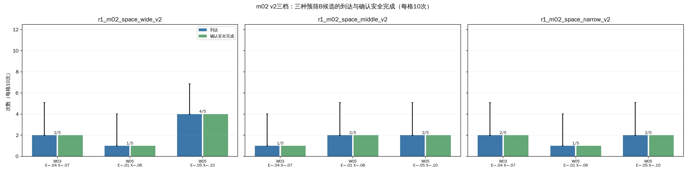
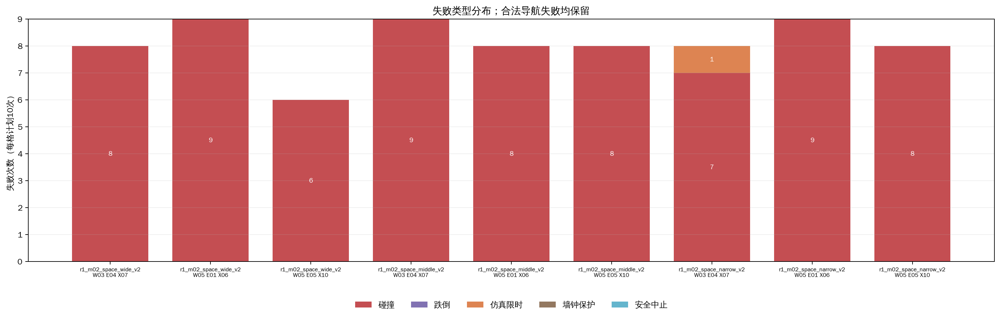
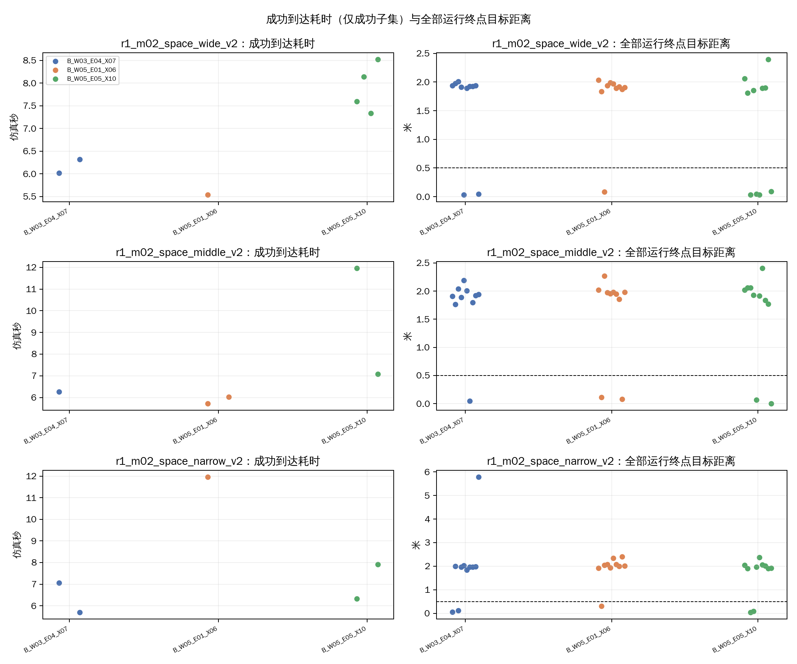
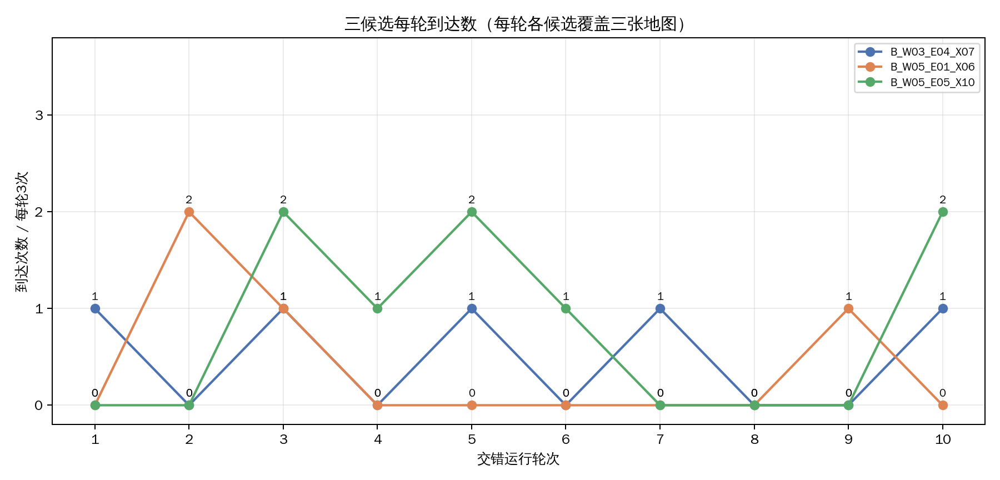
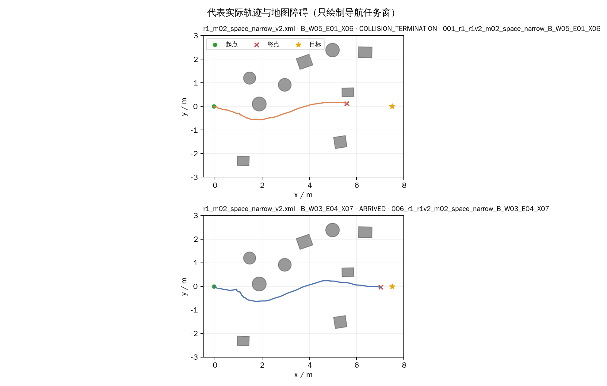
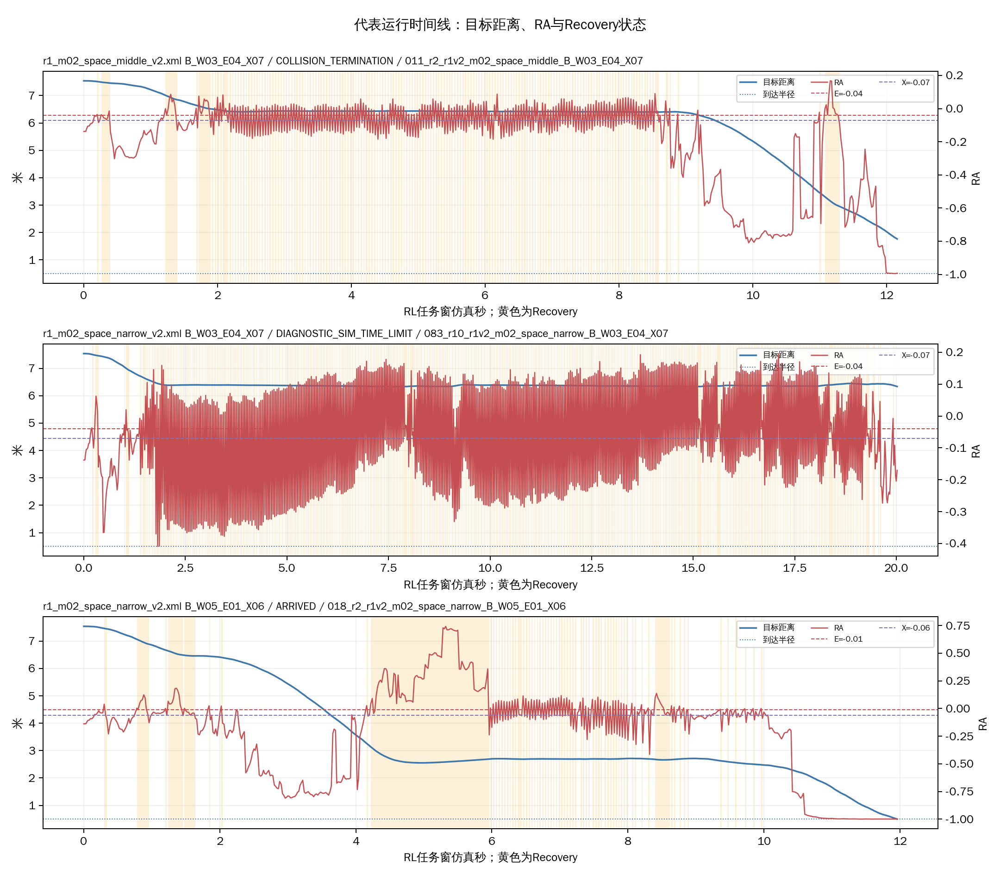

# R1-10：m02三候选同期确认（90项）

本批对三种预先筛查的B配置作同期重复确认。每图×每候选10次，共90项；三张m02 v2地图同源，不视为三个独立环境。旧筛查批次仅列作背景，不并入当前分母。候选同时改变E、X及部分宽度，只比较整体配置。

## 执行与实际设置

- 完成90/90；实际场景启动90次、非场景调用0次、补做0次。终局：到达17、碰撞72、跌倒0、仿真限时1、墙钟保护0、安全中止0、其他/UNKNOWN 0。
- 安全完成TRUE/FALSE/UNKNOWN：17/73/0；到达后站立观察完成17次。
- 运行时逐项确认实际B组、E/X及H=0；目标(7.5,0)m、半径0.5m、仿真/墙钟上限20/120秒，到达后观察2仿真秒。排程10轮，每轮9个地图×设置组合各一次，种子2026103105；种子控制次序，不代表严格初始状态配对。
- 隐藏MuJoCo、RViz关闭、无截图录像；同执行上下文GLFW预检=PASS。三份临时overlay运行完成后清理。预算峰值记账742.4MiB；原始运行记录约657.7MiB。
- 场景身份、模型/控制器/策略与主要配置版本只冻结记录一次，实际顺序及每次清理见本批`run_plan.json`、`run_schedule.csv`和逐次明细。

| 设置 | 组 | E | X | E−X | H |
|---|---|---:|---:|---:|---:|
| B_W03_E04_X07 | B | −0.04 | −0.07 | 0.03 | 0 |
| B_W05_E01_X06 | B | −0.01 | −0.06 | 0.05 | 0 |
| B_W05_E05_X10 | B | −0.05 | −0.10 | 0.05 | 0 |

## 9格地图×候选结果

| 地图 | 候选 | 有效/10 | 到达/10（Wilson 95%区间） | 安全完成T/F/U | 碰撞 | 跌倒 | 仿真限时 | 墙钟保护 | 安全中止 | 到达耗时中位数（成功n） | 终点距离中位数m | 推进中位数m | 03—07中心区进入/10 | 碰撞对象 |
|---|---|---:|---:|---:|---:|---:|---:|---:|---:|---:|---:|---:|---:|---|
| r1_m02_space_wide_v2 | B_W03_E04_X07 | 10/10 | 2/10 (20.0%; 5.7–51.0%) | 2/8/0 | 8 | 0 | 0 | 0 | 0 | 6.17s (n=2) | 1.92 | 5.62 | 10/10 | ppt_obstacle_03:8 |
| r1_m02_space_wide_v2 | B_W05_E01_X06 | 10/10 | 1/10 (10.0%; 1.8–40.4%) | 1/9/0 | 9 | 0 | 0 | 0 | 0 | 5.54s (n=1) | 1.91 | 5.63 | 10/10 | ppt_obstacle_03:9 |
| r1_m02_space_wide_v2 | B_W05_E05_X10 | 10/10 | 4/10 (40.0%; 16.8–68.7%) | 4/6/0 | 6 | 0 | 0 | 0 | 0 | 7.87s (n=4) | 1.83 | 5.71 | 9/10 | ppt_obstacle_03:6 |
| r1_m02_space_middle_v2 | B_W03_E04_X07 | 10/10 | 1/10 (10.0%; 1.8–40.4%) | 1/9/0 | 9 | 0 | 0 | 0 | 0 | 6.26s (n=1) | 1.92 | 5.62 | 10/10 | ppt_obstacle_03:9 |
| r1_m02_space_middle_v2 | B_W05_E01_X06 | 10/10 | 2/10 (20.0%; 5.7–51.0%) | 2/8/0 | 8 | 0 | 0 | 0 | 0 | 5.87s (n=2) | 1.96 | 5.58 | 9/10 | ppt_obstacle_03:8 |
| r1_m02_space_middle_v2 | B_W05_E05_X10 | 10/10 | 2/10 (20.0%; 5.7–51.0%) | 2/8/0 | 8 | 0 | 0 | 0 | 0 | 9.52s (n=2) | 1.92 | 5.62 | 9/10 | ppt_obstacle_03:8 |
| r1_m02_space_narrow_v2 | B_W03_E04_X07 | 10/10 | 2/10 (20.0%; 5.7–51.0%) | 2/8/0 | 7 | 0 | 1 | 0 | 0 | 6.38s (n=2) | 1.97 | 5.57 | 9/10 | ppt_obstacle_03:7 |
| r1_m02_space_narrow_v2 | B_W05_E01_X06 | 10/10 | 1/10 (10.0%; 1.8–40.4%) | 1/9/0 | 9 | 0 | 0 | 0 | 0 | 11.96s (n=1) | 2.03 | 5.51 | 7/10 | ppt_obstacle_03:9 |
| r1_m02_space_narrow_v2 | B_W05_E05_X10 | 10/10 | 2/10 (20.0%; 5.7–51.0%) | 2/8/0 | 8 | 0 | 0 | 0 | 0 | 7.12s (n=2) | 1.94 | 5.60 | 9/10 | ppt_obstacle_03:8 |

## 三候选各30次汇总

| 候选 | 有效/30 | 到达/30（Wilson 95%区间） | 安全完成T/F/U | 碰撞 | 跌倒 | 仿真限时 | 墙钟保护 | 安全中止 | 到达耗时中位数s（成功n） | 终点距离中位数m | Recovery占比中位数 | 切换次数中位数 | 足端接触/撞击计数 |
|---|---:|---:|---:|---:|---:|---:|---:|---:|---:|---:|---:|---:|---:|
| B_W03_E04_X07 | 30/30 | 5/30 (16.7%; 7.3–33.6%) | 5/25/0 | 24 | 0 | 1 | 0 | 0 | 6.26 (n=5) | 1.93 | 0.20 | 42 | 19/18 |
| B_W05_E01_X06 | 30/30 | 4/30 (13.3%; 5.3–29.7%) | 4/26/0 | 26 | 0 | 0 | 0 | 0 | 5.87 (n=4) | 1.96 | 0.17 | 32 | 22/21 |
| B_W05_E05_X10 | 30/30 | 8/30 (26.7%; 14.2–44.4%) | 8/22/0 | 22 | 0 | 0 | 0 | 0 | 7.76 (n=8) | 1.90 | 0.21 | 42 | 29/29 |

## 每轮变化（各候选每轮覆盖三档地图各一次）

| 轮次 | 候选 | 到达/3 | 碰撞 | 仿真限时 | 推进中位数m |
|---:|---|---:|---:|---:|---:|
| 1 | B_W03_E04_X07 | 1/3 | 2 | 0 | 5.63 |
| 1 | B_W05_E01_X06 | 0/3 | 3 | 0 | 5.52 |
| 1 | B_W05_E05_X10 | 0/3 | 3 | 0 | 5.50 |
| 2 | B_W03_E04_X07 | 0/3 | 3 | 0 | 5.56 |
| 2 | B_W05_E01_X06 | 2/3 | 1 | 0 | 7.23 |
| 2 | B_W05_E05_X10 | 0/3 | 3 | 0 | 5.64 |
| 3 | B_W03_E04_X07 | 1/3 | 2 | 0 | 5.53 |
| 3 | B_W05_E01_X06 | 1/3 | 2 | 0 | 5.50 |
| 3 | B_W05_E05_X10 | 2/3 | 1 | 0 | 7.50 |
| 4 | B_W03_E04_X07 | 0/3 | 3 | 0 | 5.63 |
| 4 | B_W05_E01_X06 | 0/3 | 3 | 0 | 5.57 |
| 4 | B_W05_E05_X10 | 1/3 | 2 | 0 | 5.69 |
| 5 | B_W03_E04_X07 | 1/3 | 2 | 0 | 5.51 |
| 5 | B_W05_E01_X06 | 0/3 | 3 | 0 | 5.58 |
| 5 | B_W05_E05_X10 | 2/3 | 1 | 0 | 7.47 |
| 6 | B_W03_E04_X07 | 0/3 | 3 | 0 | 5.64 |
| 6 | B_W05_E01_X06 | 0/3 | 3 | 0 | 5.55 |
| 6 | B_W05_E05_X10 | 1/3 | 2 | 0 | 5.62 |
| 7 | B_W03_E04_X07 | 1/3 | 2 | 0 | 5.62 |
| 7 | B_W05_E01_X06 | 0/3 | 3 | 0 | 5.59 |
| 7 | B_W05_E05_X10 | 0/3 | 3 | 0 | 5.48 |
| 8 | B_W03_E04_X07 | 0/3 | 3 | 0 | 5.62 |
| 8 | B_W05_E01_X06 | 0/3 | 3 | 0 | 5.62 |
| 8 | B_W05_E05_X10 | 0/3 | 3 | 0 | 5.64 |
| 9 | B_W03_E04_X07 | 0/3 | 3 | 0 | 5.60 |
| 9 | B_W05_E01_X06 | 1/3 | 2 | 0 | 5.67 |
| 9 | B_W05_E05_X10 | 0/3 | 3 | 0 | 5.63 |
| 10 | B_W03_E04_X07 | 1/3 | 1 | 1 | 5.60 |
| 10 | B_W05_E01_X06 | 0/3 | 3 | 0 | 5.56 |
| 10 | B_W05_E05_X10 | 2/3 | 1 | 0 | 7.45 |

## 既有筛查背景（不并入本批）

| 历史批次 | 对应候选 | 历史有效样本 | 到达 | 碰撞 | 说明 |
|---|---|---:|---:|---:|---|
| R1-6 | B_W03_E04_X07 | 9 | 4/9 (44.4%) | 5 | 宽度0.03；历史筛查每图3次 |
| R1-9 | B_W05_E01_X06 | 15 | 5/15 (33.3%) | 9 | 宽度0.05；历史筛查每图5次 |
| R1-9 | B_W05_E05_X10 | 15 | 4/15 (26.7%) | 11 | 宽度0.05；历史筛查每图5次 |

历史结果只用于判断小样本线索是否重现；不同批次的初态、顺序和执行批次不配对，不做跨批次因果解释。

## 结果解释与下一步判断

先按宽/中/窄地图查看9格表及轮次趋势，避免由30次合计掩盖局部退化。通过是否重复既有线索，需看同期各档的到达、安全完成、碰撞和推进，不以切换次数少作为优胜依据。
到达耗时只统计成功子集并报告n；不同成功样本的耗时差不能解释为整体更快。Recovery占比和切换仅作行为说明。三档地图同源，因此本批不能把90次解释成90个独立环境。候选同时移动E/X及宽度，不能拆解单一机制因果。
位姿分析以x=5.30–5.60m、y=−1.67–0.42m作为03—07近似截面；中心轨迹进入只代表机器人中心进入该区域，不等于整机穿过净空。碰撞对象按已记录事件列出；缺失的安全指标继续为UNKNOWN。

### 对候选重复性的判断

- B_W03_E04_X07本批为5/30到达，低于R1-6筛查的4/9；旧线索未在同期重复中保持。B_W05_E01_X06为4/30，低于R1-9的5/15；也未重复出原先较高的到达计数。
- B_W05_E05_X10为8/30，是本批最高计数；R1-9同为4/15（26.7%），聚合到达比例相同，算是弱线索重复。但分地图分别为4/10、2/10、2/10，区间很宽，与另外两设置重叠，不能称为稳定收益或优胜设置。
- 因而停止在这三张m02图上继续扩展E/X网格。若审阅后仍研究保持时间，可把E05/X10作为待比较候选，与共同E的参考条件作小规模、预先限定的H对照；这90项本身没有比较H，也不能说明增加H是否有用。是否启动留待用户审阅，不自动派发。
- 暂不启动新地图批次。72项碰撞均记录接触ppt_obstacle_03，中心轨迹多数经过03—07近似截面；现有数据提示需要审阅该瓶颈布局和碰撞机制，但中心穿过截面不证明整机净空，也不能据此直接改图。三档与三个候选的差异均不够支持扩大或删减布局。

本批只说明这三个预筛查B设置在三张同源开发图上的重复结果。没有同期A、初始状态未严格重放，且候选同时变化E、X与宽度；因此不证明B相对A的收益、不估计对新地图的泛化，也不能把到达数差异归因于某个单独参数。

- 
- 
- 
- 
- 
- 

| 代表运行 | 地图/候选 | 终局 | 任务耗时 | 终点距离 |
|---|---|---|---:|---:|
| 011_r2_r1v2_m02_space_middle_B_W03_E04_X07 | r1_m02_space_middle_v2.xml / B_W03_E04_X07 | COLLISION_TERMINATION | 12.16s | 1.77m |
| 083_r10_r1v2_m02_space_narrow_B_W03_E04_X07 | r1_m02_space_narrow_v2.xml / B_W03_E04_X07 | DIAGNOSTIC_SIM_TIME_LIMIT | 20.02s | 5.79m |
| 018_r2_r1v2_m02_space_narrow_B_W05_E01_X06 | r1_m02_space_narrow_v2.xml / B_W05_E01_X06 | ARRIVED | 11.96s | 0.31m |

## 限制与原始数据

- 这是同三张开发地图上的重复确认，不是独立地图验证；实际初始关节状态按运行记录报告，不宣称物理初态配对。
- 没有同期A，因此本批只比较三个B配置彼此，不把旧A并入本批分母。
- 原始终局和有效记录保留；合法碰撞、跌倒、到达或限时均未因结果不理想而重跑。
- 原始批次目录：`logs/09_R1_switch_constraints/r1_m02_confirm_90/20261031_r1_m02_confirm_90/`。保留全部JSONL、context、terminal、参数及运行日志；分析文件在evidence目录。

逐次明细、9格汇总、候选总表、轮次表和历史背景分别见`逐次运行明细.csv`、`地图设置汇总.csv`、`设置汇总.csv`、`按轮次汇总.csv`、`历史候选背景.csv`。
