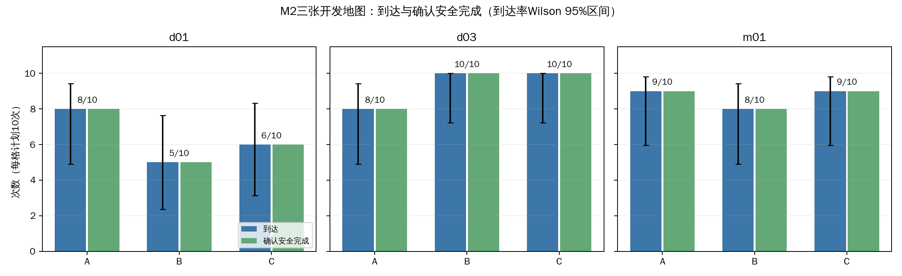
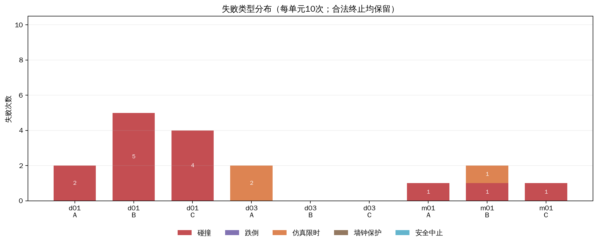
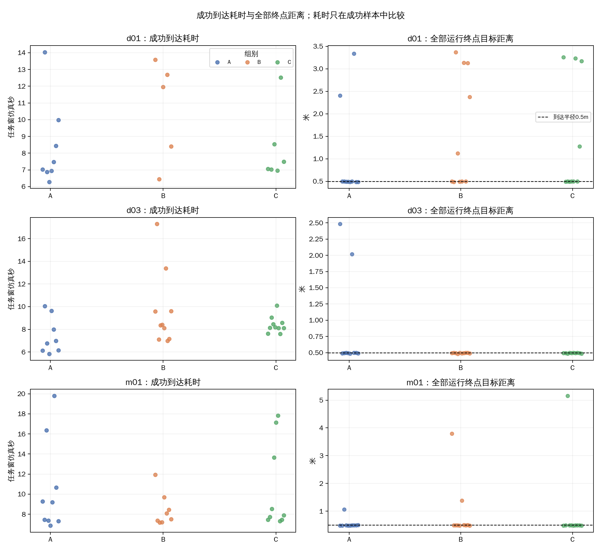
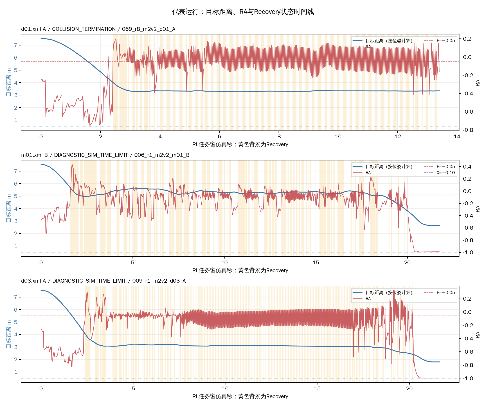

# R1-4：M2三图A/B/C重复确认实验

更新：2026-10-30。R1下的开发确认阶段；不是独立验证。分析使用本批运行器生成的metrics、context、terminal、process_facts和策略帧记录。

## 实验执行

- 计划/有效完成：90/90；实际场景启动：90；场景补做：0；合法导航结果未补跑。
- 调度：10轮交错；种子2026103017。场景终止计数：到达73、碰撞14、仿真限时3、墙钟保护0、跌倒0、安全中止0。
- 安全完成：确认73；UNKNOWN 0。安全完成按已有` safety_task_completion_status `判定；足端接触/撞击另行统计。
- 到达后的2秒站立观察：73次到达完成；未完成/未知0次。
- 本批目录占用约1.00 GiB（1,076,679,709 bytes）；完成时启动器检查约47.8 GiB可用。
- 启动前沙箱GLFW预检失败一次，未启动场景；在同一用户的现有DISPLAY/Xauthority上下文中预检通过后执行。见`dispatch_events.jsonl`。

地图身份固定为M2 selected_v2：`unitree_mujoco/unitree_robots/go2/d01.xml`→m2v2_d01，`d03.xml`→m2v2_d03，`m01.xml`→m2v2_m01；地图版本`m2-selected-development/2.1`。m01沿用M2 selected_v2中的`m2dev04-r5-20261018`布局修订。启动器逐项核对实际组别、E/X/H、机制开关、目标和场景身份；90项均为VALID，关闭清理确认均通过。使用隐藏MuJoCo窗口、关闭RViz和帧缓冲截图，没有截图或录像。

## 地图选择依据

三图都根据R1-3的具体A/B/C差异选入，而非按本批预期结果筛选：

- **d01：**此前A有一次碰撞、B/C各2/2到达；A代表轨迹从约7.5米推进到约3.5米后长时间停滞，适合复查推进不足是否重复。
- **d03：**此前A有一次Recovery内部碰撞，B/C各2/2到达，适合确认Recovery仍工作时的碰撞和任务结局是否重复。
- **m01：**此前A有一次碰撞，碰撞前最近退出RA约−0.053、退出后约0.07秒碰撞；B/C各2/2到达，适合复查与退出时机相符的差异。

## 逐地图结果

到达率为到达数/10，括号为Wilson 95%区间。确认安全完成率单列；UNKNOWN不记为False。

| 地图 | 组 | 计划/有效完成 | 到达 | 到达率（Wilson 95%） | 确认安全完成 | UNKNOWN | 碰撞 | 跌倒 | 仿真限时 | 墙钟保护 | 安全中止 |
|---|:---:|---:|---:|---:|---:|---:|---:|---:|---:|---:|---:|
| d01 | A | 10/10 | 8 | 80.0% (49.0–94.3%) | 8 | 0 | 2 | 0 | 0 | 0 | 0 |
| d01 | B | 10/10 | 5 | 50.0% (23.7–76.3%) | 5 | 0 | 5 | 0 | 0 | 0 | 0 |
| d01 | C | 10/10 | 6 | 60.0% (31.3–83.2%) | 6 | 0 | 4 | 0 | 0 | 0 | 0 |
| d03 | A | 10/10 | 8 | 80.0% (49.0–94.3%) | 8 | 0 | 0 | 0 | 2 | 0 | 0 |
| d03 | B | 10/10 | 10 | 100.0% (72.2–100.0%) | 10 | 0 | 0 | 0 | 0 | 0 | 0 |
| d03 | C | 10/10 | 10 | 100.0% (72.2–100.0%) | 10 | 0 | 0 | 0 | 0 | 0 | 0 |
| m01 | A | 10/10 | 9 | 90.0% (59.6–98.2%) | 9 | 0 | 1 | 0 | 0 | 0 | 0 |
| m01 | B | 10/10 | 8 | 80.0% (49.0–94.3%) | 8 | 0 | 1 | 0 | 1 | 0 | 0 |
| m01 | C | 10/10 | 9 | 90.0% (59.6–98.2%) | 9 | 0 | 1 | 0 | 0 | 0 | 0 |

## 每组30项汇总

| 组 | 计划/有效 | 到达 | 到达率（Wilson 95%） | 确认安全完成 | UNKNOWN | 碰撞 | 跌倒 | 仿真限时 | 墙钟保护 | 安全中止 | 成功到达耗时中位数（样本数） | 终点目标距离中位数 | Recovery占比中位数 | 单次Recovery驻留中位数 | 模式切换中位数 | 短反向中位数 | 足端接触/撞击（已知数；UNKNOWN运行数） |
|:---:|---:|---:|---:|---:|---:|---:|---:|---:|---:|---:|---:|---:|---:|---:|---:|---:|---:|
| A | 30/30 | 25 | 83.3% (66.4–92.7%) | 25 | 0 | 3 | 0 | 2 | 0 | 0 | 7.44s (n=25) | 0.49m | 24.0% | 0.03s | 28 | 26 | 20/19 (1/1) |
| B | 30/30 | 23 | 76.7% (59.1–88.2%) | 23 | 0 | 6 | 0 | 1 | 0 | 0 | 8.40s (n=23) | 0.50m | 27.0% | 0.04s | 36 | 34 | 29/28 (0/0) |
| C | 30/30 | 25 | 83.3% (66.4–92.7%) | 25 | 0 | 5 | 0 | 0 | 0 | 0 | 8.12s (n=25) | 0.50m | 24.2% | 0.21s | 14 | 12 | 18/14 (0/0) |

图表：

- 
- 
- 
- 

## 任务推进和行为代价

成功到达耗时仅在到达运行中比较，组间成功样本并不相同，不能据此单独判定整体效率。所有运行终点目标距离汇总于`逐次运行明细.csv`；3项仿真限时的距离变化（起点距离减终点距离，正数表示推进）如下：
- m01.xml B 006_r1_m2v2_m01_B：3.74m（终点3.80m）。
- d03.xml A 009_r1_m2v2_d03_A：5.06m（终点2.48m）。
- d03.xml A 060_r7_m2v2_d03_A：5.52m（终点2.02m）。

90项中Recovery占比的运行级中位数为25.2%；每次运行内Recovery驻留时长中位数的总体中位数为0.08s。模式切换、短反向中位数和足端接触/撞击总数按组列在上表，完整运行值保存在CSV。切换指标用于描述行为，不单独代表效果。

## 按地图观察

- **d01：** A到达8/10，B 5/10，C 6/10；本次重复中A到达多于B/C。B/C的失败以碰撞为主（B 5次、C 4次），A为2次碰撞；先前“A撞、B/C到达”的组合没有稳定重复。
- **d03：** A到达8/10并有2次仿真限时，B和C均10/10到达。本次A的两次超时仍体现推进不足，但重复中未出现碰撞；B/C在此开发图重复达到目标。
- **m01：** A、C均9/10到达，B为8/10；A/C各有1次碰撞，B有1次碰撞和1次仿真限时。此前B/C均到达的现象只部分重复，B本次出现推进超时。

这些地图是按此前M2结果挑选的开发地图，比较用于确认所见差异是否能在这些场景复现，不能作为对一般地图的独立验证。每格10次的区间较宽；本批未证明总体组别优劣。三图合计A/B/C确认安全完成分别为25/30、23/30、25/30；此汇总不能取代逐地图比较。2026-10-30文案更正：删除原句中“三组均为25/30”的笔误，依据本报告上表及组别汇总CSV；实验记录和表内数值未改动。

## 代表时间线

按地图挑选A组d01碰撞、B组m01仿真限时、A组d03仿真限时的长任务运行。目标距离由记录的世界位姿计算；RA与模式直接来自实际策略帧，黄色背景标示Recovery。它们用于展示过程，不作为因果证据。

| 地图/组 | 计划项 | 终止 | 任务时长 | 终点目标距离 |
|---|---|---|---:|---:|
| d01.xml A | 069_r8_m2v2_d01_A | COLLISION_TERMINATION | 13.40s | 3.34m |
| m01.xml B | 006_r1_m2v2_m01_B | DIAGNOSTIC_SIM_TIME_LIMIT | 20.02s | 3.80m |
| d03.xml A | 009_r1_m2v2_d03_A | DIAGNOSTIC_SIM_TIME_LIMIT | 20.02s | 2.48m |

## 解释边界

- A/B/C的初始关节状态没有严格重放；逐次上下文保留了关节状态采样，逐次明细记录了第一个RL有效帧的实际x/y/yaw。没有额外加入随机扰动，仍存在运行间初态差异。
- 成功到达的任务窗安全判定均为确认TRUE，未见UNKNOWN；安全完成只代表既有任务窗字段支持到达且 required safety dimensions clear。足端接触和足端撞击另行保留，不并入碰撞或当作安全完成失败。
- 3次仿真限时均为20秒有效任务窗；总仿真时钟因场景准备更早开始，终端原始时刻会更大。墙钟保护未触发。
- 没有跌倒或安全中止；没有场景补做。启动前一次GLFW失败在任何场景启动前解决。
- m01使用M2 selected_v2中的r5修订版，未用M3同源地图替代。

## 数据位置

- 原始批次：`logs/09_R1_switch_constraints/m2_ABC_repeat_90/20261030_r1_m2_abc90/`（当前约1.00 GiB）。
- 逐项统计：`逐次运行明细.csv`。
- 9格结果：`地图组别汇总.csv`。
- 组别汇总：`组别汇总.csv`。
- 本报告和图表保存在当前目录。
