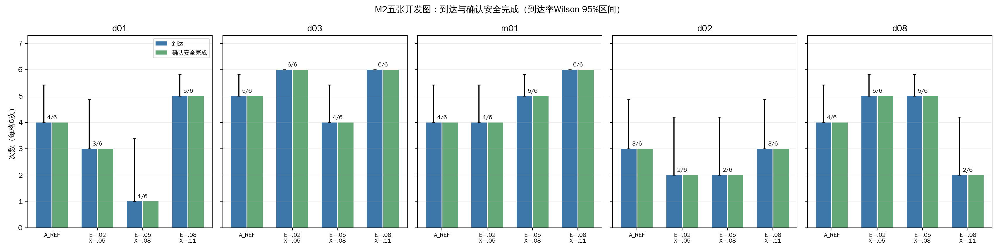
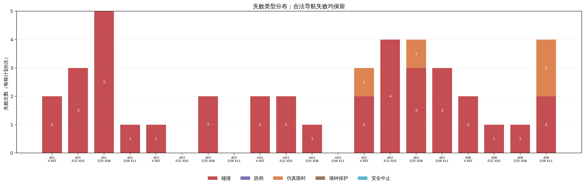
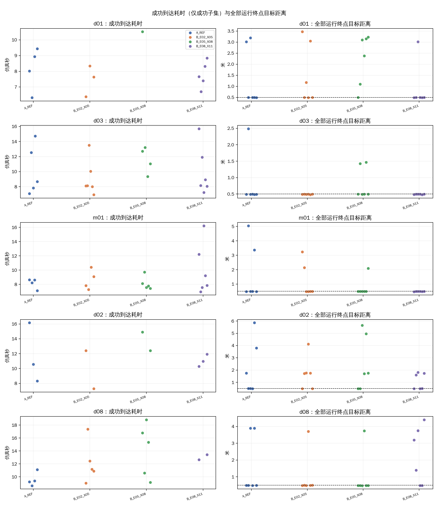
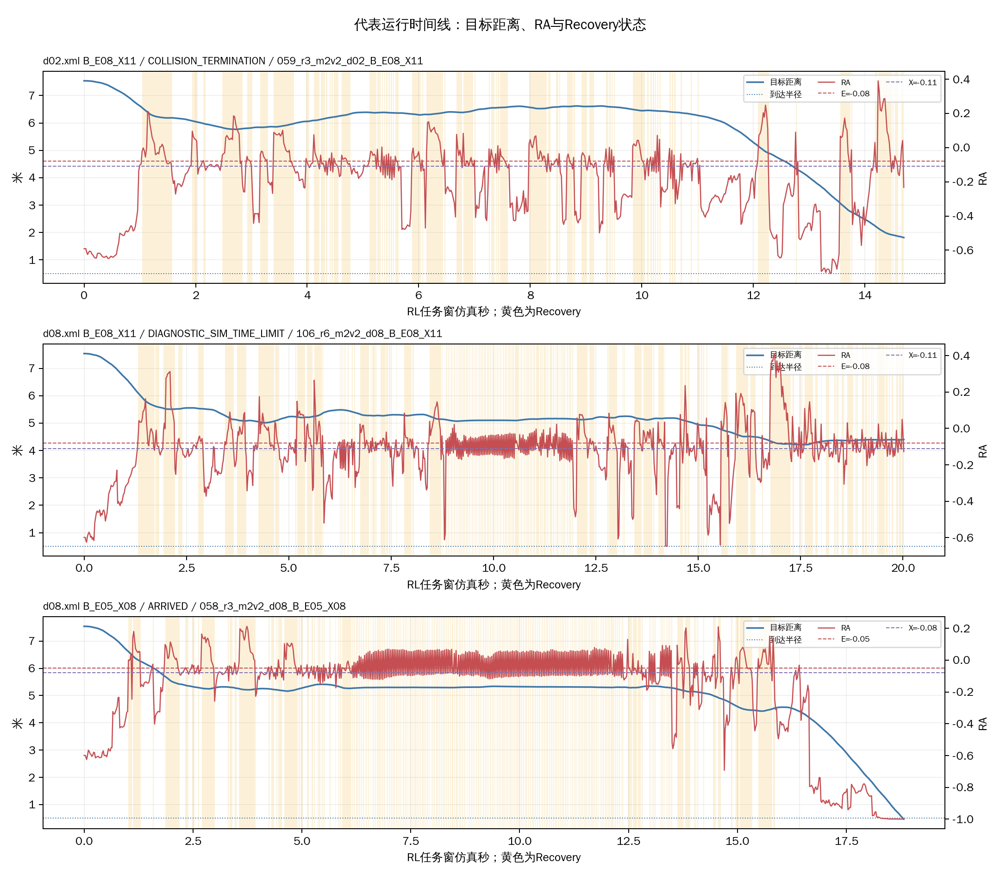

# R1-5：五张M2地图的双阈值位置比较

更新：2026-10-30。R1开发比较；不是独立验证。分析使用本批原始策略帧、context、terminal、metrics和进程记录。

## 执行情况

- 计划/有效完成：120/120；实际场景启动：120；补做：0；导航期碰撞、跌倒、限时及安全中止均作为结果保留，不重跑。
- 冻结调度：6轮、每轮20项；调度种子2026103017。启动终止计数：到达79、碰撞37、仿真限时4、墙钟保护0、跌倒0、安全中止0。
- 安全完成TRUE：79；UNKNOWN：0。到达后2秒站立观察完成79次。
- 本批原始目录占用1.39 GiB；最后一次磁盘检查可用49.1 GiB。
- 隐藏MuJoCo窗口、RViz关闭、无截图录像。每项运行后均要求诊断器确认关闭和清理完成。

- 同一DISPLAY/Xauthority上下文的GLFW预检：PASS；Git、MuJoCo和控制器/模型/配置版本仅记录一次，见`run_plan.json`（Git b158d09bd47f2f5d3bbaa97312348063767b023c；MuJoCo 3.3.3）。

地图来自M2 selected_v2，地图身份与XML绑定逐项核对：d01→m2v2_d01、d03→m2v2_d03、m01→m2v2_m01、d02→m2v2_d02、d08→m2v2_d08。m01沿用r5修订；d08保留selected_v2原身份，索引记录其来源为M1几何未改。d01/d03/m01与R1-4同版本。场景身份、参数运行证据、记录有效性和清理状态逐项检查。

## 固定设置与比较解释

| 设置 | 运行机制 | E | 有效X | H | 与其他设置的比较含义 |
|---|---|---:|---:|---:|---|
| A_REF | 单阈值A | −0.05 | −0.05 | 0 | 参考 |
| B_E02_X05 | 双阈值B | −0.02 | −0.05 | 0 | 相对B_E05_X08整体移动阈值；相对A同时改变E和滞回 |
| B_E05_X08 | 双阈值B | −0.05 | −0.08 | 0 | 与A同E，比较增加滞回的作用 |
| B_E08_X11 | 双阈值B | −0.08 | −0.11 | 0 | 相对其他B组固定宽度0.03移动阈值位置 |

当前规则RA≥E进入Recovery；所以E=−0.02较晚进入，E=−0.08较早进入。三种双阈值均宽0.03。命令入口要求A/B也提供低于E的X和正H兼容值；A的X字段被省略、有效X=E，A/B的保持字段被省略、实际H=0。批次清单记录了这一入口语义，运行时逐次证据仍须匹配上述有效参数。

## 逐地图20格结果

每格计划6次；一次结果约占16.7个百分点。区间为到达率Wilson 95%区间。安全完成UNKNOWN独立计数。
| 地图 | 设置 | 有效/6 | 到达 | 到达率（95%区间） | 安全完成 | UNKNOWN | 碰撞 | 跌倒 | 仿真限时 | 超时推进中位数m | 墙钟保护 | 安全中止 | 终点距离中位数m |
|---|---|---:|---:|---:|---:|---:|---:|---:|---:|---:|---:|---:|---:|
| d01 | A_REF | 6/6 | 4 | 66.7% (30.0–90.3%) | 4 | 0 | 2 | 0 | 0 | UNKNOWN | 0 | 0 | 0.50 |
| d01 | B_E02_X05 | 6/6 | 3 | 50.0% (18.8–81.2%) | 3 | 0 | 3 | 0 | 0 | UNKNOWN | 0 | 0 | 0.84 |
| d01 | B_E05_X08 | 6/6 | 1 | 16.7% (3.0–56.4%) | 1 | 0 | 5 | 0 | 0 | UNKNOWN | 0 | 0 | 2.74 |
| d01 | B_E08_X11 | 6/6 | 5 | 83.3% (43.6–97.0%) | 5 | 0 | 1 | 0 | 0 | UNKNOWN | 0 | 0 | 0.50 |
| d03 | A_REF | 6/6 | 5 | 83.3% (43.6–97.0%) | 5 | 0 | 1 | 0 | 0 | UNKNOWN | 0 | 0 | 0.49 |
| d03 | B_E02_X05 | 6/6 | 6 | 100.0% (61.0–100.0%) | 6 | 0 | 0 | 0 | 0 | UNKNOWN | 0 | 0 | 0.49 |
| d03 | B_E05_X08 | 6/6 | 4 | 66.7% (30.0–90.3%) | 4 | 0 | 2 | 0 | 0 | UNKNOWN | 0 | 0 | 0.50 |
| d03 | B_E08_X11 | 6/6 | 6 | 100.0% (61.0–100.0%) | 6 | 0 | 0 | 0 | 0 | UNKNOWN | 0 | 0 | 0.50 |
| m01 | A_REF | 6/6 | 4 | 66.7% (30.0–90.3%) | 4 | 0 | 2 | 0 | 0 | UNKNOWN | 0 | 0 | 0.50 |
| m01 | B_E02_X05 | 6/6 | 4 | 66.7% (30.0–90.3%) | 4 | 0 | 2 | 0 | 0 | UNKNOWN | 0 | 0 | 0.49 |
| m01 | B_E05_X08 | 6/6 | 5 | 83.3% (43.6–97.0%) | 5 | 0 | 1 | 0 | 0 | UNKNOWN | 0 | 0 | 0.49 |
| m01 | B_E08_X11 | 6/6 | 6 | 100.0% (61.0–100.0%) | 6 | 0 | 0 | 0 | 0 | UNKNOWN | 0 | 0 | 0.49 |
| d02 | A_REF | 6/6 | 3 | 50.0% (18.8–81.2%) | 3 | 0 | 2 | 0 | 1 | 1.68 | 0 | 0 | 1.12 |
| d02 | B_E02_X05 | 6/6 | 2 | 33.3% (9.7–70.0%) | 2 | 0 | 4 | 0 | 0 | UNKNOWN | 0 | 0 | 1.74 |
| d02 | B_E05_X08 | 6/6 | 2 | 33.3% (9.7–70.0%) | 2 | 0 | 3 | 0 | 1 | 1.89 | 0 | 0 | 1.73 |
| d02 | B_E08_X11 | 6/6 | 3 | 50.0% (18.8–81.2%) | 3 | 0 | 3 | 0 | 0 | UNKNOWN | 0 | 0 | 1.05 |
| d08 | A_REF | 6/6 | 4 | 66.7% (30.0–90.3%) | 4 | 0 | 2 | 0 | 0 | UNKNOWN | 0 | 0 | 0.49 |
| d08 | B_E02_X05 | 6/6 | 5 | 83.3% (43.6–97.0%) | 5 | 0 | 1 | 0 | 0 | UNKNOWN | 0 | 0 | 0.50 |
| d08 | B_E05_X08 | 6/6 | 5 | 83.3% (43.6–97.0%) | 5 | 0 | 1 | 0 | 0 | UNKNOWN | 0 | 0 | 0.48 |
| d08 | B_E08_X11 | 6/6 | 2 | 33.3% (9.7–70.0%) | 2 | 0 | 2 | 0 | 2 | 3.74 | 0 | 0 | 2.29 |

## 每种设置30项汇总

| 设置 | 有效/30 | 到达 | 到达率（Wilson 95%） | 安全完成 | UNKNOWN | 碰撞 | 跌倒 | 仿真限时 | 墙钟保护 | 安全中止 | 到达耗时中位数（成功n） | 终点距离中位数m | Recovery占比中位数 | 单次驻留中位数s | 切换中位数 | 短反向中位数 | 足端接触/撞击已知计数 |
|---|---:|---:|---:|---:|---:|---:|---:|---:|---:|---:|---:|---:|---:|---:|---:|---:|---:|
| A_REF | 30/30 | 20 | 66.7% (48.8–80.8%) | 20 | 0 | 9 | 0 | 1 | 0 | 0 | 8.66s (n=20) | 0.50 | 27.3% | 0.04 | 54 | 49 | 24/23 |
| B_E02_X05 | 30/30 | 20 | 66.7% (48.8–80.8%) | 20 | 0 | 10 | 0 | 0 | 0 | 0 | 8.68s (n=20) | 0.50 | 29.1% | 0.05 | 43 | 40 | 33/33 |
| B_E05_X08 | 30/30 | 17 | 56.7% (39.2–72.6%) | 17 | 0 | 12 | 0 | 1 | 0 | 0 | 10.58s (n=17) | 0.50 | 30.0% | 0.02 | 57 | 53 | 32/32 |
| B_E08_X11 | 30/30 | 22 | 73.3% (55.6–85.8%) | 22 | 0 | 6 | 0 | 2 | 0 | 0 | 8.89s (n=22) | 0.50 | 30.1% | 0.04 | 52 | 50 | 23/22 |

## 对比观察

先按地图看20格计数，不以30项总数掩盖地图差异。每张地图的四设置到达/安全完成/碰撞/仿真限时列在下方；终点距离、耗时、Recovery和切换行为见CSV及图。

- **d01：** 到达/安全完成/碰撞/仿真限时：A_REF 4/4/2/0；B_E02_X05 3/3/3/0；B_E05_X08 1/1/5/0；B_E08_X11 5/5/1/0。
- **d03：** 到达/安全完成/碰撞/仿真限时：A_REF 5/5/1/0；B_E02_X05 6/6/0/0；B_E05_X08 4/4/2/0；B_E08_X11 6/6/0/0。
- **m01：** 到达/安全完成/碰撞/仿真限时：A_REF 4/4/2/0；B_E02_X05 4/4/2/0；B_E05_X08 5/5/1/0；B_E08_X11 6/6/0/0。
- **d02：** 到达/安全完成/碰撞/仿真限时：A_REF 3/3/2/1；B_E02_X05 2/2/4/0；B_E05_X08 2/2/3/1；B_E08_X11 3/3/3/0。
- **d08：** 到达/安全完成/碰撞/仿真限时：A_REF 4/4/2/0；B_E02_X05 5/5/1/0；B_E05_X08 5/5/1/0；B_E08_X11 2/2/2/2。

### 结果解读

同E对照中，B_E05_X08相对A_REF的到达为17/30对20/30，碰撞12对9，仿真限时各1次；到达数在d01、d03、d02较少，在m01、d08各多1次。此次没有显示滞回带来跨地图一致的任务收益。
固定宽度三种B设置合计到达分别为20/30、17/30、22/30。较早进入的B_E08_X11在d01、d03、m01到达数较高，但d08为2/6并出现2次仿真限时；d02为3/6且有3次碰撞。按地图差异看阈值位置的表现依赖场景，22/30的合计不能支持普遍最优结论。
A_REF与B_E02_X05合计均为20/30到达；B_E02_X05碰撞10次、没有仿真限时，A_REF碰撞9次、有1次限时。该整体对比同时改变进入阈值和滞回状态，不能解释为滞回单独作用。
d02与d08的推进代价需要和终局类别一起看：4次仿真限时中，d02/A_REF推进1.68m、d02/B_E05_X08推进1.89m；d08/B_E08_X11两次推进3.14m和4.35m（中位数3.74m），限时时终点仍距目标3.19m和4.40m。d02共12次碰撞，五图中最多；但每格6次，不将地图碰撞率外推为一般地图风险。
成功到达耗时只在到达子集中比较，各设置成功样本数不同。切换次数与Recovery占比作为行为描述，不单独代表效果。足端接触/撞击计数保留为独立字段，不并入环境碰撞。

仿真限时的距离变化以起始目标距离减终点目标距离报告，正值表示推进。

图表：

- 
- 
- 
- 

## 代表运行

按数据可用性，选取一例碰撞、一例仿真限时和一例到达（若对应事件存在）。时间线中的距离由实际位姿计算，RA和模式来自策略帧；黄色背景为Recovery。时间上的接近只作描述，不据此推断因果。

| 计划项 | 地图/设置 | 终止 | 任务耗时 | 终点目标距离 |
|---|---|---|---:|---:|
| 059_r3_m2v2_d02_B_E08_X11 | d02.xml / B_E08_X11 | COLLISION_TERMINATION | 14.70s | 1.81m |
| 106_r6_m2v2_d08_B_E08_X11 | d08.xml / B_E08_X11 | DIAGNOSTIC_SIM_TIME_LIMIT | 20.02s | 4.40m |
| 058_r3_m2v2_d08_B_E05_X08 | d08.xml / B_E05_X08 | ARRIVED | 18.82s | 0.47m |

## 限制与数据

- 这是开发比较，五图按M2 selected_v2筛选而来，不是独立留出地图；每格6次且初始关节状态未严格重放。调度随机种子只打乱计划顺序，不保证物理初态相同。
- 有效的控制证据来自运行上下文；A的单阈值退出由E导出。入口兼容参数与有效运行值分别记录，解释时以实际消费值为准。
- 本报告不宣称某个设置普遍最优。负面结果、UNKNOWN及记录字段缺失按实际记录保留。

- 原始批次：`logs/09_R1_switch_constraints/m2_threshold_position_120/20261030_r1_m2_threshold120/`（1.39 GiB）。
- 逐次表：`逐次运行明细.csv`；20格表：`地图设置汇总.csv`；四设置汇总：`设置汇总.csv`。
- 报告与图表：当前目录。
