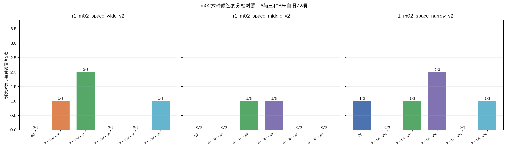
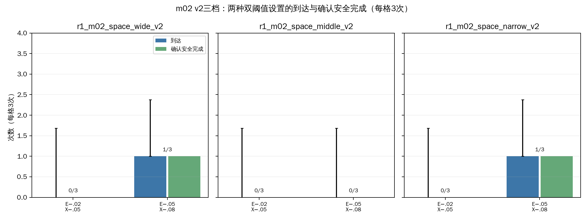
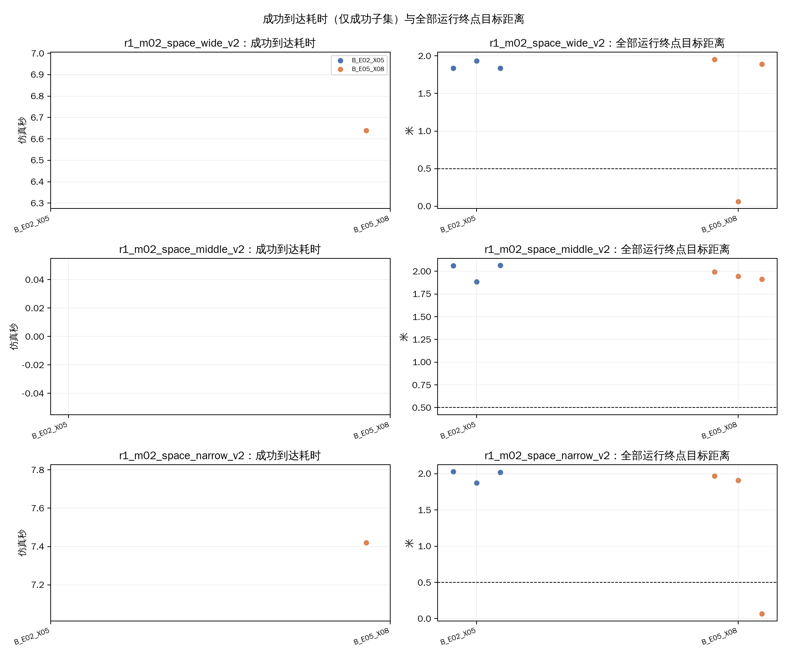
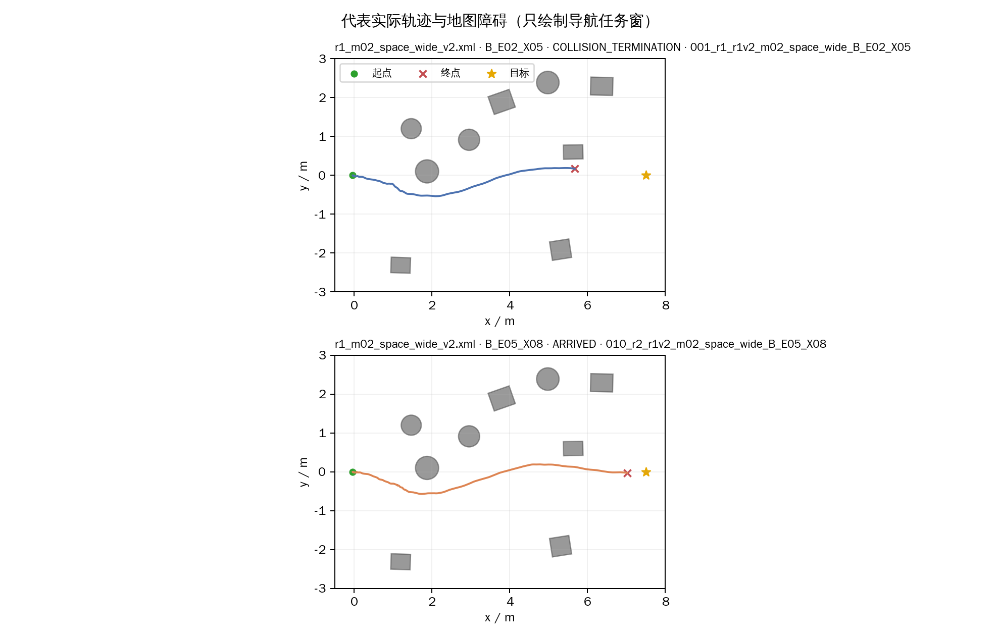
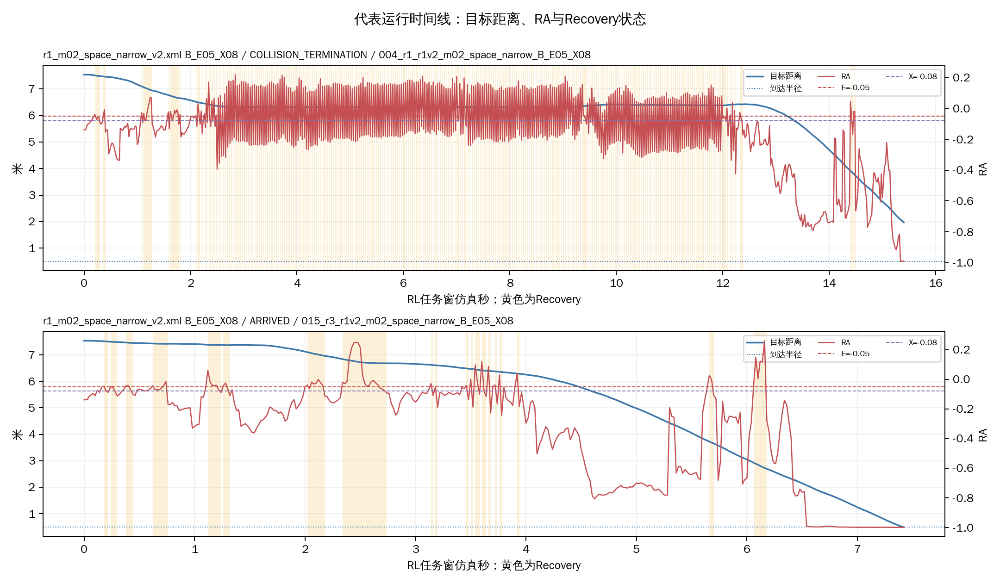

# R1-7：m02三档两种双阈值补测（18项）

本批是R1开发阶段的跨批次补测。只运行m02 v2三张地图和两种B设置，不含同期A；旧72项A与三种B仅作跨批次参考，不能当作严格配对。每格3次，三张地图同源。

## 执行与参数

- 完成：18/18 VALID；实际场景启动18次、非场景调用0次、补做0次。终局：到达2、碰撞16、跌倒0、仿真限时0、墙钟保护0、安全中止0、其他/UNKNOWN 0。
- 安全完成TRUE/FALSE/UNKNOWN：2/16/0；到达后站立观察完成2次。
- 实际参数逐项匹配：B_E02_X05为E=−0.02/X=−0.05/H=0，B_E05_X08为E=−0.05/X=−0.08/H=0；均为B、保持关闭、双阈值宽度0.03。目标(7.5,0)m，半径0.5m，20/120秒，到达后站立观察2仿真秒。
- 三轮交错排程，种子2026103102。隐藏MuJoCo、RViz关闭，无截图录像；同上下文GLFW预检PASS。两个临时overlay已在运行结束后清理；原始记录保留。运行期间批次峰值约190.6MiB，清理后约134.5MiB。
- 版本、实际随机顺序、场景身份和每次运行清理证据见批次`run_plan.json`与`run_schedule.csv`。

| 设置 | E | X | H | 用途 |
|---|---:|---:|---:|---|
| B_E02_X05 | −0.02 | −0.05 | 0 | 本批新补测 |
| B_E05_X08 | −0.05 | −0.08 | 0 | 本批新补测 |

## 本批六格结果

| 地图 | 设置 | 有效/3 | 到达 | 安全完成T/F/U | 碰撞 | 跌倒 | 仿真限时 | 墙钟保护 | 安全中止 | 到达耗时中位数s（成功n） | 终点距离中位数m | 推进中位数m | 03—07中心轨迹进入数/3 | 记录到的碰撞对象 |
|---|---|---:|---:|---:|---:|---:|---:|---:|---:|---:|---:|---:|---:|---|
| r1_m02_space_wide_v2 | B_E02_X05 | 3/3 | 0/3 | 0/3/0 | 3 | 0 | 0 | 0 | 0 | UNKNOWN (n=0) | 1.84 | 5.70 | 3/3 | ppt_obstacle_03:3 |
| r1_m02_space_wide_v2 | B_E05_X08 | 3/3 | 1/3 | 1/2/0 | 2 | 0 | 0 | 0 | 0 | 6.64 (n=1) | 1.89 | 5.65 | 3/3 | ppt_obstacle_03:2 |
| r1_m02_space_middle_v2 | B_E02_X05 | 3/3 | 0/3 | 0/3/0 | 3 | 0 | 0 | 0 | 0 | UNKNOWN (n=0) | 2.06 | 5.48 | 3/3 | ppt_obstacle_03:3 |
| r1_m02_space_middle_v2 | B_E05_X08 | 3/3 | 0/3 | 0/3/0 | 3 | 0 | 0 | 0 | 0 | UNKNOWN (n=0) | 1.95 | 5.59 | 3/3 | ppt_obstacle_03:3 |
| r1_m02_space_narrow_v2 | B_E02_X05 | 3/3 | 0/3 | 0/3/0 | 3 | 0 | 0 | 0 | 0 | UNKNOWN (n=0) | 2.02 | 5.52 | 3/3 | ppt_obstacle_03:3 |
| r1_m02_space_narrow_v2 | B_E05_X08 | 3/3 | 1/3 | 1/2/0 | 2 | 0 | 0 | 0 | 0 | 7.42 (n=1) | 1.91 | 5.63 | 3/3 | ppt_obstacle_03:2 |

本批碰撞事件记录到的对象：{'ppt_obstacle_03': 16}。该字段描述已记录接触对象，不补推未记录接触。

## 与旧72项m02结果并列（跨批次）

下表汇总原72项中的A_REF与三种B，以及本批两种B；每一格均为3次。R1-6旧批次不计入本批18次，也不是本批同期A或严格配对。本批运行、模型和参数版本见本批`run_plan.json`；旧72项版本见[原批次清单](../../../../logs/09_R1_switch_constraints/r1_v2_threshold_72/20261031_r1_v2_threshold72/run_plan.json)。
| 地图 | 设置 | 批次来源 | E/X/H | n | 到达 | 安全完成T/F/U | 碰撞 | 跌倒 | 仿真限时 | 墙钟保护 | 安全中止 | 到达耗时中位数s（成功n） | 终点距离中位数m | 推进中位数m | 03—07中心轨迹进入数 |
|---|---|---|---|---:|---:|---:|---:|---:|---:|---:|---:|---:|---:|---:|---:|
| r1_m02_space_wide_v2 | A_REF | R1-6旧72项（跨批次） | -0.05/-0.05/0 | 3 | 0 | 0/3/0 | 3 | 0 | 0 | 0 | 0 | UNKNOWN (n=0) | 2.05 | 5.49 | 3/3 |
| r1_m02_space_wide_v2 | B_E03_X06 | R1-6旧72项（跨批次） | -0.03/-0.06/0 | 3 | 1 | 1/2/0 | 2 | 0 | 0 | 0 | 0 | 6.18 (n=1) | 1.81 | 5.73 | 3/3 |
| r1_m02_space_wide_v2 | B_E04_X07 | R1-6旧72项（跨批次） | -0.04/-0.07/0 | 3 | 2 | 2/1/0 | 1 | 0 | 0 | 0 | 0 | 5.82 (n=2) | 0.10 | 7.44 | 3/3 |
| r1_m02_space_wide_v2 | B_E06_X09 | R1-6旧72项（跨批次） | -0.06/-0.09/0 | 3 | 0 | 0/3/0 | 3 | 0 | 0 | 0 | 0 | UNKNOWN (n=0) | 1.85 | 5.69 | 3/3 |
| r1_m02_space_wide_v2 | B_E02_X05 | R1-7本批18项 | -0.02/-0.05/0 | 3 | 0 | 0/3/0 | 3 | 0 | 0 | 0 | 0 | UNKNOWN (n=0) | 1.84 | 5.70 | 3/3 |
| r1_m02_space_wide_v2 | B_E05_X08 | R1-7本批18项 | -0.05/-0.08/0 | 3 | 1 | 1/2/0 | 2 | 0 | 0 | 0 | 0 | 6.64 (n=1) | 1.89 | 5.65 | 3/3 |
| r1_m02_space_middle_v2 | A_REF | R1-6旧72项（跨批次） | -0.05/-0.05/0 | 3 | 0 | 0/3/0 | 3 | 0 | 0 | 0 | 0 | UNKNOWN (n=0) | 1.94 | 5.60 | 3/3 |
| r1_m02_space_middle_v2 | B_E03_X06 | R1-6旧72项（跨批次） | -0.03/-0.06/0 | 3 | 0 | 0/3/0 | 3 | 0 | 0 | 0 | 0 | UNKNOWN (n=0) | 2.04 | 5.50 | 3/3 |
| r1_m02_space_middle_v2 | B_E04_X07 | R1-6旧72项（跨批次） | -0.04/-0.07/0 | 3 | 1 | 1/2/0 | 2 | 0 | 0 | 0 | 0 | 6.48 (n=1) | 1.97 | 5.57 | 2/3 |
| r1_m02_space_middle_v2 | B_E06_X09 | R1-6旧72项（跨批次） | -0.06/-0.09/0 | 3 | 1 | 1/2/0 | 2 | 0 | 0 | 0 | 0 | 6.38 (n=1) | 1.97 | 5.57 | 3/3 |
| r1_m02_space_middle_v2 | B_E02_X05 | R1-7本批18项 | -0.02/-0.05/0 | 3 | 0 | 0/3/0 | 3 | 0 | 0 | 0 | 0 | UNKNOWN (n=0) | 2.06 | 5.48 | 3/3 |
| r1_m02_space_middle_v2 | B_E05_X08 | R1-7本批18项 | -0.05/-0.08/0 | 3 | 0 | 0/3/0 | 3 | 0 | 0 | 0 | 0 | UNKNOWN (n=0) | 1.95 | 5.59 | 3/3 |
| r1_m02_space_narrow_v2 | A_REF | R1-6旧72项（跨批次） | -0.05/-0.05/0 | 3 | 1 | 1/2/0 | 2 | 0 | 0 | 0 | 0 | 7.86 (n=1) | 1.82 | 5.71 | 3/3 |
| r1_m02_space_narrow_v2 | B_E03_X06 | R1-6旧72项（跨批次） | -0.03/-0.06/0 | 3 | 0 | 0/3/0 | 3 | 0 | 0 | 0 | 0 | UNKNOWN (n=0) | 1.85 | 5.69 | 3/3 |
| r1_m02_space_narrow_v2 | B_E04_X07 | R1-6旧72项（跨批次） | -0.04/-0.07/0 | 3 | 1 | 1/2/0 | 2 | 0 | 0 | 0 | 0 | 6.40 (n=1) | 2.00 | 5.53 | 3/3 |
| r1_m02_space_narrow_v2 | B_E06_X09 | R1-6旧72项（跨批次） | -0.06/-0.09/0 | 3 | 2 | 2/1/0 | 1 | 0 | 0 | 0 | 0 | 6.53 (n=2) | 0.04 | 7.50 | 3/3 |
| r1_m02_space_narrow_v2 | B_E02_X05 | R1-7本批18项 | -0.02/-0.05/0 | 3 | 0 | 0/3/0 | 3 | 0 | 0 | 0 | 0 | UNKNOWN (n=0) | 2.02 | 5.52 | 3/3 |
| r1_m02_space_narrow_v2 | B_E05_X08 | R1-7本批18项 | -0.05/-0.08/0 | 3 | 1 | 1/2/0 | 2 | 0 | 0 | 0 | 0 | 7.42 (n=1) | 1.91 | 5.63 | 3/3 |

## 判断与限制

逐档结果显示碰撞主要发生在障碍03；到达样本少，不能把成功子集的耗时解释为整体效率。推进量按每格全部有效运行计算，终点距离和终局需一起看。中心位姿进入03—07近似截面不等于整机通过净空。
本批和旧72项只做跨批次开发线索：运行批次、样本次序、初态与随机扰动不同，且没有同期A。每格3次、三档同源，结果不足以估计通过率或判定一般优势。新两档若仅在某一档地图出现改善，也只构成该布局上的候选线索。
双阈值与A的整体差异同时涉及E和X；两种新设置之间也同时移动阈值位置。H均为0，因此本批不评估保持时间。到达耗时仅对到达子集统计并注明样本数；Recovery与切换仅作行为描述。

## 图表与案例

- 
- 
- 
- 
- 

代表轨迹和时间线仅绘制导航任务窗；轨迹用于辅助核对研究区域，不等同于整机净空或策略可达保证。

## 数据位置

- 本批逐次明细：`逐次运行明细.csv`；六格汇总：`地图设置汇总.csv`；两设置汇总：`设置汇总.csv`；六种候选×三图跨批次对照：`跨批次候选对照.csv`。
- 原始运行记录：`logs/09_R1_switch_constraints/r1_m02_threshold_refine_18/20261031_r1_m02_threshold_refine18/`。批次约0.13GiB；旧72项文件未改。
