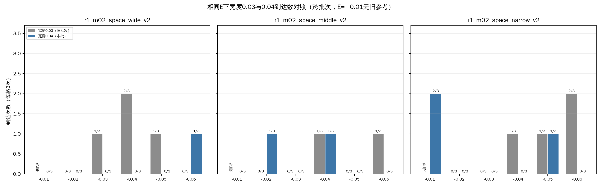
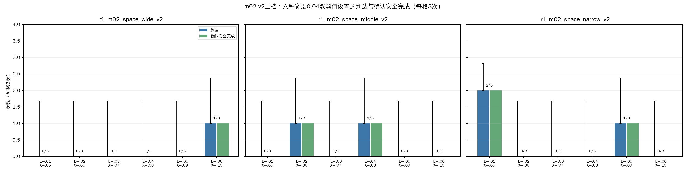
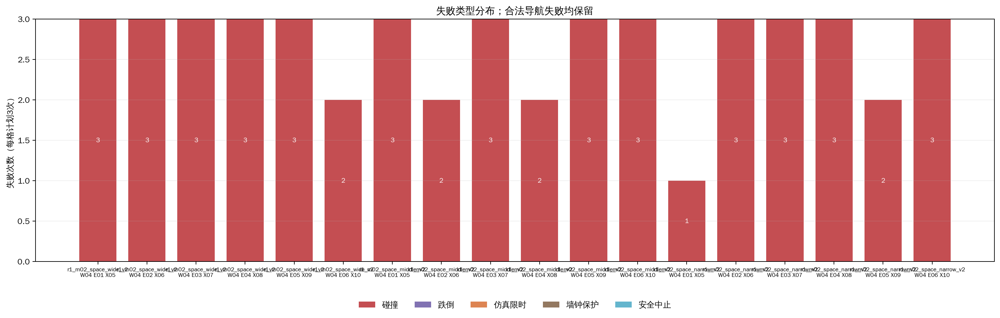
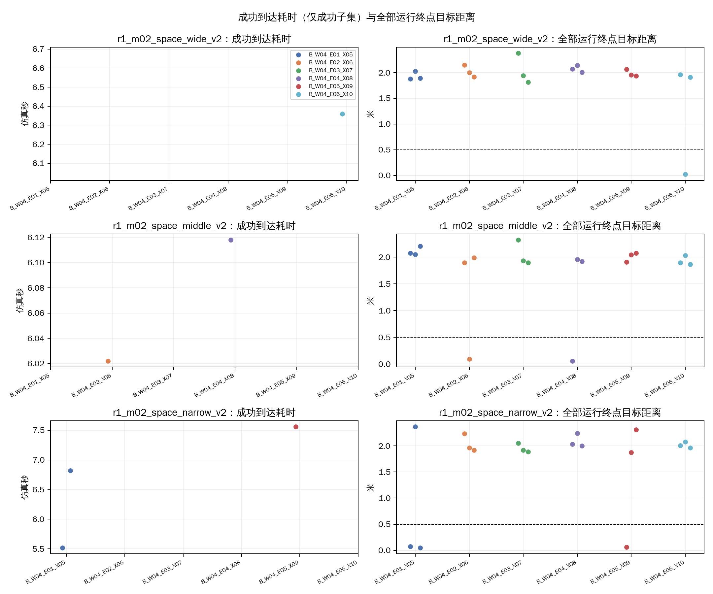
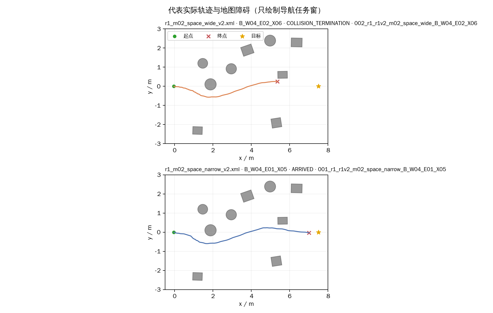
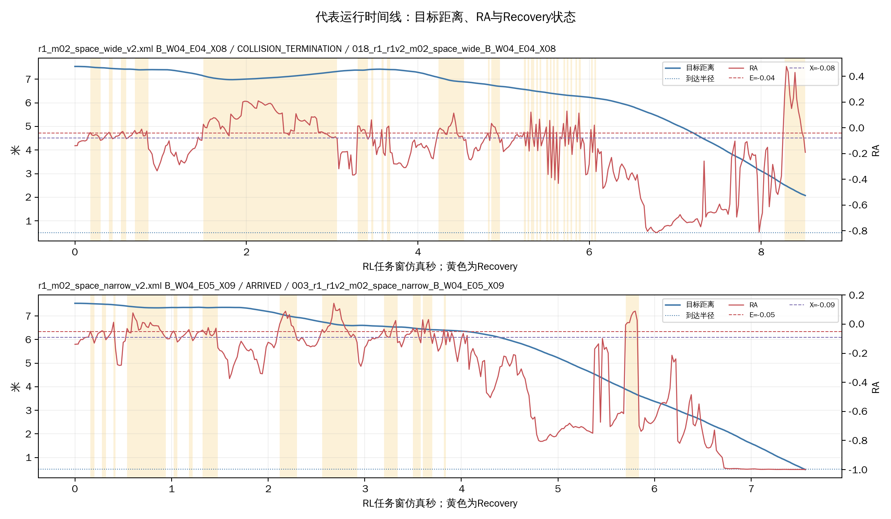

# R1-8：m02宽度0.04双阈值比较（54项）

本批为开发筛查，只运行m02 v2三档与六种宽度0.04的B设置；没有同期A。R1-6/7宽度0.03结果仅作跨批次参考，初始状态和运行次序未严格配对。每格3次，三张地图同源。

## 执行与参数

- 完成：54/54 VALID；实际场景启动54次、非场景调用0次、补做0次。终局：到达6、碰撞48、跌倒0、仿真限时0、墙钟保护0、安全中止0、其他/UNKNOWN 0。
- 安全完成TRUE/FALSE/UNKNOWN：6/48/0；到达后站立观察完成6次。
- 设置逐项匹配B组和E/X：E从−0.01至−0.06步长−0.01，X=E−0.04（最低X=−0.10）；全部实际H=0、保持关闭。目标(7.5,0)m、到达半径0.5m、仿真/墙钟上限20/120秒，到达后观察2仿真秒。
- 三轮交错排程，种子2026103103。隐藏MuJoCo、RViz关闭，无截图录像；同上下文GLFW预检PASS。六份临时overlay已在运行结束后清理。批次峰值约512.6MiB，清理后运行记录约0.34GiB；分析和图表另存于报告目录。
- 运行、模型、参数版本、冻结顺序和场景身份见本批`run_plan.json`与`run_schedule.csv`。旧R1-6/7版本记录链接见下方跨批次对照章节。

| 设置 | E | X | E−X | 实际H |
|---|---:|---:|---:|---:|
| B_W04_E01_X05 | -0.01 | -0.05 | 0.04 | 0 |
| B_W04_E02_X06 | -0.02 | -0.06 | 0.04 | 0 |
| B_W04_E03_X07 | -0.03 | -0.07 | 0.04 | 0 |
| B_W04_E04_X08 | -0.04 | -0.08 | 0.04 | 0 |
| B_W04_E05_X09 | -0.05 | -0.09 | 0.04 | 0 |
| B_W04_E06_X10 | -0.06 | -0.10 | 0.04 | 0 |

## 18格地图×设置结果

| 地图 | 设置 | 有效/3 | 到达 | 安全完成T/F/U | 碰撞 | 跌倒 | 仿真限时 | 墙钟保护 | 安全中止 | 到达耗时中位数s（成功n） | 终点距离中位数m | 推进中位数m | 03—07中心轨迹进入数/3 | 碰撞对象 |
|---|---|---:|---:|---:|---:|---:|---:|---:|---:|---:|---:|---:|---:|---|
| r1_m02_space_wide_v2 | B_W04_E01_X05 | 3/3 | 0/3 | 0/3/0 | 3 | 0 | 0 | 0 | 0 | UNKNOWN (n=0) | 1.89 | 5.64 | 3/3 | ppt_obstacle_03:3 |
| r1_m02_space_wide_v2 | B_W04_E02_X06 | 3/3 | 0/3 | 0/3/0 | 3 | 0 | 0 | 0 | 0 | UNKNOWN (n=0) | 2.00 | 5.54 | 3/3 | ppt_obstacle_03:3 |
| r1_m02_space_wide_v2 | B_W04_E03_X07 | 3/3 | 0/3 | 0/3/0 | 3 | 0 | 0 | 0 | 0 | UNKNOWN (n=0) | 1.94 | 5.59 | 2/3 | ppt_obstacle_03:3 |
| r1_m02_space_wide_v2 | B_W04_E04_X08 | 3/3 | 0/3 | 0/3/0 | 3 | 0 | 0 | 0 | 0 | UNKNOWN (n=0) | 2.07 | 5.47 | 3/3 | ppt_obstacle_03:3 |
| r1_m02_space_wide_v2 | B_W04_E05_X09 | 3/3 | 0/3 | 0/3/0 | 3 | 0 | 0 | 0 | 0 | UNKNOWN (n=0) | 1.96 | 5.58 | 3/3 | ppt_obstacle_03:3 |
| r1_m02_space_wide_v2 | B_W04_E06_X10 | 3/3 | 1/3 | 1/2/0 | 2 | 0 | 0 | 0 | 0 | 6.36 (n=1) | 1.91 | 5.63 | 3/3 | ppt_obstacle_03:2 |
| r1_m02_space_middle_v2 | B_W04_E01_X05 | 3/3 | 0/3 | 0/3/0 | 3 | 0 | 0 | 0 | 0 | UNKNOWN (n=0) | 2.07 | 5.47 | 3/3 | ppt_obstacle_03:3 |
| r1_m02_space_middle_v2 | B_W04_E02_X06 | 3/3 | 1/3 | 1/2/0 | 2 | 0 | 0 | 0 | 0 | 6.02 (n=1) | 1.90 | 5.64 | 3/3 | ppt_obstacle_03:2 |
| r1_m02_space_middle_v2 | B_W04_E03_X07 | 3/3 | 0/3 | 0/3/0 | 3 | 0 | 0 | 0 | 0 | UNKNOWN (n=0) | 1.94 | 5.60 | 2/3 | ppt_obstacle_03:3 |
| r1_m02_space_middle_v2 | B_W04_E04_X08 | 3/3 | 1/3 | 1/2/0 | 2 | 0 | 0 | 0 | 0 | 6.12 (n=1) | 1.92 | 5.62 | 3/3 | ppt_obstacle_03:2 |
| r1_m02_space_middle_v2 | B_W04_E05_X09 | 3/3 | 0/3 | 0/3/0 | 3 | 0 | 0 | 0 | 0 | UNKNOWN (n=0) | 2.05 | 5.49 | 3/3 | ppt_obstacle_03:3 |
| r1_m02_space_middle_v2 | B_W04_E06_X10 | 3/3 | 0/3 | 0/3/0 | 3 | 0 | 0 | 0 | 0 | UNKNOWN (n=0) | 1.90 | 5.64 | 3/3 | ppt_obstacle_03:3 |
| r1_m02_space_narrow_v2 | B_W04_E01_X05 | 3/3 | 2/3 | 2/1/0 | 1 | 0 | 0 | 0 | 0 | 6.17 (n=2) | 0.08 | 7.46 | 2/3 | ppt_obstacle_03:1 |
| r1_m02_space_narrow_v2 | B_W04_E02_X06 | 3/3 | 0/3 | 0/3/0 | 3 | 0 | 0 | 0 | 0 | UNKNOWN (n=0) | 1.96 | 5.57 | 2/3 | ppt_obstacle_03:3 |
| r1_m02_space_narrow_v2 | B_W04_E03_X07 | 3/3 | 0/3 | 0/3/0 | 3 | 0 | 0 | 0 | 0 | UNKNOWN (n=0) | 1.92 | 5.62 | 3/3 | ppt_obstacle_03:3 |
| r1_m02_space_narrow_v2 | B_W04_E04_X08 | 3/3 | 0/3 | 0/3/0 | 3 | 0 | 0 | 0 | 0 | UNKNOWN (n=0) | 2.03 | 5.51 | 2/3 | ppt_obstacle_03:3 |
| r1_m02_space_narrow_v2 | B_W04_E05_X09 | 3/3 | 1/3 | 1/2/0 | 2 | 0 | 0 | 0 | 0 | 7.56 (n=1) | 1.88 | 5.66 | 2/3 | ppt_obstacle_03:2 |
| r1_m02_space_narrow_v2 | B_W04_E06_X10 | 3/3 | 0/3 | 0/3/0 | 3 | 0 | 0 | 0 | 0 | UNKNOWN (n=0) | 2.00 | 5.53 | 3/3 | ppt_obstacle_03:3 |

### 六设置汇总

| 设置 | 有效/9 | 到达 | 安全完成T/F/U | 碰撞 | 跌倒 | 仿真限时 | 墙钟保护 | 安全中止 | 到达耗时中位数s（成功n） | 终点距离中位数m | Recovery占比中位数 | 切换次数中位数 |
|---|---:|---:|---:|---:|---:|---:|---:|---:|---:|---:|---:|---:|
| B_W04_E01_X05 | 9/9 | 2 | 2/7/0 | 7 | 0 | 0 | 0 | 0 | 6.17 (n=2) | 2.03 | 0.18 | 26 |
| B_W04_E02_X06 | 9/9 | 1 | 1/8/0 | 8 | 0 | 0 | 0 | 0 | 6.02 (n=1) | 1.96 | 0.15 | 29 |
| B_W04_E03_X07 | 9/9 | 0 | 0/9/0 | 9 | 0 | 0 | 0 | 0 | UNKNOWN (n=0) | 1.94 | 0.21 | 44 |
| B_W04_E04_X08 | 9/9 | 1 | 1/8/0 | 8 | 0 | 0 | 0 | 0 | 6.12 (n=1) | 2.01 | 0.21 | 54 |
| B_W04_E05_X09 | 9/9 | 1 | 1/8/0 | 8 | 0 | 0 | 0 | 0 | 7.56 (n=1) | 1.96 | 0.23 | 46 |
| B_W04_E06_X10 | 9/9 | 1 | 1/8/0 | 8 | 0 | 0 | 0 | 0 | 6.36 (n=1) | 1.96 | 0.20 | 46 |

本批碰撞事件记录到的接触对象：{'ppt_obstacle_03': 48}。区域检查使用任务窗机器人中心位姿；中心经过不等同于整机轮廓净空。

## 与宽度0.03同E设置并列（跨批次）

E=−0.02/−0.03/−0.04/−0.05/−0.06的宽度0.03结果来自R1-7或R1-6；E=−0.01没有同E旧档。原A_REF仅列作既有开发背景，不计入本批，不作同期对照。每个历史及新格各3次。下面的计数是描述性并列，不是配对推断或因果效应。
[R1-6运行版本](../../../../logs/09_R1_switch_constraints/r1_v2_threshold_72/20261031_r1_v2_threshold72/run_plan.json)；[R1-7运行版本](../../../../logs/09_R1_switch_constraints/r1_m02_threshold_refine_18/20261031_r1_m02_threshold_refine18/run_plan.json)。
| 地图 | E | 宽度0.03来源/设置 | 旧到达/3 | 旧碰撞 | 旧推进中位数m | 宽度0.04设置 | 新到达/3 | 新碰撞 | 新推进中位数m | 新到达耗时中位数s（成功n） |
|---|---:|---|---:|---:|---:|---|---:|---:|---:|---:|
| r1_m02_space_wide_v2 | -0.01 | NONE / NO_SAME_E_REFERENCE | 无同E旧档 | — | UNKNOWN | B_W04_E01_X05 | 0/3 | 3 | 5.64 | UNKNOWN (n=0) |
| r1_m02_space_wide_v2 | -0.02 | R1-7宽度0.03（跨批次） / B_E02_X05 | 0/3 | 3 | 5.70 | B_W04_E02_X06 | 0/3 | 3 | 5.54 | UNKNOWN (n=0) |
| r1_m02_space_wide_v2 | -0.03 | R1-6宽度0.03（跨批次） / B_E03_X06 | 1/3 | 2 | 5.73 | B_W04_E03_X07 | 0/3 | 3 | 5.59 | UNKNOWN (n=0) |
| r1_m02_space_wide_v2 | -0.04 | R1-6宽度0.03（跨批次） / B_E04_X07 | 2/3 | 1 | 7.44 | B_W04_E04_X08 | 0/3 | 3 | 5.47 | UNKNOWN (n=0) |
| r1_m02_space_wide_v2 | -0.05 | R1-7宽度0.03（跨批次） / B_E05_X08 | 1/3 | 2 | 5.65 | B_W04_E05_X09 | 0/3 | 3 | 5.58 | UNKNOWN (n=0) |
| r1_m02_space_wide_v2 | -0.06 | R1-6宽度0.03（跨批次） / B_E06_X09 | 0/3 | 3 | 5.69 | B_W04_E06_X10 | 1/3 | 2 | 5.63 | 6.36 (n=1) |
| r1_m02_space_middle_v2 | -0.01 | NONE / NO_SAME_E_REFERENCE | 无同E旧档 | — | UNKNOWN | B_W04_E01_X05 | 0/3 | 3 | 5.47 | UNKNOWN (n=0) |
| r1_m02_space_middle_v2 | -0.02 | R1-7宽度0.03（跨批次） / B_E02_X05 | 0/3 | 3 | 5.48 | B_W04_E02_X06 | 1/3 | 2 | 5.64 | 6.02 (n=1) |
| r1_m02_space_middle_v2 | -0.03 | R1-6宽度0.03（跨批次） / B_E03_X06 | 0/3 | 3 | 5.50 | B_W04_E03_X07 | 0/3 | 3 | 5.60 | UNKNOWN (n=0) |
| r1_m02_space_middle_v2 | -0.04 | R1-6宽度0.03（跨批次） / B_E04_X07 | 1/3 | 2 | 5.57 | B_W04_E04_X08 | 1/3 | 2 | 5.62 | 6.12 (n=1) |
| r1_m02_space_middle_v2 | -0.05 | R1-7宽度0.03（跨批次） / B_E05_X08 | 0/3 | 3 | 5.59 | B_W04_E05_X09 | 0/3 | 3 | 5.49 | UNKNOWN (n=0) |
| r1_m02_space_middle_v2 | -0.06 | R1-6宽度0.03（跨批次） / B_E06_X09 | 1/3 | 2 | 5.57 | B_W04_E06_X10 | 0/3 | 3 | 5.64 | UNKNOWN (n=0) |
| r1_m02_space_narrow_v2 | -0.01 | NONE / NO_SAME_E_REFERENCE | 无同E旧档 | — | UNKNOWN | B_W04_E01_X05 | 2/3 | 1 | 7.46 | 6.17 (n=2) |
| r1_m02_space_narrow_v2 | -0.02 | R1-7宽度0.03（跨批次） / B_E02_X05 | 0/3 | 3 | 5.52 | B_W04_E02_X06 | 0/3 | 3 | 5.57 | UNKNOWN (n=0) |
| r1_m02_space_narrow_v2 | -0.03 | R1-6宽度0.03（跨批次） / B_E03_X06 | 0/3 | 3 | 5.69 | B_W04_E03_X07 | 0/3 | 3 | 5.62 | UNKNOWN (n=0) |
| r1_m02_space_narrow_v2 | -0.04 | R1-6宽度0.03（跨批次） / B_E04_X07 | 1/3 | 2 | 5.53 | B_W04_E04_X08 | 0/3 | 3 | 5.51 | UNKNOWN (n=0) |
| r1_m02_space_narrow_v2 | -0.05 | R1-7宽度0.03（跨批次） / B_E05_X08 | 1/3 | 2 | 5.63 | B_W04_E05_X09 | 1/3 | 2 | 5.66 | 7.56 (n=1) |
| r1_m02_space_narrow_v2 | -0.06 | R1-6宽度0.03（跨批次） / B_E06_X09 | 2/3 | 1 | 7.50 | B_W04_E06_X10 | 0/3 | 3 | 5.53 | UNKNOWN (n=0) |

A_REF旧72项背景（非同期、未计入本批）：r1_m02_space_wide_v2到达0/3、碰撞3；r1_m02_space_middle_v2到达0/3、碰撞3；r1_m02_space_narrow_v2到达1/3、碰撞2。完整候选汇总表见`跨批次候选对照.csv`。

## 走法与观察

用已有位姿记录统计中心位置是否进入x=5.30–5.60m、y=−1.67–0.42m的03—07近似截面；该统计只用于确认路径经过研究区域，不保证整机净空。碰撞对象来自原始任务窗安全记录。
## 判断与解释边界

本批54次中6次到达、48次与障碍03碰撞，没有跌倒或超时。对宽度0.04设置本身，唯一相对集中的线索是窄档B_W04_E01_X05到达2/3；同设置在宽、中档均0/3。其他设置全批次到达为0/9或1/9。故目前没有跨布局的稳定任务改善；只把窄档E=−0.01/X=−0.05作为局部探索线索保留待审，不据此定为胜出参数。其余五种设置在本批没有显示足够改善证据，可暂不列优先候选。
与宽度0.03的同E历史格相比，宽度0.04只有E=−0.02中档由0/3变1/3；E=−0.03宽档1/3降为0/3；E=−0.04宽档2/3降为0/3、另两档也未增加；E=−0.05窄档同为1/3；E=−0.06宽档由0/3变1/3但窄档由2/3变0/3。结合不同批次、初态和顺序，这些起伏不能归因于宽度变化。
区域轨迹统计显示大多数运行的机器人中心进入03—07近似截面（各格2/3或3/3），但48次碰撞事件全记录为障碍03；中心位置通过截面不表示机体几何净空。布局仍被实际使用，但宽/中/窄本批都没有一致的避碰改善。

对相同E，宽度0.04同时使X比宽度0.03低0.01；本批与旧批的初态、运行顺序和批次环境不同，因此差异只能作为开发线索。E=−0.01没有同E宽度0.03参考。每格3次、三档同源，不能估计稳健通过率或统计显著性。
到达时间只对成功样本统计并注明n；不同成功子集不能证明整体更快。推进以每格全体有效运行的目标距离变化计算。Recovery占比和切换次数仅作行为说明，不单独作为效果判断。

## 图表与数据

- 
- 
- 
- 
- 
- 

逐次、18格汇总、六设置汇总、36组批次×设置×地图宽度候选背景见`逐次运行明细.csv`、`地图设置汇总.csv`、`设置汇总.csv`、`跨批次候选对照.csv`及`同E宽度对照.csv`。轨迹只绘制导航任务窗，不包含到达后的站立和收尾段。
原始记录位于`logs/09_R1_switch_constraints/r1_m02_width04_54/20261031_r1_m02_width04_54/`；当前文件量约0.34GiB，旧批次与地图均未改。
