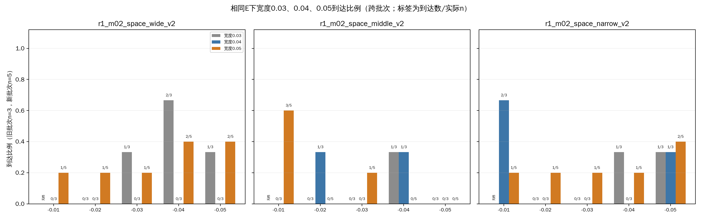
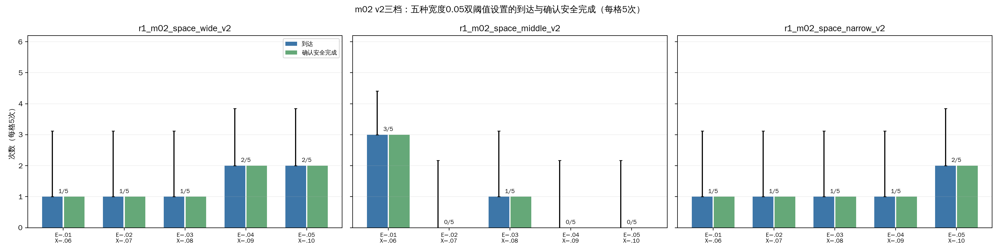
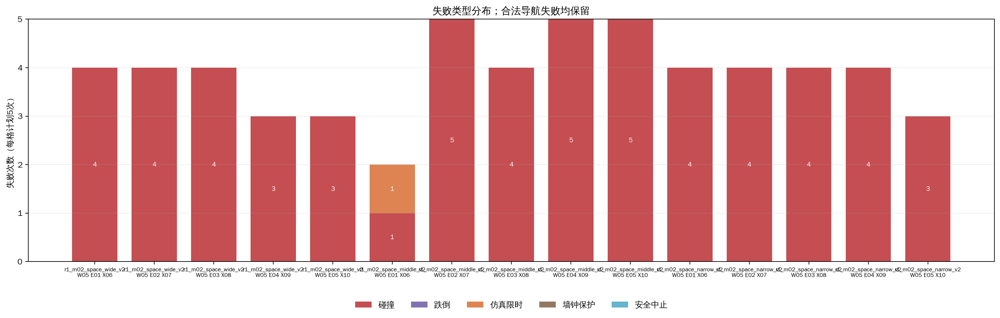
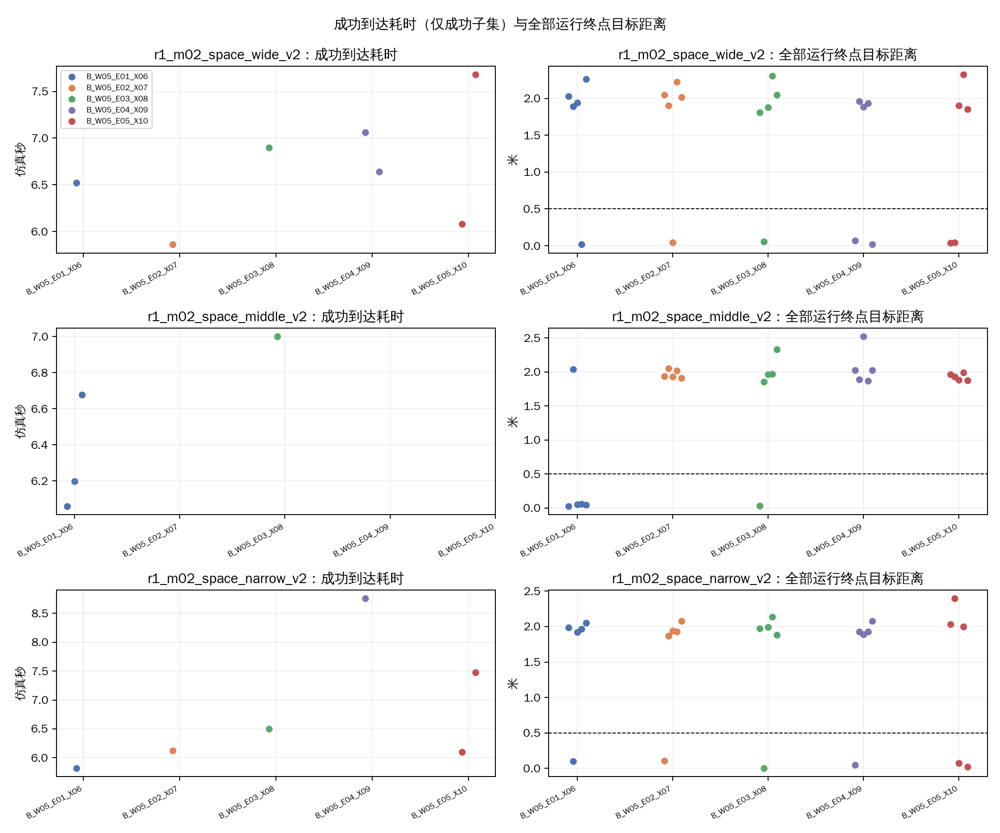
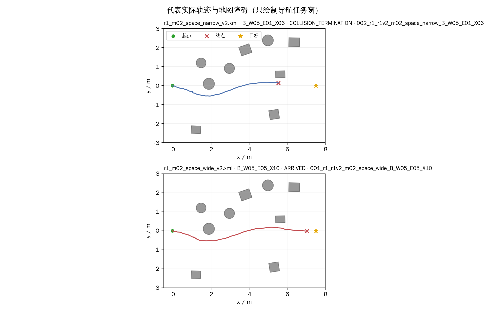
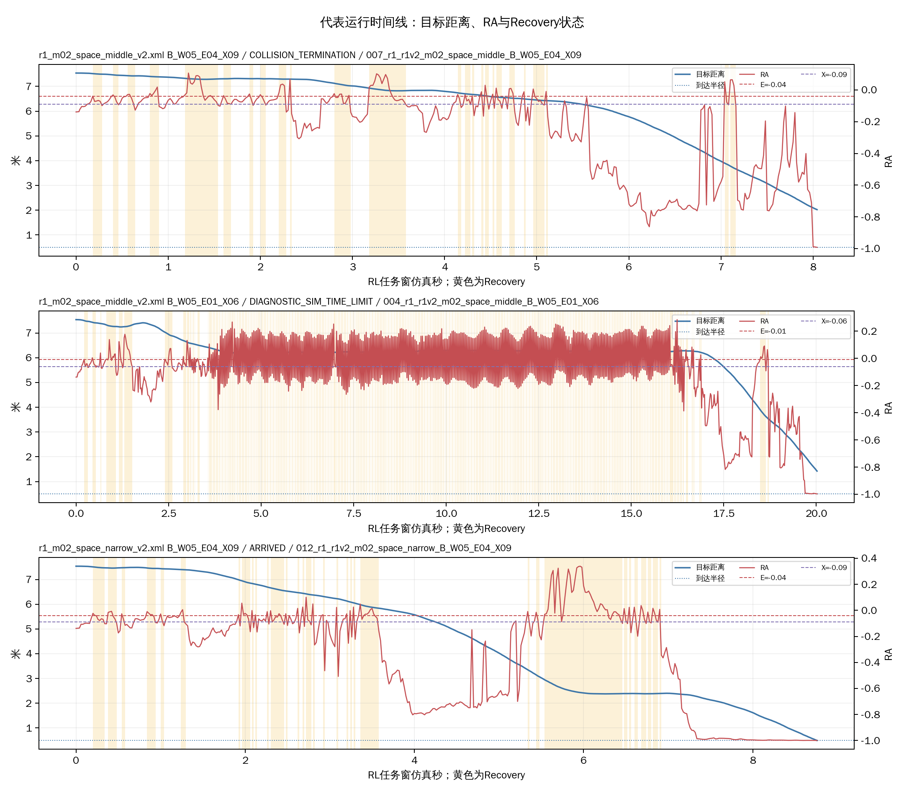

# R1-9：m02宽度0.05双阈值比较（75项）

本批为开发筛查，只运行m02 v2三档与五种宽度0.05的B设置；没有同期A。R1-6/7宽度0.03及R1-8宽度0.04结果仅作跨批次参考，初态和运行顺序未严格配对。每格5次，三张地图同源。

## 执行与参数

- 完成：75/75 VALID；实际场景启动75次、非场景调用0次、补做0次。终局：到达17、碰撞57、跌倒0、仿真限时1、墙钟保护0、安全中止0、其他/UNKNOWN 0。
- 安全完成TRUE/FALSE/UNKNOWN：17/58/0；到达后站立观察完成17次。
- 设置逐项匹配B组和E/X：E为−0.01至−0.05，X=E−0.05（最低X=−0.10）；全部实际H=0、保持关闭。目标(7.5,0)m、到达半径0.5m、仿真/墙钟上限20/120秒，到达后观察2仿真秒。
- 五轮交错排程，种子2026103104。隐藏MuJoCo、RViz关闭，无截图录像；同上下文GLFW预检PASS。五份临时overlay在全部运行后清理。批次记账峰值648.6MiB；保留运行记录约513MiB；分析图表另存。
- 运行、模型、参数版本、冻结顺序和场景身份见本批`run_plan.json`与`run_schedule.csv`。

| 设置 | E | X | E−X | 实际H |
|---|---:|---:|---:|---:|
| B_W05_E01_X06 | -0.01 | -0.06 | 0.05 | 0 |
| B_W05_E02_X07 | -0.02 | -0.07 | 0.05 | 0 |
| B_W05_E03_X08 | -0.03 | -0.08 | 0.05 | 0 |
| B_W05_E04_X09 | -0.04 | -0.09 | 0.05 | 0 |
| B_W05_E05_X10 | -0.05 | -0.10 | 0.05 | 0 |

## 15格地图×设置结果

| 地图 | 设置 | 有效/5 | 到达 | 安全完成T/F/U | 碰撞 | 跌倒 | 仿真限时 | 墙钟保护 | 安全中止 | 到达耗时中位数s（成功n） | 终点距离中位数m | 推进中位数m | 03—07中心轨迹进入数/5 | 碰撞对象 |
|---|---|---:|---:|---:|---:|---:|---:|---:|---:|---:|---:|---:|---:|---|
| r1_m02_space_wide_v2 | B_W05_E01_X06 | 5/5 | 1/5 | 1/4/0 | 4 | 0 | 0 | 0 | 0 | 6.52 (n=1) | 1.94 | 5.60 | 4/5 | ppt_obstacle_03:4 |
| r1_m02_space_wide_v2 | B_W05_E02_X07 | 5/5 | 1/5 | 1/4/0 | 4 | 0 | 0 | 0 | 0 | 5.86 (n=1) | 2.02 | 5.52 | 4/5 | ppt_obstacle_03:4 |
| r1_m02_space_wide_v2 | B_W05_E03_X08 | 5/5 | 1/5 | 1/4/0 | 4 | 0 | 0 | 0 | 0 | 6.90 (n=1) | 1.88 | 5.66 | 4/5 | ppt_obstacle_03:4 |
| r1_m02_space_wide_v2 | B_W05_E04_X09 | 5/5 | 2/5 | 2/3/0 | 3 | 0 | 0 | 0 | 0 | 6.85 (n=2) | 1.88 | 5.66 | 5/5 | ppt_obstacle_03:3 |
| r1_m02_space_wide_v2 | B_W05_E05_X10 | 5/5 | 2/5 | 2/3/0 | 3 | 0 | 0 | 0 | 0 | 6.88 (n=2) | 1.86 | 5.68 | 4/5 | ppt_obstacle_03:3 |
| r1_m02_space_middle_v2 | B_W05_E01_X06 | 5/5 | 3/5 | 3/2/0 | 1 | 0 | 1 | 0 | 0 | 6.20 (n=3) | 0.05 | 7.48 | 5/5 | ppt_obstacle_03:1 |
| r1_m02_space_middle_v2 | B_W05_E02_X07 | 5/5 | 0/5 | 0/5/0 | 5 | 0 | 0 | 0 | 0 | UNKNOWN (n=0) | 1.93 | 5.60 | 5/5 | ppt_obstacle_03:5 |
| r1_m02_space_middle_v2 | B_W05_E03_X08 | 5/5 | 1/5 | 1/4/0 | 4 | 0 | 0 | 0 | 0 | 7.00 (n=1) | 1.96 | 5.58 | 4/5 | ppt_obstacle_03:4 |
| r1_m02_space_middle_v2 | B_W05_E04_X09 | 5/5 | 0/5 | 0/5/0 | 5 | 0 | 0 | 0 | 0 | UNKNOWN (n=0) | 2.02 | 5.52 | 4/5 | ppt_obstacle_03:5 |
| r1_m02_space_middle_v2 | B_W05_E05_X10 | 5/5 | 0/5 | 0/5/0 | 5 | 0 | 0 | 0 | 0 | UNKNOWN (n=0) | 1.93 | 5.61 | 5/5 | ppt_obstacle_03:5 |
| r1_m02_space_narrow_v2 | B_W05_E01_X06 | 5/5 | 1/5 | 1/4/0 | 4 | 0 | 0 | 0 | 0 | 5.82 (n=1) | 1.96 | 5.57 | 5/5 | ppt_obstacle_03:4 |
| r1_m02_space_narrow_v2 | B_W05_E02_X07 | 5/5 | 1/5 | 1/4/0 | 4 | 0 | 0 | 0 | 0 | 6.12 (n=1) | 1.93 | 5.61 | 5/5 | ppt_obstacle_03:4 |
| r1_m02_space_narrow_v2 | B_W05_E03_X08 | 5/5 | 1/5 | 1/4/0 | 4 | 0 | 0 | 0 | 0 | 6.50 (n=1) | 1.97 | 5.57 | 5/5 | ppt_obstacle_03:4 |
| r1_m02_space_narrow_v2 | B_W05_E04_X09 | 5/5 | 1/5 | 1/4/0 | 4 | 0 | 0 | 0 | 0 | 8.76 (n=1) | 1.93 | 5.61 | 5/5 | ppt_obstacle_03:4 |
| r1_m02_space_narrow_v2 | B_W05_E05_X10 | 5/5 | 2/5 | 2/3/0 | 3 | 0 | 0 | 0 | 0 | 6.79 (n=2) | 2.00 | 5.54 | 4/5 | ppt_obstacle_03:3 |

### 五设置汇总

| 设置 | 有效/15 | 到达（比例） | 安全完成T/F/U | 碰撞 | 跌倒 | 仿真限时 | 墙钟保护 | 安全中止 | 到达耗时中位数s（成功n） | 终点距离中位数m | Recovery占比中位数 | 切换次数中位数 |
|---|---:|---:|---:|---:|---:|---:|---:|---:|---:|---:|---:|---:|
| B_W05_E01_X06 | 15/15 | 5/15 (33.3%) | 5/10/0 | 9 | 0 | 1 | 0 | 0 | 6.20 (n=5) | 1.92 | 0.17 | 32 |
| B_W05_E02_X07 | 15/15 | 2/15 (13.3%) | 2/13/0 | 13 | 0 | 0 | 0 | 0 | 5.99 (n=2) | 1.93 | 0.18 | 32 |
| B_W05_E03_X08 | 15/15 | 3/15 (20.0%) | 3/12/0 | 12 | 0 | 0 | 0 | 0 | 6.90 (n=3) | 1.96 | 0.18 | 40 |
| B_W05_E04_X09 | 15/15 | 3/15 (20.0%) | 3/12/0 | 12 | 0 | 0 | 0 | 0 | 7.06 (n=3) | 1.93 | 0.20 | 38 |
| B_W05_E05_X10 | 15/15 | 4/15 (26.7%) | 4/11/0 | 11 | 0 | 0 | 0 | 0 | 6.79 (n=4) | 1.90 | 0.18 | 36 |

本批碰撞事件记录到的对象：{'ppt_obstacle_03': 57}。中心位姿区域统计不代表整机净空。

## 与宽度0.03/0.04同E结果并列（跨批次）

下面按相同E展示宽度0.03、0.04、0.05的实际到达数/样本数和比例，并注明各自批次。宽度0.03/0.04每格3次，宽度0.05每格5次；分母不同，不能直接比较到达计数。E=−0.01没有宽度0.03旧格。旧A_REF只作背景，不计入本批或同E宽度对照。三批初态、顺序和实验批次不同；即使E相同，X也随宽度移动，不能把差异归因于宽度本身。
[R1-6宽度0.03运行版本](../../../../../logs/09_R1_switch_constraints/r1_v2_threshold_72/20261031_r1_v2_threshold72/run_plan.json)；[R1-7宽度0.03运行版本](../../../../../logs/09_R1_switch_constraints/r1_m02_threshold_refine_18/20261031_r1_m02_threshold_refine18/run_plan.json)；[R1-8宽度0.04运行版本](../../../../../logs/09_R1_switch_constraints/r1_m02_width04_54/20261031_r1_m02_width04_54/run_plan.json)。
| 地图 | E | 宽度0.03到达/n（比例，批次） | 宽度0.04到达/n（比例，批次） | 宽度0.05到达/n（比例，本批） |
|---|---:|---|---|---|
| r1_m02_space_wide_v2 | -0.01 | 无同E旧档 | 0/3（0.0%，R1-8宽度0.04（跨批次，每格3次）） | 1/5（20.0%，R1-9宽度0.05（本批，每格5次）） |
| r1_m02_space_wide_v2 | -0.02 | 0/3（0.0%，R1-7宽度0.03（跨批次，每格3次）） | 0/3（0.0%，R1-8宽度0.04（跨批次，每格3次）） | 1/5（20.0%，R1-9宽度0.05（本批，每格5次）） |
| r1_m02_space_wide_v2 | -0.03 | 1/3（33.3%，R1-6宽度0.03（跨批次，每格3次）） | 0/3（0.0%，R1-8宽度0.04（跨批次，每格3次）） | 1/5（20.0%，R1-9宽度0.05（本批，每格5次）） |
| r1_m02_space_wide_v2 | -0.04 | 2/3（66.7%，R1-6宽度0.03（跨批次，每格3次）） | 0/3（0.0%，R1-8宽度0.04（跨批次，每格3次）） | 2/5（40.0%，R1-9宽度0.05（本批，每格5次）） |
| r1_m02_space_wide_v2 | -0.05 | 1/3（33.3%，R1-7宽度0.03（跨批次，每格3次）） | 0/3（0.0%，R1-8宽度0.04（跨批次，每格3次）） | 2/5（40.0%，R1-9宽度0.05（本批，每格5次）） |
| r1_m02_space_middle_v2 | -0.01 | 无同E旧档 | 0/3（0.0%，R1-8宽度0.04（跨批次，每格3次）） | 3/5（60.0%，R1-9宽度0.05（本批，每格5次）） |
| r1_m02_space_middle_v2 | -0.02 | 0/3（0.0%，R1-7宽度0.03（跨批次，每格3次）） | 1/3（33.3%，R1-8宽度0.04（跨批次，每格3次）） | 0/5（0.0%，R1-9宽度0.05（本批，每格5次）） |
| r1_m02_space_middle_v2 | -0.03 | 0/3（0.0%，R1-6宽度0.03（跨批次，每格3次）） | 0/3（0.0%，R1-8宽度0.04（跨批次，每格3次）） | 1/5（20.0%，R1-9宽度0.05（本批，每格5次）） |
| r1_m02_space_middle_v2 | -0.04 | 1/3（33.3%，R1-6宽度0.03（跨批次，每格3次）） | 1/3（33.3%，R1-8宽度0.04（跨批次，每格3次）） | 0/5（0.0%，R1-9宽度0.05（本批，每格5次）） |
| r1_m02_space_middle_v2 | -0.05 | 0/3（0.0%，R1-7宽度0.03（跨批次，每格3次）） | 0/3（0.0%，R1-8宽度0.04（跨批次，每格3次）） | 0/5（0.0%，R1-9宽度0.05（本批，每格5次）） |
| r1_m02_space_narrow_v2 | -0.01 | 无同E旧档 | 2/3（66.7%，R1-8宽度0.04（跨批次，每格3次）） | 1/5（20.0%，R1-9宽度0.05（本批，每格5次）） |
| r1_m02_space_narrow_v2 | -0.02 | 0/3（0.0%，R1-7宽度0.03（跨批次，每格3次）） | 0/3（0.0%，R1-8宽度0.04（跨批次，每格3次）） | 1/5（20.0%，R1-9宽度0.05（本批，每格5次）） |
| r1_m02_space_narrow_v2 | -0.03 | 0/3（0.0%，R1-6宽度0.03（跨批次，每格3次）） | 0/3（0.0%，R1-8宽度0.04（跨批次，每格3次）） | 1/5（20.0%，R1-9宽度0.05（本批，每格5次）） |
| r1_m02_space_narrow_v2 | -0.04 | 1/3（33.3%，R1-6宽度0.03（跨批次，每格3次）） | 0/3（0.0%，R1-8宽度0.04（跨批次，每格3次）） | 1/5（20.0%，R1-9宽度0.05（本批，每格5次）） |
| r1_m02_space_narrow_v2 | -0.05 | 1/3（33.3%，R1-7宽度0.03（跨批次，每格3次）） | 1/3（33.3%，R1-8宽度0.04（跨批次，每格3次）） | 2/5（40.0%，R1-9宽度0.05（本批，每格5次）） |

A_REF旧72项背景（非同期、未计入本批）：r1_m02_space_wide_v2到达0/3、碰撞3；r1_m02_space_middle_v2到达0/3、碰撞3；r1_m02_space_narrow_v2到达1/3、碰撞2。完整候选汇总见`跨批次候选对照.csv`。

## 走法与结果解读

用已有任务窗位姿记录统计中心是否进入x=5.30–5.60m、y=−1.67–0.42m的03—07近似截面，并报告接触对象；中心进入该截面不等于机体通过净空。
本批地图×设置表给出每格5次结果；五设置汇总给出每配置15次总体计数。将逐格结果与碰撞对象、终点距离及推进一起看。只有到达样本用于报告到达耗时，不能用不同成功子集比较整体效率；切换和Recovery只用于描述行为。
三档地图同源，不是三个独立场景类型；每格5次仍为小规模开发筛查。与宽度0.03/0.04的并列是跨批次线索，改变宽度同时改变X，初态和运行次序也不同，不作因果、显著性或通过率结论。H本批固定为0，不评价保持时间。

### 本批判断与后续候选

按地图汇总，宽档到达7/25、碰撞18/25；中档到达4/25、碰撞20/25并有1次仿真限时；窄档到达6/25、碰撞19/25。15格中每格有4/5或5/5条中心轨迹进入03—07近似截面，但不能由中心位姿确认整机穿过净空；碰撞记录全部指向障碍03。代表轨迹也显示机器人接近该区域后终止。当前结果支持“研究区域被实际接近/进入”，不支持“宽度档稳定决定通过”。

五种设置中B_W05_E01_X06到达5/15、碰撞9次并有1次仿真限时，是本批最高到达计数；B_W05_E05_X10为4/15、碰撞11次，其余三项分别为2–3/15到达。各设置到达均不超过三分之一，差距小且不确定性较大，不能称为已验证改进。可在审阅后把E01作为本批内优先复看候选、E05作为次级比较；其余三档暂不优先追加。这个排序只是开发筛选，不是最终选参。地图方面，宽/中/窄三档均可暂留作布局对照，但不应声称已经形成单调难度梯度；若后续目标必须是确认机体穿过03—07空隙，应先审阅轨迹和障碍03接触位置，再决定是否小幅修订地图，不在本轮据结果自动改图。

宽度0.03/0.04/0.05同E并列中，本批若干格的比例相较旧批次有上升或下降，但每格分母为5对3、批次初态和顺序未配对，而且E变化时X随宽度变化。它们只能提示候选范围，不能归因于宽度本身或比较因果效果。全批没有跌倒、墙钟保护或安全中止，但“无记录”仅描述本批，不构成一般安全结论。

## 图表与数据

- 
- 
- 
- 
- 
- 

逐次明细、15格地图设置汇总、五设置汇总、跨批次候选及同E宽度数据见`逐次运行明细.csv`、`地图设置汇总.csv`、`设置汇总.csv`、`跨批次候选对照.csv`和`同E宽度对照.csv`。轨迹只绘制导航任务窗，不包括到达后的站立和收尾。
原始批次位于`logs/09_R1_switch_constraints/r1_m02_width05_75/20261031_r1_m02_width05_75/`，逐次运行记录约513MiB；含运行计划的批次目录约514MiB，报告与图表约1.4MiB。五份临时overlay和绘图缓存已删除；旧地图和旧批次未改。
