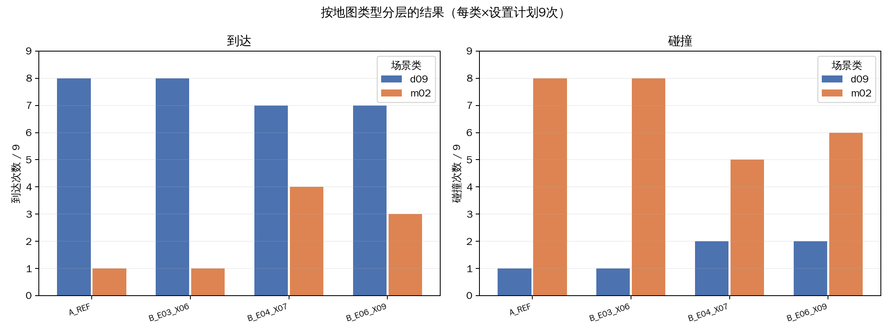
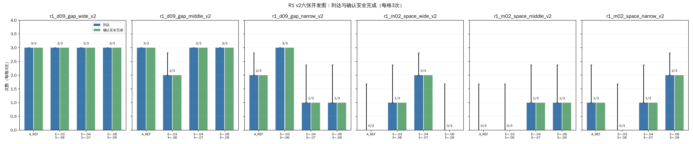
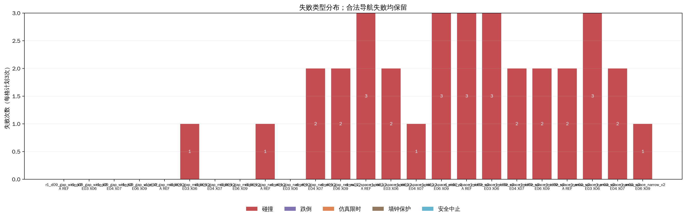
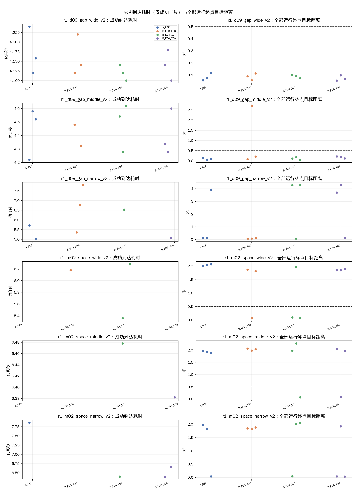
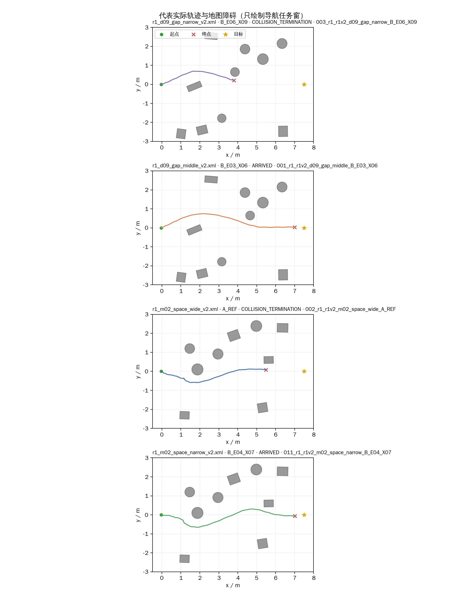
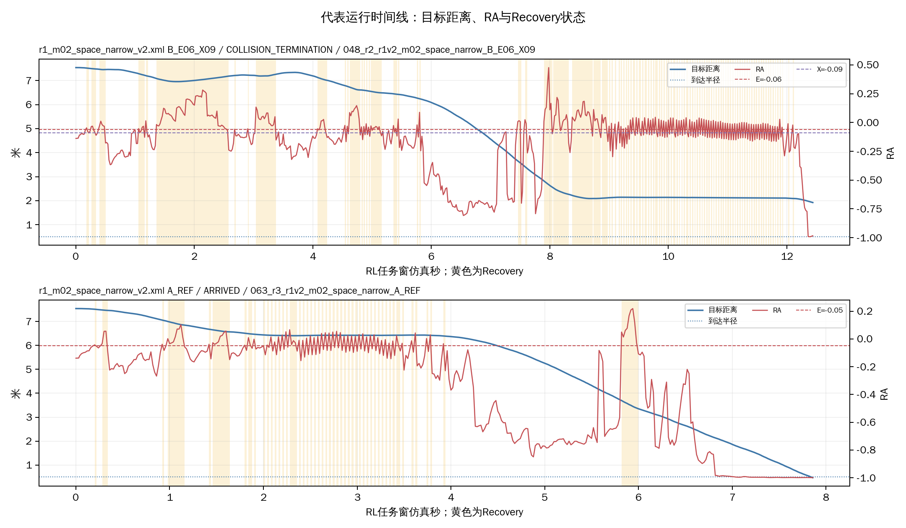

# R1 v2六图×四设置×三次开发比较

本批是按d09连续障碍与m02有限空间分层的开发筛查，不是独立验证。每格仅3次，初始关节状态未严格重放。

## 执行与设置

- 完成记录：72/72；实际场景启动72次，非场景调用0次，补做0次。终局：到达39、碰撞33、跌倒0、仿真限时0、墙钟保护0、安全中止0、其他/UNKNOWN 0。
- 到达后站立观察完成39次；安全完成TRUE 39、FALSE 33、UNKNOWN 0。
- 统一目标(7.5,0)m、半径0.5m、仿真/墙钟上限20/120秒、到达后站立观察2仿真秒；A组E=X=−0.05，B三档按表，H=0。
- 3轮交错排程，种子2026103101；本批占用0.45 GiB。隐藏GLFW、RViz关闭，无截图录像。
- 每项以实际context、控制参数、场景身份、VALID记录及shutdown/closeout字段逐项核对；同环境GLFW预检状态：PASS。运行版本记录见`run_plan.json`。

| 设置 | 组 | E | 有效X | 实际H | 说明 |
|---|---|---:|---:|---:|---|
| A_REF | A | −0.05 | −0.05 | 0 | A参考，单阈值 |
| B_E03_X06 | B | −0.03 | −0.06 | 0 | 双阈值，宽度0.03 |
| B_E04_X07 | B | −0.04 | −0.07 | 0 | 双阈值，宽度0.03 |
| B_E06_X09 | B | −0.06 | −0.09 | 0 | 双阈值，宽度0.03 |

B相对A同时改变E和X，不能把整体差异单独归因于滞回；A的兼容CLI参数不代表启用保持，四组实际H均为0。

## 24格结果

| 地图 | 设置 | 有效/3 | 终局 | 安全完成 T/F/U | 碰撞 | 跌倒 | 仿真限时 | 墙钟保护 | 安全中止 | 到达耗时中位数s（成功n） | 终点距离中位数m | 推进中位数m |
|---|---|---:|---|---:|---:|---:|---:|---:|---:|---:|---:|---:|
| r1_d09_gap_wide_v2 | A_REF | 3/3 | ARRIVED:3 | 3/0/0 | 0 | 0 | 0 | 0 | 0 | 4.16 (n=3) | 0.07 | 7.47 |
| r1_d09_gap_wide_v2 | B_E03_X06 | 3/3 | ARRIVED:3 | 3/0/0 | 0 | 0 | 0 | 0 | 0 | 4.14 (n=3) | 0.09 | 7.45 |
| r1_d09_gap_wide_v2 | B_E04_X07 | 3/3 | ARRIVED:3 | 3/0/0 | 0 | 0 | 0 | 0 | 0 | 4.12 (n=3) | 0.09 | 7.45 |
| r1_d09_gap_wide_v2 | B_E06_X09 | 3/3 | ARRIVED:3 | 3/0/0 | 0 | 0 | 0 | 0 | 0 | 4.14 (n=3) | 0.07 | 7.47 |
| r1_d09_gap_middle_v2 | A_REF | 3/3 | ARRIVED:3 | 3/0/0 | 0 | 0 | 0 | 0 | 0 | 4.52 (n=3) | 0.08 | 7.45 |
| r1_d09_gap_middle_v2 | B_E03_X06 | 3/3 | ARRIVED:2, COLLISION_TERMINATION:1 | 2/1/0 | 1 | 0 | 0 | 0 | 0 | 4.40 (n=2) | 0.20 | 7.33 |
| r1_d09_gap_middle_v2 | B_E04_X07 | 3/3 | ARRIVED:3 | 3/0/0 | 0 | 0 | 0 | 0 | 0 | 4.54 (n=3) | 0.11 | 7.43 |
| r1_d09_gap_middle_v2 | B_E06_X09 | 3/3 | ARRIVED:3 | 3/0/0 | 0 | 0 | 0 | 0 | 0 | 4.34 (n=3) | 0.20 | 7.34 |
| r1_d09_gap_narrow_v2 | A_REF | 3/3 | ARRIVED:2, COLLISION_TERMINATION:1 | 2/1/0 | 1 | 0 | 0 | 0 | 0 | 5.37 (n=2) | 0.10 | 7.44 |
| r1_d09_gap_narrow_v2 | B_E03_X06 | 3/3 | ARRIVED:3 | 3/0/0 | 0 | 0 | 0 | 0 | 0 | 6.78 (n=3) | 0.07 | 7.47 |
| r1_d09_gap_narrow_v2 | B_E04_X07 | 3/3 | ARRIVED:1, COLLISION_TERMINATION:2 | 1/2/0 | 2 | 0 | 0 | 0 | 0 | 6.54 (n=1) | 4.28 | 3.26 |
| r1_d09_gap_narrow_v2 | B_E06_X09 | 3/3 | ARRIVED:1, COLLISION_TERMINATION:2 | 1/2/0 | 2 | 0 | 0 | 0 | 0 | 5.06 (n=1) | 3.70 | 3.84 |
| r1_m02_space_wide_v2 | A_REF | 3/3 | COLLISION_TERMINATION:3 | 0/3/0 | 3 | 0 | 0 | 0 | 0 | UNKNOWN (n=0) | 2.05 | 5.49 |
| r1_m02_space_wide_v2 | B_E03_X06 | 3/3 | ARRIVED:1, COLLISION_TERMINATION:2 | 1/2/0 | 2 | 0 | 0 | 0 | 0 | 6.18 (n=1) | 1.81 | 5.73 |
| r1_m02_space_wide_v2 | B_E04_X07 | 3/3 | ARRIVED:2, COLLISION_TERMINATION:1 | 2/1/0 | 1 | 0 | 0 | 0 | 0 | 5.82 (n=2) | 0.10 | 7.44 |
| r1_m02_space_wide_v2 | B_E06_X09 | 3/3 | COLLISION_TERMINATION:3 | 0/3/0 | 3 | 0 | 0 | 0 | 0 | UNKNOWN (n=0) | 1.85 | 5.69 |
| r1_m02_space_middle_v2 | A_REF | 3/3 | COLLISION_TERMINATION:3 | 0/3/0 | 3 | 0 | 0 | 0 | 0 | UNKNOWN (n=0) | 1.94 | 5.60 |
| r1_m02_space_middle_v2 | B_E03_X06 | 3/3 | COLLISION_TERMINATION:3 | 0/3/0 | 3 | 0 | 0 | 0 | 0 | UNKNOWN (n=0) | 2.04 | 5.50 |
| r1_m02_space_middle_v2 | B_E04_X07 | 3/3 | ARRIVED:1, COLLISION_TERMINATION:2 | 1/2/0 | 2 | 0 | 0 | 0 | 0 | 6.48 (n=1) | 1.97 | 5.57 |
| r1_m02_space_middle_v2 | B_E06_X09 | 3/3 | ARRIVED:1, COLLISION_TERMINATION:2 | 1/2/0 | 2 | 0 | 0 | 0 | 0 | 6.38 (n=1) | 1.97 | 5.57 |
| r1_m02_space_narrow_v2 | A_REF | 3/3 | ARRIVED:1, COLLISION_TERMINATION:2 | 1/2/0 | 2 | 0 | 0 | 0 | 0 | 7.86 (n=1) | 1.82 | 5.71 |
| r1_m02_space_narrow_v2 | B_E03_X06 | 3/3 | COLLISION_TERMINATION:3 | 0/3/0 | 3 | 0 | 0 | 0 | 0 | UNKNOWN (n=0) | 1.85 | 5.69 |
| r1_m02_space_narrow_v2 | B_E04_X07 | 3/3 | ARRIVED:1, COLLISION_TERMINATION:2 | 1/2/0 | 2 | 0 | 0 | 0 | 0 | 6.40 (n=1) | 2.00 | 5.53 |
| r1_m02_space_narrow_v2 | B_E06_X09 | 3/3 | ARRIVED:2, COLLISION_TERMINATION:1 | 2/1/0 | 1 | 0 | 0 | 0 | 0 | 6.53 (n=2) | 0.04 | 7.50 |

## 两类场景分层比较

每类每设置合计9项；下表并列报告到达、确认安全完成、碰撞、跌倒和限时。小样本仅看作开发线索。

| 场景类 | 设置 | 到达/9 | 安全完成TRUE | 碰撞 | 跌倒 | 仿真限时 | 到达耗时中位数s（n） | 终点距离中位数m |
|---|---|---:|---:|---:|---:|---:|---:|---:|
| d09 | A_REF | 8/9 | 8 | 1 | 0 | 0 | 4.38 (n=8) | 0.10 |
| d09 | B_E03_X06 | 8/9 | 8 | 1 | 0 | 0 | 4.40 (n=8) | 0.09 |
| d09 | B_E04_X07 | 7/9 | 7 | 2 | 0 | 0 | 4.28 (n=7) | 0.10 |
| d09 | B_E06_X09 | 7/9 | 7 | 2 | 0 | 0 | 4.28 (n=7) | 0.11 |
| m02 | A_REF | 1/9 | 1 | 8 | 0 | 0 | 7.86 (n=1) | 1.97 |
| m02 | B_E03_X06 | 1/9 | 1 | 8 | 0 | 0 | 6.18 (n=1) | 1.87 |
| m02 | B_E04_X07 | 4/9 | 4 | 5 | 0 | 0 | 6.34 (n=4) | 1.96 |
| m02 | B_E06_X09 | 3/9 | 3 | 6 | 0 | 0 | 6.40 (n=3) | 1.85 |

### m02研究区域路径检查

以03/07两障碍实际轮廓之间的近似横截面x=5.30–5.60m、y=−1.67–0.42m统计任务窗位姿。B组三档进入该区域的运行数为：B_E03_X06 9/9；B_E04_X07 8/9；B_E06_X09 9/9。合计26/27；唯一未进入的是中档B_E04_X07，轨迹在约(x=5.25,y=0.33)m碰03后终止。该检查只说明中心位姿经过区域，不核对整机轮廓净空。

## 结果解读与候选

d09：A_REF与B_E03_X06均为8/9到达，B_E04_X07与B_E06_X09均为7/9。没有设置在d09上超过A；B_E03可作与A表现相近的对照，未显示收益。
m02：A_REF与B_E03_X06均为1/9到达，B_E04_X07为4/9、B_E06_X09为3/9；相应碰撞数为8、8、5、6。E04值得保留为m02局部候选，E06可作次级对照；两者在d09均为7/9，不能称为跨场景改善。每格3次且各档同源，这些结果只作筛查线索。
全部设置18次合并后到达为A_REF 9/18、B_E03_X06 9/18、B_E04_X07 11/18、B_E06_X09 10/18。合计差别主要来自m02，不能证明普遍收益；到达耗时只按成功样本比较且样本数不同。

## 设置总览

| 设置 | 有效/18 | 到达 | 安全完成TRUE/FALSE/UNKNOWN | 碰撞 | 跌倒 | 仿真限时 | 墙钟保护 | 安全中止 | 到达耗时中位数s（成功n） | 终点距离中位数m | Recovery占比中位数 | 切换次数中位数 |
|---|---:|---:|---:|---:|---:|---:|---:|---:|---:|---:|---:|---:|
| A_REF | 18/18 | 9 | 9/9/0 | 9 | 0 | 0 | 0 | 0 | 4.52 (n=9) | 0.98 | 0.13 | 17 |
| B_E03_X06 | 18/18 | 9 | 9/9/0 | 9 | 0 | 0 | 0 | 0 | 4.48 (n=9) | 1.01 | 0.18 | 27 |
| B_E04_X07 | 18/18 | 11 | 11/7/0 | 7 | 0 | 0 | 0 | 0 | 4.62 (n=11) | 0.11 | 0.16 | 20 |
| B_E06_X09 | 18/18 | 10 | 10/8/0 | 8 | 0 | 0 | 0 | 0 | 4.47 (n=10) | 0.21 | 0.15 | 23 |

耗时只比较到达样本，样本数不同，不能据此宣称整体更快。Recovery占比和切换次数仅解释行为，不单独代表效果。六图同源，不视为六个独立环境。

## 图表与代表轨迹

- 
- 
- 
- 
- 
- 

代表轨迹按任务耗时截断，排除终局后站立和收尾段；轨迹用于展示位置，不等于安全或策略可达证明。

## 数据入口与限制

- 逐次表：`逐次运行明细.csv`；地图×设置表：`地图设置汇总.csv`；设置汇总：`设置汇总.csv`。原始批次保存在`logs/09_R1_switch_constraints/r1_v2_threshold_72/20261031_r1_v2_threshold72/`。
- 每格3次属于开发筛查；不能证明通过率、普遍最优或跨地图泛化。A与B同时改变E和X；调度种子只随机顺序，不保证物理初态重放。
- 安全完成、位姿、Recovery及切换字段按现有记录口径保留；缺失指标为UNKNOWN，不据UNKNOWN形成安全结论。
