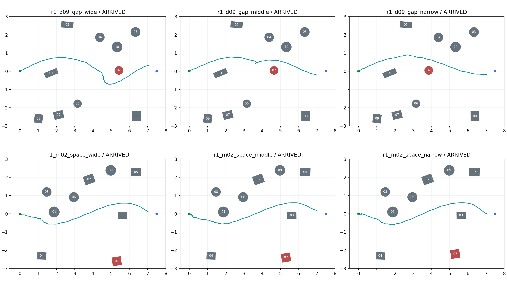

# R1六张地图A组观看结果

日期：2026-10-31。六图各有一次进入策略的有效记录，均ARRIVED；六次站立观察、shutdown和closeout完成。R1保持ACTIVE，等待布局与下一步审阅。单图一次不估计通过率、不比较参数优劣。

## 运行结果

| 地图 | 终局 | 记录 | 终点距离（m） | 站立观察 |
|---|---|---|---:|---|
| r1_d09_gap_wide | ARRIVED | VALID | 0.497 | COMPLETE |
| r1_d09_gap_middle | ARRIVED | VALID | 0.499 | COMPLETE |
| r1_d09_gap_narrow | ARRIVED | VALID | 0.483 | COMPLETE |
| r1_m02_space_wide | ARRIVED | VALID | 0.492 | COMPLETE |
| r1_m02_space_middle | ARRIVED | VALID | 0.488 | COMPLETE |
| r1_m02_space_narrow | ARRIVED | VALID | 0.489 | COMPLETE |

统一使用A组E=X=−0.05，实际H=0、滞回关闭；目标(7.5,0)、到达半径0.5m、20仿真秒/120墙钟秒、到达后2秒站立。CLI的X=−0.06与H=0.30仅是A组未消费的兼容参数，不代表实际启用了滞回或保持。MuJoCo窗口可见、RViz关闭，无截图录像。

## 实际走法与研究价值

- d09宽档从01上侧、02下侧绕行；中档、窄档均从01与02上侧绕行。布局变化下本次走法不同，但三次不是相同初态的严格重放，不能仅凭一次运行认定间距导致路线变化。可保留为布局变化案例，尚不能认定存在稳定的连续交替绕行压力。
- m02三档都从03上侧绕行，x≈5.5m时机身中心y分别约0.581、0.603、0.602m。实际轨迹基本相似，没有穿过03—07之间的局部空隙。本次不支持将它直接当作通道宽度影响的主实验；建议先审阅此问题，再决定是否另提更贴近实际路线的空间模板，不自动加障碍封路。
- 上述判断来自任务终止前的策略位姿采样与布局叠加。截面采样不代表整机足迹和连续时间的精确通道判定。

## 启动问题及更正

1. 旧报告将首批物理循环描述为一直step=0，这不准确。view3完整context的后续观测已达到step=3608、sim_time≈7.216s；实际拒绝字段是runtime_model_fingerprint与全0预期不符。六张新图的登记及layouts.json都曾保留全0占位值。已用现有加载工具得到真实值并补全两处，完成MuJoCo增量构建；未放宽检查。
2. 本轮先修改目录、未同步layouts.json时发生一次无场景设置拒绝；同步后六图设置读取通过，未隐瞒这次遗漏。
3. d09中档首次准备阶段发生仿真时间重置和后续STALE。用户确认误操作；保留该PREPARATION_FAILURE，单独重新运行中档。有效宽档及其他合法终局没有重跑。
4. 本轮实际启动7次：6次进入策略并到达，1次误操作准备失败；另1次设置拒绝未创建场景。此前GLFW及占位登记失败均保留在同一批次，不计入本次六图走法结果。

## 数据解释与环境

- 原手动分析器对d09宽档的任务碰撞和跌倒给出UNKNOWN，其他五次对应字段为False；不能将六次ARRIVED写成六次已确认安全完成。原始cycle0发布时钟限制等问题如实保留，本轮不扩展修复正式分析链。
- 所有到达完成2秒站立观察，六份记录均VALID；VALID不等于安全结论完整。实际配置已从context核对。
- 单独增加--no-rviz参数，使可见MuJoCo不必连带启动RViz；既有--no-window行为保持。没有改变控制逻辑、模型、地图几何或阈值。
- 原始批次位于[运行目录](../../../../../logs/09_R1_switch_constraints/r1_layout_watch_20261031/)，包含历史失败共约52MiB。共享临时overlay约28.06MiB，已清理；没有复制六套模型资源。
- 六次的诊断器均确认清理完成；结束后沙箱外进程核对未发现本次MuJoCo、controller、RViz、ROS启动或诊断器残留。
- [逐图结果](观看结果.csv)及[机器结果](观看结果.json)保留run_id与原始目录。只使用既有记录作图，排除终止后的站立与收尾位姿。未运行后续参数比较，未提交Git。
