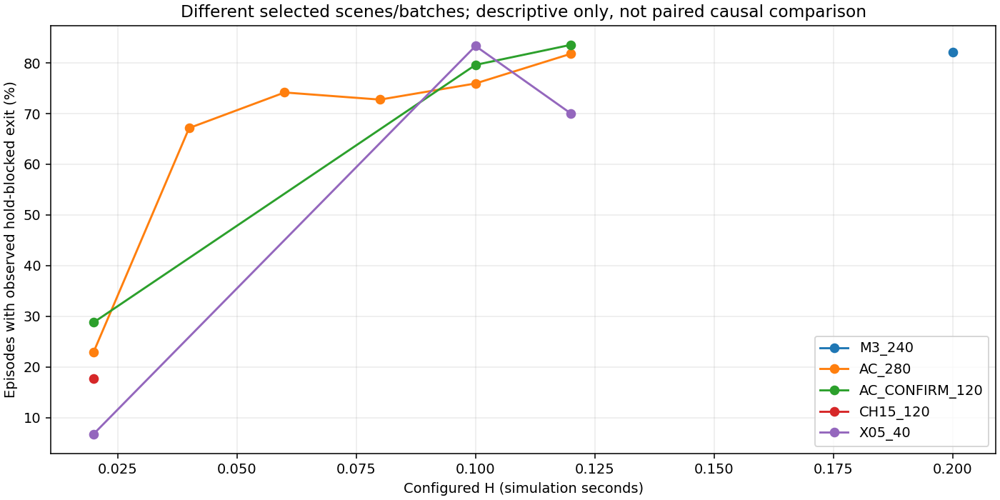

# 阶段一只读核查：Recovery指令更新与切换约束

日期：2026-11-02。归属：R1。性质：已有代码与原始记录的独立派生分析，不修改历史实验结果。

## 1. 审阅结论

**建议继续Periodic方向：进入阶段二的最小实现方案审阅；当前不实施、不启动新运行。**

理由不是“已经证明缓存导致碰撞”，而是已经确认一个可单独检验的问题：当前自动RA路径在Recovery入口优化一次Twist，驻留中使用新的机器人状态计算动作，但不重新优化Twist；指定ABS在线部署版本在满足风险条件的策略周期重新优化。已有记录中确有持续缓存、状态改变、目标距离增加并接近障碍的案例，也有长缓存后仍到达的反例。因此值得比较两种更新方式，但不能宣称Periodic能改善安全或任务。

计算成本仍是未解决的必要条件。现有Go2记录没有独立Twist优化起止时间，不能确定20ms更新是否可行，也不能现在定更新周期。建议下一步只提交一个保留Frozen、可选Periodic、同一优化器的最小方案；计时与更新机会列入其本机验证，不直接上服务器。

另确认两处优化公式差异：当前位移惩罚使用线性位移近似，梯度逐分量裁剪；指定官方部署使用带转率交叉项的位移近似、梯度L2范数裁剪。它们不证明移植错误，也不使内部A/C对照自动无效，但意味着Periodic不能被称作“完整恢复官方算法”。未来若比较更新时间，应保持这些公共优化条件不变，不把多种修改混在一批。

## 2. 范围、版本与数据

计划已按审阅意见修订：[有条件通过的计划](../../../designs/R1/TWIST_SWITCHING_RESEARCH_PLAN_REVIEW_20261102.md)。五阶段顺序不变；本次仅执行阶段一。R1继续ACTIVE，阶段二和后续实验未获本报告自行授权。

### 2.1 参考版本

- 当前仓库HEAD：`e0c322b0e488b12ded2829c393b4891dc864d9ee`。本次读取时`StateRL.cpp`相对HEAD无未提交差异。其他工作区原有修改不作为本次修改或故障处理。
- 主在线参考：LeCAR-Lab/ABS提交`9b95329ffb823c15dead02be620ff96938e4d0a3`的`deployment/src/abs_src/depth_obstacle_depth_goal_ros.py`。已打开对应官方页面；本地ABS与ABS_fuwuqi两份部署文件均与该提交内容相同。
- 辅助参考：同一官方提交的`training/legged_gym/legged_gym/scripts/testbed.py`。本地ABS版本相同，ABS_fuwuqi中的testbed不同，本次不用后者混合推论。
- 该主参考是Go1在线部署，当前是Go2/ROS2/LibTorch移植；模型、平台与执行方式不同，源代码对照不等于运行性能复现。

参考的在线分支在风险满足时执行Twist优化再调用Recovery，未提供当前移植的入口缓存状态机；这是本次确认的更新语义差异。[官方指定版本代码](https://github.com/LeCAR-Lab/ABS/blob/9b95329ffb823c15dead02be620ff96938e4d0a3/deployment/src/abs_src/depth_obstacle_depth_goal_ros.py#L457-L538)

版本和文件一致性结果仅记录一次，见[source_references.json](source_references.json)。没有恢复或审计全部历史提交，不声称800次运行经过逐提交源码复核；已有日志用于确认这些运行的实际入口与驻留行为。

### 2.2 数据覆盖

| 批次 | 原始记录数 | 可确定控制任务窗口 | 边界不足 |
|---|---:|---:|---:|
| M3四组 | 240 | 239 | 1次安全中止 |
| 五图A/C扫描 | 280 | 279 | 1次安全中止 |
| 三图A/C确认 | 120 | 119 | 1次墙钟保护 |
| challenge15六图A/C | 120 | 119 | 1次墙钟保护 |
| 图05四档 | 40 | 40 | 0 |
| 合计 | 800 | 796 | 4 |

全部800条保留在本次[读取清单](run_inventory.csv)，4条缺少完整终止帧/周期边界，不补造其任务窗口，不用于连续事件计算；不改变原来的记录有效性、安全完成或终局。

任务窗口采用原记录的首个活跃周期至持久化终止帧，不含站立观察和收尾。读取到24,591个Recovery片段，其中116个终局截断；全部可分析片段的入口都找到同一仿真时刻的入口Twist日志。日志Twist只打印到两位小数，不冒充完整精度。4个相邻周期区间存在时钟/连续性不足，时间积分跳过并在表中列出。

本次没有读取已转存U盘的旧T1，也不假设原M1被清理的逐帧数据能够恢复。

## 3. Twist控制链：当前执行的到底是什么

完整逐项表见[twist_control_chain.csv](twist_control_chain.csv)。关键代码：[当前控制器](../../../../../quadruped_ros2_control_humble/controllers/rl_quadruped_controller/src/FSM/StateRL.cpp)、[切换语义](../../../../../quadruped_ros2_control_humble/controllers/rl_quadruped_controller/include/rl_quadruped_controller/FSM/RASwitchingLogic.hpp)。

### 3.1 当前Go2自动路径

1. 当前状态与前方射线更新，RA推理（StateRL.cpp:2291–2297）。
2. A/B/C/D共享切换函数按RA、E/X、仿真时间和H决定本周期模式（2344–2366）。
3. 只有`enter_edge`触发Twist优化、保存三个缓存分量并打印入口信息（2385–2398）。
4. Recovery每周期重建49维观测，使用当前接触、角速度、重力、关节状态、上次动作和缓存Twist，重新调用Recovery网络（897–911、2413–2426）。
5. 动作按关节顺序变换、缩放和限幅，生成关节目标并进入现有命令写出链。已知写出不等于MuJoCo消费已得到完整确认，该历史UNKNOWN保留。

因此Frozen冻结的是Twist命令，不是整个Recovery策略动作。机器人转向后，即使缓存的机身坐标分量不变，其世界运动方向也会变，不能只看世界坐标速度符号判断命令过时或后退。

自动路径之外还有手动RL_REC入口在1776行计算Twist；它不是本次A/B/C/D自动批次。reset清除模式和缓存（591–601）。每次新的Recovery入口重新从当时观测初始化优化，不沿用上个片段作为优化初值。

### 3.2 与指定参考的差异及公平性

| 项目 | 指定在线部署 | 当前Go2 |
|---|---|---|
| 主调度 | 策略分支内判断风险，满足时重新优化 | 状态机入口边触发，驻留复用 |
| 风险阈值 | 严格大于−0.05 | 原A/B/C/D共享路径主要使用达到进入阈值；旧stabilized模式另有严格边界 |
| 优化次数 | 每次3轮 | 每次3轮 |
| 初始化、系数、速度界 | 当前速度初始化，指定系数与界 | 同类设置；不能由此认定模型和系统等同 |
| 位移惩罚 | 含速度与转率的交叉项 | 线速度乘tau |
| 梯度裁剪 | 整体范数裁剪 | 分量分别裁剪 |
| Recovery策略调用 | 风险分支替换Agile动作 | 每个Recovery周期推理，Twist缓存 |
| 辅助testbed | 仿真中每步对风险环境优化，10轮 | 不是当前在线3轮、入口缓存路径 |

阈值边界、近似和裁剪差异本次只记录，不改实现，不推定其影响大小。源码中“匹配ROS1 80ms驻留”“避免每8ms重算”等注释，不能替代对指定参考代码和实际周期的核对；本次不把这些注释作为官方存在80ms缓存的证据。

### 3.3 计算成本能确认到什么程度

五个数据批次的逐run策略记录间隔中位数，按批次取中位后均接近20ms；各批次最大单run P95约22.7～31.8ms。这说明当前Frozen记录本身有调度波动，不能以名义50Hz推定新增优化必然可承受。

记录包含风险评价、模式与帧发布时刻，但没有独立GD起止耗时或每次更新成功应用标记；入口Twist日志打印时刻也不是完整计算时间。不能用“风险到发布差”当成GD耗时，不能由Go1脚本的计时变量推定Go2成本。

若阶段二获准，最少需要每次更新的片段身份、仿真时刻/策略周期、优化耗时、成功应用的Twist；已有入口日志可保留，周期更新不要逐步刷长篇日志。不需要新的复杂记录系统。

## 4. H实际作用：哪些退出被挡住

### 4.1 定义

本次逐周期检查：当前仍在Recovery、此前也在Recovery、保持状态为ACTIVE、时钟有效，而且RA已低于实际退出阈值。出现这种周期，记为一次可观测的H退出限制。

- 片段数和周期数直接计数，包括终局帧上可观察到的限制。
- 时间按相邻、同时间段、连续周期之间的实际仿真间隔，用左端观测近似累计；终局以后无时间则不外推。
- 不把“名义H还剩多少”替代实际控制状态持续时间。
- 时间是当前轨迹上观察到的退出限制，不是相对H=0的因果额外驻留。RA之后可能再升高，提前退出也可能改变后续全部状态。
- H到期后RA仍高而继续Recovery的时间单列，不能全算给H。

### 4.2 按批次与H汇总

| 批次/组/H | 片段数 | 出现H限制的片段 | 受限周期 | 受限时间近似(s) | 到期后RA仍高的时间近似(s) |
|---|---:|---:|---:|---:|---:|
| AC_280/C/0.02 | 1772 | 407 | 407 | 8.186 | 51.234 |
| AC_280/C/0.04 | 1388 | 932 | 1274 | 25.602 | 58.048 |
| AC_280/C/0.06 | 960 | 712 | 1543 | 30.796 | 39.946 |
| AC_280/C/0.08 | 892 | 649 | 1958 | 39.082 | 41.496 |
| AC_280/C/0.1 | 873 | 663 | 2421 | 48.458 | 39.776 |
| AC_280/C/0.12 | 841 | 688 | 3033 | 60.662 | 30.952 |
| AC_CONFIRM_120/C/0.02 | 1528 | 440 | 440 | 8.880 | 58.126 |
| AC_CONFIRM_120/C/0.1 | 922 | 734 | 2709 | 54.186 | 35.562 |
| AC_CONFIRM_120/C/0.12 | 846 | 707 | 3233 | 64.718 | 32.394 |
| CH15_120/C/0.02 | 1820 | 322 | 327 | 6.252 | 27.730 |
| M3_240/C/0.2 | 860 | 706 | 4761 | 94.858 | 30.434 |
| M3_240/D/0.2 | 729 | 546 | 3266 | 65.074 | 50.472 |
| X05_40/C/0.02 | 59 | 4 | 4 | 0.068 | 2.594 |
| X05_40/C/0.1 | 42 | 35 | 105 | 2.072 | 0.920 |
| X05_40/C/0.12 | 30 | 21 | 84 | 1.666 | 0.860 |

分母包含可观察到的删失片段，但不补未观察时长；不同批次场景不同，不能将表中比例差直接归因于H。逐图、逐片段与删失见[逐图表](hold_effect_by_scene.csv)、[片段表](recovery_episode_observations.csv)。

### 4.3 三个重要解释

1. **H=0.02并非没有作用，但机会依赖场景。** 三图确认中440/1528个片段出现限制（28.8%），图05新40项只有4/59（6.8%）。后者很难仅靠延长一个极短保持改变大量决策。
2. **离散周期与浮点边界值得说明。** 三图H=0.02的440个受限周期中，363个的记录elapsed与H相差小于1μs；源码直接比较浮点时间是否达到H。某些差值略小于H时保持仍ACTIVE，下一周期才观察到到期，符合既有实际驻留中位数约0.04s。这说明有效限制常受离散采样及严格时间比较影响，不能简单把H=.02称为“完全无约束的一周期”。本轮不修正或放宽比较，不将它独立定为收益不稳定的原因。
3. **更长H增加限制，不代表收益增加。** 最新图05的H=.10/.12分别在35/42、21/30个片段出现限制，仍没有超过同期A的到达计数。这里的周期定义包括删失终点，和旧报告按完整退出片段统计的34、20可能不同，不追改旧报告。

最新六图H=.02的本次322个受限片段与旧报告“321个到期前RA转低片段”采用不同周期/删失口径；本次记录到327个直接受限周期，不能把两种指标混写。复用旧审计定义与本次直接周期统计分开保存，没有重新给旧实验选参。

## 5. 碰撞与推进：不把时间接近写成原因

### 5.1 事件与对齐

从物理碰撞历史按开始步和障碍名去重，并限制在已确认控制任务窗口内，共得到378条物理接触事件，来自376次碰撞终局运行；有两次运行各涉及额外事件，不把事件数当失败运行数。其余非碰撞终局不凭旧累计事件算碰撞。

记录最后前帧、第一后帧、最近Recovery入口与出口、退出到碰撞的间隔，以及退出后是否已再次进入Recovery。前帧到物理事件的时间差中位约10ms，最大40ms；不存在把所有事件说成严格同步的依据。

若物理事件落在前后模式不同的策略帧之间，分类为无法确定。分类描述的是采样所支持的模式区间，不证明当时某条命令已被MuJoCo消费。保留最后采样模式，便于与旧报告的“最近帧”统计对照，但不混为同一口径。

| 批次 | Recovery内部（前后记录支持） | 退出后Agile | 模式跨帧无法确定 | 事件总数 |
|---|---:|---:|---:|---:|
| M3_240 | 18 | 27 | 4 | 49 |
| AC_280 | 20 | 111 | 15 | 146 |
| AC_CONFIRM_120 | 11 | 43 | 4 | 58 |
| CH15_120 | 23 | 40 | 30 | 93 |
| X05_40 | 6 | 17 | 9 | 32 |

其中127条事件在最近一次退出之后、碰撞之前已经重新接管，不能再仅因存在最近退出就称“退出后Agile碰撞”。上述可分析事件中未发现“此前从未Recovery”的类别；边界不足的4条运行不支持这一判断，不能外推所有历史失败。

完整事件表：[collision_progress_cases.csv](collision_progress_cases.csv)。本次严格对齐统计与历史仅用最近前帧的21次M3 Recovery碰撞等统计不同，不覆盖历史分类或正式终局。

### 5.2 六个代表案例

按事件类别及是否构成反例选取，规则在分析脚本末段，未运行新模型或比较Periodic反事实。

| 案例 | 已观察事实 | 能说明什么、不能说明什么 |
|---|---|---|
| M3 challenge18 / D，run 50f413… | 当前Recovery约0.088s，最近RA≈−0.287，H=.20未到期，缓存vx≈−.57；最近一次退出后已重新接管。前帧差8ms。 | 存在H限制退出时的后退碰撞情形；只缩短周期更新不保证来得及改变，不能认定缓存过时。 |
| M3 challenge01 / D，run c50aa3… | 驻留约1.06s，H已过，RA≈.379仍高；缓存约[−.30,.30,−.46]，最近约1s净目标距离增加.289m，中心到碰撞物轮廓由约.455降到.180m，朝向变化约−.316rad。 | 同一Twist在状态改变时持续使用，值得比较重优化；但不能证明新Twist一定不同或更安全。单纯再延长H不会改变当时RA不允许退出。 |
| M3 challenge08 / D，run d8f0c4… | 驻留约.428s，RA≈.183，H已过；同一Twist下朝向变化约.308rad，中心净空由.519降至.290m，同时仍向目标净推进约.158m。 | 推进与靠近障碍可同时发生，不宜把所有近障碍前进都当成无效动作；可作更新与避障权衡案例。 |
| M3 challenge13 / A，run 25e0cf… | 最近退出后约.068s碰撞，期间未再接管，最后RA≈−.144。 | 是明确的近期退出邻接案例，但不证明退出导致碰撞；也不能与已经重新接管的事件混类。 |
| AC_280 challenge27 / C H=.04，run 1f6bc9… | 一个约.70s片段缓存[−1.07,−.30,−.03]，该段净目标距离增加约.466m；整次终局为仿真限时。 | 有长缓存和推进不足共存，值得检验更新；退让也可能是必要避障，不能由净退后直接定指令有害。 |
| M3 challenge24 / D，run b51797… | 有2.378s缓存片段，朝向变化约.659rad，该段净目标推进约.018m，整次最终到达。 | 长缓存、旋转或短期推进很小并不必然失败，是防止选择性解释的反例。 |

Twist为机身坐标、日志仅两位小数。中心到障碍轮廓距离按真实圆柱/旋转箱体计算，不是障碍中心距离，也不是整机足迹净空。碰撞可能发生在腿或机身外缘，中心仍有正距离不意味着记录矛盾。

[代表案例明细](representative_cases.csv) · [图1：保持内与到期后碰撞](cases_1.png) · [图2：转向与退出邻接](cases_2.png) · [图3：推进不足与成功反例](cases_3.png)。

## 6. 地图几何与同源关系

本次涉及37张已存在地图：30张M3、R1 m02中档和六张challenge15变体。没有生成、修改或按本次结果剔除地图。见[几何与来源表](scene_geometry_sources.csv)及[原障碍参数](geometry_obstacles.json)。

- M3来源经过历史表现筛选，部分与M1/M2同源；它不是独立新分布。
- 六张challenge15图的共同母图是challenge15，其更早来源为d02。六图只改变03前后位置，共同新增11、外移09；不能算六个独立模板。
- 六图现行记录均为左绕，但这只是实际中心轨迹分类，不证明新增11完全封右侧，更不证明所有左侧运动安全。
- 原图04/09等侧障与03构成局部转向空间。03沿x移动既改变02—03关系，也改变它到目标和其他障碍的关系，不能将六图结果单独解释为Recovery结束时机。
- 图05新40项32次碰撞全在03；其中既有Agile也有Recovery最近帧，且H=.02实际限制机会很少。继续小幅移动同一物体或扩大H网格，难以单独辨别Twist更新作用。
- 几何间隙适合用于定义局部条件，不能保证当前感知与策略具有全局绕行能力；未来不应把无全局规划的死胡同作为仅靠切换必须解决的任务。

## 7. 阶段二前的最小建议

建议提交一个**可选择Frozen/Periodic、仍使用同一当前Go2优化器**的方案审阅。它回答的是更新时点的作用，不是“纠正全部ABS复现差异”。两处优化公式差异本轮不顺手修正；若未来要恢复公式，应另立共同变更并重新明确对照。

方案应只明确：入口初始化；固定周期重算；采用最新状态；退出后重置；每次成功应用的Twist与必要耗时记录。周期现在不定，不直接默认20ms。更新前退出的片段比例、实际每段入口/周期更新次数要按H分别报告，否则长H可能只是增加了接受更新的机会。

之后的小批次仍优先A/C×Frozen/Periodic四条件，共同E与固定C的H，不以A-Frozen对C-Periodic替代完整对照。B/D暂不加入，也不重开H搜索。H值与更新周期须由阶段二方案解释并另审，不自动选择图05或仅选本次碰撞案例。

计算成本、真实新Twist是否改变运动和任务改善，都还没有被本次只读分析验证。报告建议继续的是有限、可证伪的对照设计，不是直接实施或保证收益；审阅器仍可决定缩小问题或结束方向。

## 8. 已知限制、校核和收尾

- 当前源码、指定参考与入口日志能证明路径差异；不能证明动态重优化会给出更好解，也不能用已有Frozen轨迹模拟真实Periodic结果。
- 无独立GD耗时、无每周期完整精度Twist字段；按入口日志和源码可重建当前片段缓存到两位小数，但不能还原完整优化梯度或证明MuJoCo消费。
- 4条任务边界不足运行单列，4个不完整周期区间不积分；删失片段不外推。各批次统计只描述现有选定数据，不作独立样本推断或显著性宣告。
- 净推进使用固定目标与world_pose计算，绕行路径长度另列，没有沿用可能将路径长度描述为推进的历史字段命名。
- 新派生分类采用前后帧对齐，允许UNKNOWN，未更改原metrics、终局、安全完成或旧分析文件。
- 离线脚本先适配了旧记录缺少safety_terminal_boundary、少数终止帧为空的真实格式差异；使用持久化任务终止帧定义当前控制窗口，边界不明则保留UNKNOWN，不通过默认时间绕过。受限时间统计区分真实周期状态与理想H剩余值，未修改控制器。
- 核对800条清单、796个可分析窗口、24,591个片段、378个事件来自376次碰撞终局，所有可分析片段均有唯一对应入口Twist日志；没有把事件数当运行数，也没有将历史数据合并排名。
- 本轮仅修订计划并新增派生分析脚本、表和4张图。未运行MuJoCo/ROS/controller或策略推理，没有本轮仿真进程需要关闭；离线分析和绘图已退出。未修改控制代码、参数、地图或原始记录，未清理数据、未提交Git。R1仍ACTIVE，不标记整个研究完成。

## 交付索引

- [计划修订版](../../../designs/R1/TWIST_SWITCHING_RESEARCH_PLAN_REVIEW_20261102.md)。
- [控制链对照](twist_control_chain.csv)、[源代码版本](source_references.json)。
- [逐图H作用](hold_effect_by_scene.csv)、[批次H汇总](hold_effect_summary.csv)、[逐Recovery片段](recovery_episode_observations.csv)。
- [碰撞事件与推进](collision_progress_cases.csv)、[六个代表案例](representative_cases.csv)。
- [地图几何与来源](scene_geometry_sources.csv)、[运行读取清单](run_inventory.csv)。
- [只读分析脚本](analyze_existing_records.py)。
