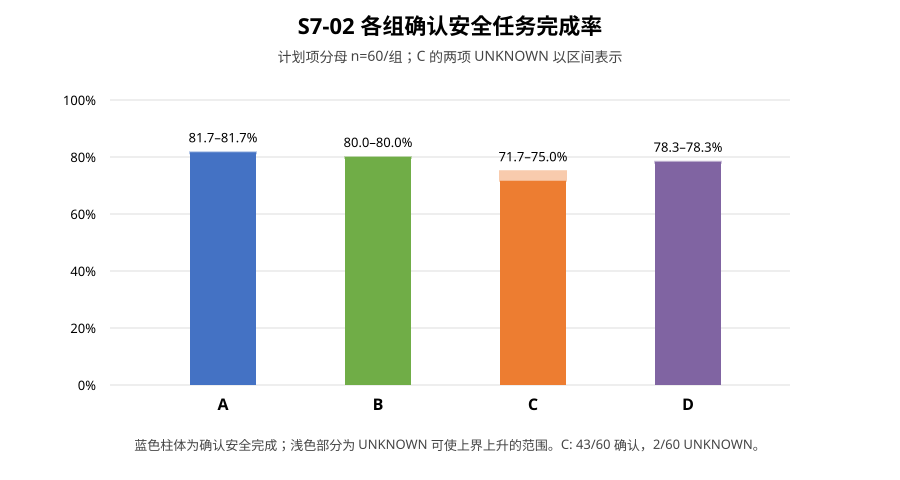

# S7-02 正式实验执行与分析报告

> **数据可用性更新（2026-10-23）：**本报告记录实验完成时由统一分析器从原始记录生成的结果。之后逐帧JSONL及ROS详细日志按[数据精简说明](DATA_RETENTION_20261023.md)清理；汇总、台账、终局事实、图表及部分gzip上下文/指标仍保留，但当前不能从逐帧原始数据完整重算时间序列。报告中的历史结果和当时运行记录保持原样。

日期：2026-10-23。批次：`s7-abcd240-20261023`。状态：240 个冻结计划项全部运行，S7-02 保持 **ACTIVE**，提交 Director 审阅。

## 执行结果

按冻结矩阵顺序完成全部 240 个计划项，A/B/C/D 每组各 60 项。总实际场景启动 241 次：基础计划启动 240 次，加上获批的 S7-001 唯一一次工程替代。该替代与首次 attempt 绑定，首次启动因 GLFW 初始化失败退出码 1、没有策略帧；替代以 ARRIVED 结束。两次都保留在可靠性账中，未超过 252 次上限。批次状态 `COMPLETE`，台账审计 `PASS`，无未派发计划项。

首次启动故障发生在 holdout08 / B 的 S7-001：MuJoCo 日志记录 `ERROR: could not initialize GLFW`。获批替代在可访问 `DISPLAY=:0` 的同一执行环境完成。除该已批准替代外，没有重跑合法碰撞、跌倒或超时等研究终局。

## 三层结果与组别

冻结分析器从原始记录重算，计划项主结果为：187 项确认安全完成，51 项确认未完成，2 项安全完成状态 UNKNOWN；没有未启动或未解决工程项。全实际启动账为 240 个有效任务结果和 1 个基础设施启动失败（S7-001 原始 attempt）。首次实际启动敏感性不选用替代成功结果，因此为 186 项确认安全完成、51 项确认未完成、2 项 UNKNOWN、1 项未启动（首发启动失败）。

| 组 | 确认安全完成 | 已知未完成 | UNKNOWN | 按全部计划项计的安全完成率范围 |
|---|---:|---:|---:|---:|
| A | 49/60 | 11 | 0 | 81.7% |
| B | 48/60 | 12 | 0 | 80.0% |
| C | 43/60 | 15 | 2 | 71.7%–75.0% |
| D | 47/60 | 13 | 0 | 78.3% |

碰撞终止 31 项、仿真时限 20 项、墙钟保护未完成 2 项；没有跌倒终局。足端事件另作并列指标统计。2 项 UNKNOWN 都在 C 组，未把 UNKNOWN 计成 False 或 0。

## 主指标、机制交互与代价

主要对比均为地图等权差值；区间为以地图为簇的 10,000 次 bootstrap 95% 区间，种子 `2026102002`。无确认性 p 值检验。

| 指标（越高越好，除注明） | B−A | C−A | D−B | D−C | 交互 (D−C)−(B−A) |
|---|---:|---:|---:|---:|---:|
| 确认安全完成率（百分点） | −1.7 [−13.3, 11.7] | −10.0 [−25.0, 5.0] | −1.7 [−6.7, 3.3] | +6.7 [−1.7, 15.0] | +8.3 [−6.7, 23.3] |
| 0.5 秒短反向切换（次/有效分钟，越低越好） | −29.5 [−81.9, 18.6] | −113.9 [−177.9, −61.2] | −91.2 [−132.7, −53.3] | −6.8 [−14.4, 1.7] | +22.7 [−24.2, 73.6] |
| Recovery 占比 | +1.6 [−0.0, 3.2] 个百分点 | +5.3 [2.9, 7.7] 个百分点 | +3.2 [1.3, 5.2] 个百分点 | −0.4 [−2.4, 1.7] 个百分点 | −2.0 [−4.2, 0.4] 个百分点 |

滞回 B 相对 A 的安全完成率差值很小且不确定；C 相对 A 的切换频率降低，同时完成率偏低、任务耗时增加约 2.0 秒（地图簇区间约 +1.2 至 +2.9 秒）。加入滞回的 D 相对 C，切换频率点估计再降约 6.8 次/有效分钟，但区间跨 0，安全完成率点估计增加 6.7 个百分点，区间也跨 0。交互区间跨 0，不能据此宣称机制存在确定的协同增益。

并列代价：D−B 仿真超时率增加 5.0 个百分点（bootstrap 区间 0 至 10）；碰撞率差值为 −3.3 个百分点（区间 −10.0 至 +3.3）。C 的任务完成率区间受 2 项 UNKNOWN 影响，所有 UNKNOWN 数学情景界详见比较 CSV；情景界不是置信区间。到达子集耗时和共同到达耗时只作条件结果，不能解释成整体加速。无综合分排名。

## 时钟、版本、清理与限制

严格决策时钟重建应用于全批；本批需重建的运行数为 0，安全分类和时序敏感性均无变化。原始 STALE/年龄等数据继续保留。MuJoCo 命令消费仍按既有证据保持 UNKNOWN。

批次清单记录代码提交 `26e7b5381759bb9a0ac97efc2c6fd2ba559c58e6`、模型、主要配置及运行/分析器版本；实验期间未修改冻结参数、地图或控制逻辑。批次预算为 6 GiB、保护线 15 GiB；结束可用空间约 56 GiB。`/proc` 核对没有本批 MuJoCo、诊断器、controller/ROS 或 RViz 进程残留，正式运行环境已关闭。

这些是原M1冻结测试集地图分布上的本科毕设机制对照结果，不声称参数全局最优，也不用于再次选择参数或证明一般环境泛化。结果由 Director 审阅后再判断 S7-02 是否完成；S7 整体保持未完成。实验完成时无训练、实机运行、数据删除或 Git 提交；后续数据精简见报告顶部说明。

## 结果文件

批次保留记录、首次 GLFW 失败、替代 attempt、台账及配置见[批次目录](../../../../logs/08_formal_experiment/S7_ABCD_240/s7-abcd240-20261023/)；逐帧记录的后续清理范围见本报告顶部说明。冻结分析器输出与三层台账见[formal_summary](../../../../logs/08_formal_experiment/S7_ABCD_240/s7-abcd240-20261023/analysis/formal_summary/)，其中包括逐计划项CSV、首次启动敏感性、全部实际启动分类、组间比较、重建敏感性及JSON汇总。
