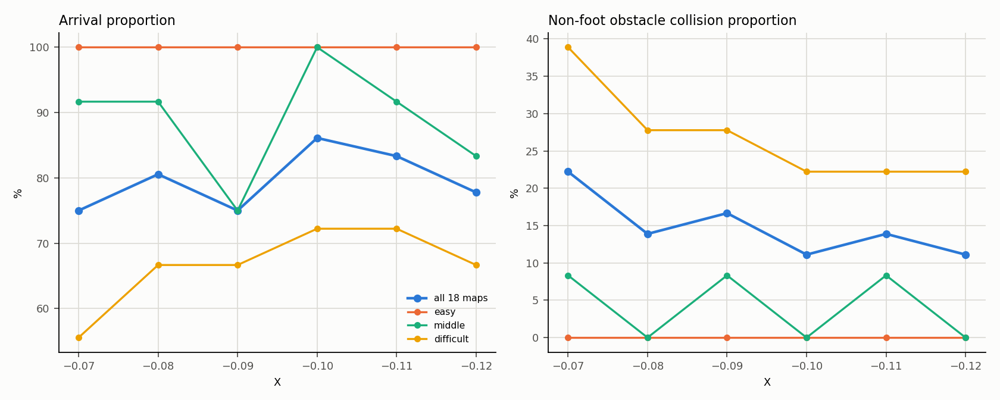
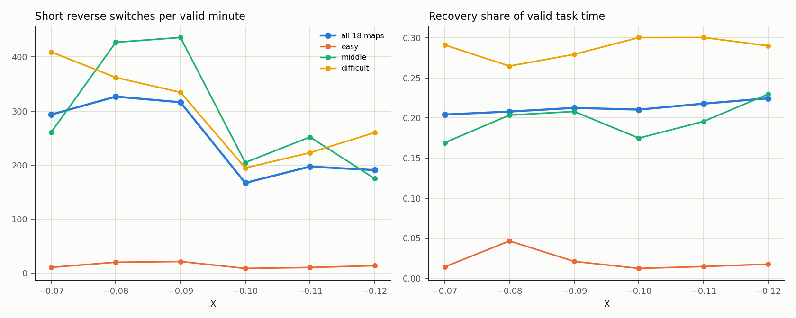
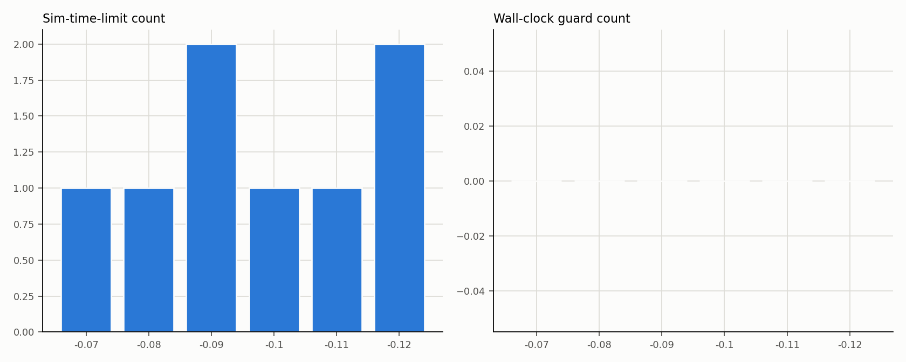

# T1 新版M2六档退出阈值216项局部扫描执行报告

**审阅后状态：T1 COMPLETE（Director有条件通过，用户同意，2026-10-18）。216/216有效任务记录，退出阈值开发选参结束。固定后续B/D研究的代表值E=−0.05、X=−0.10；本轮不修改部署配置，不启动新实验。**

通过范围为当前开发扫描的记录/分析与代表参数选择，不是正式A/B/C/D验证、总体成功率、统计非劣效或全局最优结论。候选段规范写为[−0.11,−0.10]，仅指两个已测档。Recovery占用/驻留增加、足端撞击增多、d05退化、速度未证明改善、约81%短时重入、初态/抽样/样本量、其他档跌倒及UNKNOWN限制保留。详见[代表参数与选择边界](../../../designs/T1/EXIT_THRESHOLD_SELECTION.md)。当前没有已授权Active Task，T2尚未建立。

下文保留技术执行报告和原提交阶段的结论快照；其中“等待审阅/保持ACTIVE”描述当时状态，不覆盖上述完成结论。原始数据和历史派生分析未修改。

## 1. 范围与冻结条件

执行依据：[216项执行提示词](../../../T1_M2_LOCAL_SCAN_216_EXECUTOR_PROMPT.md)。运行前已冻结[方法](FROZEN_METHOD_216.md)。

| 项目 | 固定值 |
|---|---|
| 地图 | 当前 M2 e01–e03、m01–m06、d01–d09，共18图 |
| 来源 | `designs/M2/selected_v2/scene_index.csv` 与 `layouts.json`；m01 为 r5 修改版 |
| 组别 | 全部 B，保持关闭 |
| E | −0.05 |
| X | −0.07、−0.08、−0.09、−0.10、−0.11、−0.12 |
| 次数 | 每图每档2次；每档36次；共216项 |
| 目标 / 半径 | (7.5, 0) m / 0.5 m |
| 时限 | 20仿真秒 / 120墙钟秒 |
| 站立观察 | 站稳后2仿真秒；独立墙钟保护30秒 |
| 显示 | 隐藏GLFW、`start_rviz:=false`、无截图/视频 |
| 调度种子 | 2026101801 |
| Bootstrap | 地图成簇，10000次，种子2026101802 |

18图按历史表现有目的选择，easy/middle/difficult = 3/6/9（17%/33%/50%），困难图占比高；这个比例不代表一般环境分布，也不代表总体成功率。地图未因结果重新分层，未使用留出集。

## 2. 准备与定向核验

- 复用已验证的 `manual_ab_compare.py → s1_run_diagnostic.py` 生产链；新增 `scripts/manual_t1_m2_local_scan_216.py` 负责冻结计划、恢复和串行派发。
- 216项键（地图、重复、X）唯一；每档36次；108个地图×阈值格各2次；全36个地图块中每档在六个顺序位置各出现6次；第一轮六种循环位移各3个地图块；第二轮每图反转第一轮档序。计划内已保存 `schedule.verification`。
- 六个独立 B overlay（X=−0.07…−0.12）逐一通过生产配置校验；不共用可变配置。
- 每项显式使用 `--groups B --repeats 1 --entry-threshold -0.05 --exit-threshold <X> --standing-observation-sim-s 2 --sim-limit-s 20 --wall-cap-s 120 --goal-x 7.5 --goal-y 0 --no-window --disable-framebuffer-capture`。
- 216/216 实际消费为 B / E=−0.05 / 对应 X / `hold=false`；216/216 的 MuJoCo 日志为 `requested=hidden visible=0`；216/216 的 ROS 启动命令含 `start_rviz:=false`；未生成 framebuffer 图片。
- 2秒站立观察：180个适用 run 实测 2.000–2.024 仿真秒；36个碰撞/跌倒 run 为 `NOT_REACHED_OR_UNKNOWN`。
- 记录一次代码/生产阶段：Git `929c704bfcdb4429c138ea7a6aa658198015eaed`；MuJoCo、controller 库、ABS/Recovery 模型和18图 XML 哈希保存在计划中。
- 试跑报告已按提示词更正：m02 的100次短反向改为“到达运行中最高（全部18项中 d07 为121次）”；d07 退出 RA=−0.538 仅作时间邻接记录，不认定为退出阈值原因。

## 3. 执行结果

- 计划216项，有效任务结果216项；记录有效性 `VALID` 216/216。
- 确认场景启动216次；工程补做0次；纯编排错误0次；未超过220次上限。
- cycle 0 捕获216/216；首个活跃策略周期精确持久化216/216；策略周期缺口0、无效时钟帧0；任务窗口安全覆盖完整216/216；base_link 物理步界内216/216、越界步0；shutdown/closeout 216/216 确认。
- 终局：**ARRIVED 172、COLLISION_TERMINATION 33、DIAGNOSTIC_SIM_TIME_LIMIT 8、FALL_TERMINATION 3、WALL_CLOCK_GUARD_INCOMPLETE 0**。
- 批次约2.1 GB，低于4 GiB预算；可用磁盘约51 GB，高于15 GiB保护线。最终 runner、MuJoCo、ROS/controller、RViz 和辅助进程扫描为空。

## 4. 六档总体结果（18图地图等权）

| X | 有效 | 到达 | 非足端碰撞终止 | 跌倒 | 仿真时限 | 墙钟 | 到达率 | 碰撞率(已知) | 短反向/有效分钟 | Recovery占比 | 总切换/run | 辅助分 |
|---:|---:|---:|---:|---:|---:|---:|---:|---:|---:|---:|---:|---:|
| −0.07 | 36 | 27 | 8 | 0 | 1 | 0 | 75.0% | 22.2% | 293.3 | 20.4% | 52.4 | 68.2 |
| −0.08 | 36 | 29 | 5 | 1 | 1 | 0 | 80.6% | 13.9% | 326.7 | 20.8% | 57.7 | 72.5 |
| −0.09 | 36 | 27 | 6 | 1 | 2 | 0 | 75.0% | 16.7% | 316.2 | 21.3% | 63.7 | 69.2 |
| **−0.10** | 36 | **31** | **4** | 0 | 1 | 0 | **86.1%** | **11.1%** | **167.0** | 21.1% | **30.6** | **78.0** |
| **−0.11** | 36 | **30** | **5** | 0 | 1 | 0 | **83.3%** | **13.9%** | **197.1** | 21.8% | **33.1** | **75.4** |
| −0.12 | 36 | 28 | 5 | 1 | 2 | 0 | 77.8% | 11.1% | 190.7 | 22.5% | 43.3 | 75.0 |

完整108格见 [`map_threshold_108.csv`](map_threshold_108.csv)；逐run见 [`per_run_results.csv`](per_run_results.csv)。

口径补充：表中−0.12的非足端碰撞率11.1%是按地图等权、各地图已知样本计算，另有1条分类UNKNOWN；最不利情景为13.9%。该档的`COLLISION_TERMINATION`终局为5/36（13.9%），与非足端分类指标不是同一口径，不能把UNKNOWN计为False，或将11.1%当作与−0.10同等完整的证据。候选判断使用情景分析，−0.12另因确认跌倒不进入推荐。

## 5. 分层结果

| 层 | X | 到达/有效 | 到达率 | 碰撞率 | 跌倒 | 仿真时限 | 短反向/有效分钟 | Recovery占比 | 辅助分 |
|---|---|---:|---:|---:|---:|---:|---:|---:|---:|
| easy | −0.07 | 6/6 | 100% | 0.0% | 0 | 0 | 10.7 | 1.4% | 95.3 |
| easy | −0.10 | 6/6 | 100% | 0.0% | 0 | 0 | 8.7 | 1.2% | 95.4 |
| easy | −0.11 | 6/6 | 100% | 0.0% | 0 | 0 | 10.4 | 1.5% | 95.3 |
| middle | −0.07 | 11/12 | 91.7% | 8.3% | 0 | 0 | 260.5 | 16.9% | 81.7 |
| middle | −0.10 | 12/12 | 100% | 0.0% | 0 | 0 | 204.6 | 17.5% | 88.8 |
| middle | −0.11 | 11/12 | 91.7% | 8.3% | 0 | 0 | 251.8 | 19.6% | 81.1 |
| difficult | −0.07 | 10/18 | 55.6% | 38.9% | 0 | 1 | 409.3 | 29.1% | 50.2 |
| difficult | −0.10 | 13/18 | 72.2% | 22.2% | 0 | 1 | 194.6 | 30.0% | 65.0 |
| difficult | −0.11 | 13/18 | 72.2% | 22.2% | 0 | 1 | 222.9 | 30.0% | 64.9 |

- 总体改善主要来自 difficult 层的到达率提高和碰撞率下降，不是把困难层退化掩盖成总体改善。
- easy 层全部到达、无碰撞；短反向频率本身很低（8.7–21.5/有效分钟），−0.10 相对参考下降18.7%，略低于20%，但3图样本不足以单独判断。
- middle 层 −0.10 为12/12到达、0碰撞；−0.11 与参考同为11/12、8.3%碰撞，短反向下降仅3.3%，该层未达到20%参考。

完整3层×6档共18行见 [`layer_summary_18.csv`](layer_summary_18.csv)；层内只有3/6/9个地图簇，层内差异不作为显著优劣结论。

## 6. 与参考 X=−0.07 的差值（地图成簇 bootstrap 95%区间）

差值方向：到达/碰撞为百分点；短反向为每有效分钟次数。区间为同一重抽地图集合上的配对差值，10000次，seed 2026101802。

| X | 到达差值(pp) | 95%区间 | 碰撞差值(pp，最不利情景) | 95%区间 | 短反向差值(/min) | 95%区间 |
|---:|---:|---|---:|---|---:|---|
| −0.08 | +5.6 | [−5.6, 19.4] | −8.3 | [−25.0, 5.6] | +33.4 | [−64.7, 140.9] |
| −0.09 | 0.0 | [−19.4, 19.4] | −5.6 | [−22.2, 11.1] | +22.9 | [−125.6, 201.3] |
| **−0.10** | **+11.1** | **[0.0, 22.2]** | **−11.1** | **[−22.2, 0.0]** | **−126.3** | **[−175.9, −79.4]** |
| **−0.11** | **+8.3** | **[−8.3, 22.2]** | **−8.3** | **[−22.2, 8.3]** | **−96.1** | **[−167.0, −27.3]** |
| −0.12 | +2.8 | [−16.7, 22.2] | −8.3 | [−27.8, 11.1] | −102.6 | [−191.4, 4.4] |

区间很宽（18个地图簇，easy仅3簇），不能把点估计过门槛写成统计显著或非劣效；也不能把区间含0写成等效。

## 7. 候选可接受段与代表值

按冻结规则：任务容忍度（到达下降≤5pp、碰撞上升≤5pp）、无任务期确认跌倒、短反向频率相对参考下降≥20%，并要求连续至少两个相邻离散档。

| X | 到达pp | 碰撞pp | 短反向相对变化 | 跌倒 | 任务筛选 | 切换改善 | 资格 |
|---:|---:|---:|---:|---:|---|---|---|
| −0.07 | 0.0 | 0.0 | 0% | 0 | 参考 | 否 | 参考 |
| −0.08 | +5.6 | −8.3 | +11.4% | 1 | 是 | 否 | 否 |
| −0.09 | 0.0 | −5.6 | +7.8% | 1 | 是 | 否 | 否 |
| **−0.10** | **+11.1** | **−11.1** | **−43.1%** | **0** | **是** | **是** | **候选** |
| **−0.11** | **+8.3** | **−8.3** | **−32.8%** | **0** | **是** | **是** | **候选** |
| −0.12 | +2.8 | −11.1 | −35.0% | 1 | 是 | 是 | 否（跌倒） |

**候选段：X = [−0.11, −0.10]**。这一段只代表已采样的离散网格，不声称 −0.105 等未测数值也已证明鲁棒。

**代表值：X = −0.10。** 该段为偶数档，两个中间值按冻结规则优先较窄滞回（X更接近E）取 −0.10；同时 −0.10 在总体和逐图上都比 −0.11 更一致（见下节）。

### −0.10 的代价

- 到达率 86.1%（参考75.0%），非足端碰撞 11.1%（参考22.2%），短反向 167.0/min（参考293.3），总切换 30.6/run（参考52.4），Recovery退出 15.25/run（参考26.14）。
- Recovery占比 21.1%（参考20.4%，+0.6pp）；单次Recovery驻留均值0.147s、中位0.080s、p90 0.340s（参考0.081/0.022/0.200s）——退出次数少了，但单次驻留更长，不能称为“更稳定的不退出”。
- 足端撞击总次数20（参考16），−0.11为13。
- 地图等权到达时间8.53s（参考8.19s）；同图同重复都到达的选择性配对差均值+0.109s（24对），即略慢，但成功子集不同。
- 辅助分78.0（参考68.2）。

## 8. 逐图退化与“总体掩盖”检查

−0.10：d05 有1/2次从到达变为碰撞（到达−0.5、碰撞+0.5，该图短反向仍−56.6%）；d02、d03、d06、d09、m06 各有1/2次改善；其余地图到达/碰撞不变。−0.10 没有其他地图的到达下降或碰撞上升。少数地图（e02、e03、m02）短反向频率相对参考略升，但幅度小。

−0.11：d01、d05、m05 各有1/2次到达下降并转为碰撞；d01 短反向频率相对参考 **+177.3%**，m01 +26.2%、m02 +23.4%、m06 +26.0%、e03 +24.5%。因此 −0.11 的总体改善确实掩盖了若干地图的切换退化和三个地图的单次任务退化；这是选择 −0.10 而非 −0.11 的主要理由。

| 地图 | 层 | X | 到达差值(run比例) | 碰撞差值(run比例) | 短反向相对变化 |
|---|---|---|---:|---:|---:|
| d05 | difficult | −0.10 | −0.5 | +0.5 | −56.6% |
| d01 | difficult | −0.11 | −0.5 | +0.5 | +177.3% |
| d05 | difficult | −0.11 | −0.5 | +0.5 | −63.4% |
| m05 | middle | −0.11 | −0.5 | +0.5 | −47.7% |
| m06 | middle | −0.11 | +0.5 | −0.5 | +26.0% |
| m01 | middle | −0.11 | 0.0 | 0.0 | +26.2% |
| m02 | middle | −0.11 | 0.0 | 0.0 | +23.4% |
| e03 | easy | −0.11 | 0.0 | 0.0 | +24.5% |

完整逐图差值见 [`map_deltas_vs_ref.csv`](map_deltas_vs_ref.csv)，108格见 [`map_threshold_108.csv`](map_threshold_108.csv)。

## 9. 安全、失败与UNKNOWN

### 跌倒（3次，均为任务期确认）

| 地图 | X | 重复 | run_id | 任务时长(s) | 终止距目标(m) |
|---|---:|---:|---|---:|---:|
| m06 | −0.08 | 2 | `342fae095af14e4692a4e43ff42371f4` | 3.98 | 2.84 |
| m06 | −0.12 | 2 | `d566b85eae224665aea6ab754c733588` | 3.84 | 2.78 |
| m04 | −0.09 | 2 | `a614629336dd4b3393f7d8c5f3b04894` | 3.80 | 2.58 |

三次均为 `FALL_TERMINATION`，不是碰撞或超时；−0.10 和 −0.11 没有任务期确认跌倒。−0.08、−0.09、−0.12 因跌倒不进入自动代表值推荐；单次事件不能宣布真实风险概率。

### 碰撞上下文

33次碰撞中，碰撞前最后策略帧状态为 AGILE 25次、RECOVERY 8次；24/33在碰撞前0.5s内有一次 Recovery→Agile 退出；没有“完全未触发Recovery”的碰撞。策略帧与物理碰撞终止相差约0–18ms，时间邻接不等于退出阈值因果；未触发Recovery的碰撞单列为0，不假定由退出阈值解决。完整表见 [`collision_context.csv`](collision_context.csv)。

### UNKNOWN

`d01 / X=−0.12 / repeat1` 的终局为 `COLLISION_TERMINATION`，原始事件为 RL_calf 接触 `ppt_obstacle_05`，但 `nonfoot_collision_failure=UNKNOWN`；不补成False，也不当作0碰撞。该档另有1次跌倒，本来就不进入代表值推荐。其余215项非足端碰撞/跌倒字段为True或False。

### 足端、越界与覆盖

足端撞击总数：−0.07 16、−0.08 17、−0.09 13、−0.10 20、−0.11 13、−0.12 17。所有216项 base_link 物理步越界增量为0；这只说明base_link点，不是整机足迹。安全覆盖216/216完整；一个非足端分类UNKNOWN如上。

## 10. 切换、Recovery驻留与重入

| X | 总切换/run | Recovery进/出/run | Recovery占比 | 退出后0.5s内重入比例 | 驻留均值s | 驻留中位s | 驻留p90 s |
|---:|---:|---:|---:|---:|---:|---:|---:|
| −0.07 | 52.4 | 26.1/26.1 | 20.4% | 81.5% | 0.081 | 0.022 | 0.200 |
| −0.08 | 57.7 | 28.9/28.9 | 20.8% | 86.0% | 0.071 | 0.020 | 0.198 |
| −0.09 | 63.7 | 31.9/31.8 | 21.3% | 79.7% | 0.066 | 0.020 | 0.180 |
| **−0.10** | **30.6** | **15.3/15.3** | 21.1% | 81.5% | 0.147 | 0.080 | 0.340 |
| **−0.11** | **33.1** | **16.6/16.5** | 21.8% | 81.4% | 0.132 | 0.042 | 0.320 |
| −0.12 | 43.3 | 21.6/21.6 | 22.5% | 76.5% | 0.113 | 0.040 | 0.280 |

−0.10/−0.11 减少了总切换、Recovery退出次数和短反向，但Recovery占比略升、单次驻留更长；不能把“少退出”直接解释成稳定性改善。短反向频率按有效任务时间计算；提前碰撞/跌倒会截断观察，失败run的低切换数不视为改善。退出后0.5秒内重入比例与参考接近（约81%），说明退出后短时再进入仍常见。完整驻留表见 [`recovery_residence.csv`](recovery_residence.csv)。

## 11. 到达时间与选择性配对

- 地图等权成功到达时间：−0.07 8.19s、−0.10 8.53s、−0.11 7.95s；成功子集不同。
- 同图同重复都到达的配对差（X − 参考）：−0.10 均值+0.109s（24对，中位+0.055s）；−0.11 均值−0.039s（24对，中位+0.200s）。负值表示该X更快；不能被解释为总体加速。
- 非到达 run 不伪造到达时间。完整配对表见 [`paired_arrival_time_diff.csv`](paired_arrival_time_diff.csv)。

## 12. 初态、记录与收尾

- 216/216 cycle 0 实测初态捕获，含具名关节q/dq、姿态、位置/速度和同周期身份；cycle0 的仿真时间范围6.024–11.95s，重复号不等于严格初态重放。现有入口没有可控初态种子，未声称同图同重复完全一致。
- 216/216 `record_validity=VALID`；216/216 实际配置来源确认；216/216 首个活跃策略周期精确持久化；周期缺口0、无效时钟0；任务窗口安全覆盖完整；shutdown/closeout确认；最终进程扫描为空。
- 隐藏GLFW仍依赖 `DISPLAY=:0` / `XAUTHORITY=/run/user/1000/gdm/Xauthority` / OpenGL context，不是真正无X11的headless；GLFW预检 PASS，renderer为 Mesa Intel (RPL-P)，窗口已关闭。
- 批次约2.1GB；磁盘可用约51GB。未删除旧数据、未录视频/截图。

## 13. 分析重建说明

自动分析第一次因某个 run 的 `foot_impact_count` 是字符串 `UNKNOWN` 在聚合阶段失败；第二次成功生成主体表，但 `collision_context.csv` 因键名前缀重复而为空。两次都只涉及派生分析，未改动任何原始场景记录，也未重跑场景。修正数值规范化和键名前缀后重新生成全部分析产物；最终计划状态为 `COMPLETE`，分析重建记录保存在 `m2_local_scan_216_plan.json` 的 `analysis_recovery` 字段。

## 14. 结论与限制

- 本轮支持把 **X=−0.10 至 −0.11** 作为已采样离散网格上的候选可接受段；代表值建议 **X=−0.10**，备选 −0.11。
- −0.10 的任务表现、碰撞和切换点估计均优于参考；但Recovery占比、单次驻留和足端撞击略增，地图等权到达时间略慢，且d05有一次运行退化。它不是“全面更优”，而是当前开发数据上的工程折中。
- −0.11 的总体指标也过门槛，但逐图退化更多（d01/d05/m05各一次任务退化，多个middle/easy图短反向变差），因此不作为首选代表值。
- −0.12 有1次确认跌倒，不能因为总体碰撞率低而进入自动推荐；−0.08/−0.09也有跌倒且切换变差。
- 置信区间较宽，不能声称统计显著、非劣效或全局最优；5个百分点门槛是工程筛选容忍度，不是统计证明；每个离散档36次，一次约2.78个百分点、两次约5.56个百分点。
- 困难层和高风险地图占比高，本批比例不代表一般环境；地图×阈值108格中每格仅2次，不能估计可靠成功率。
- 原40/30/20/10评分只是辅助，不替代安全审查；任务期无碰撞/跌倒的False结论只适用于覆盖完整的任务窗口，不外推到整机足迹或实机。
- 本批结束后按提示词停止自动退出阈值搜索：不新增扫描、不启动留出验证、保持时间实验或正式对照，等待Director审阅。

## 15. 通俗总结

216次运行全部完成，都有有效记录：172次到达、33次碰撞、8次到20仿真秒仍未到达、3次跌倒，没有墙钟超时。相对 X=−0.07，X=−0.10 和 −0.11 这两个相邻档同时满足“到达不明显变差、碰撞不明显增加、短反向至少减少20%”，因此形成一个候选段 [−0.11, −0.10]。按规则取代表值 X=−0.10：到达率86.1%（参考75.0%），非足端碰撞11.1%（参考22.2%），短反向167次/有效分钟（参考293.3），总切换和Recovery退出也明显减少。代价是Recovery占比略升、单次驻留更长、足端撞击20次（参考16次）、到达时间略慢；d05有一次运行从到达变成碰撞。−0.11 总体也不错，但有三个地图各一次任务退化，且多个地图短反向变差，所以不作首选。−0.12 虽然切换改善，但有1次确认跌倒，按规则不能进入自动推荐。所有原始记录、失败和UNKNOWN都保留；仿真、ROS/controller、RViz和辅助进程已退出。T1保持ACTIVE，等待Director审阅，不提交Git。
