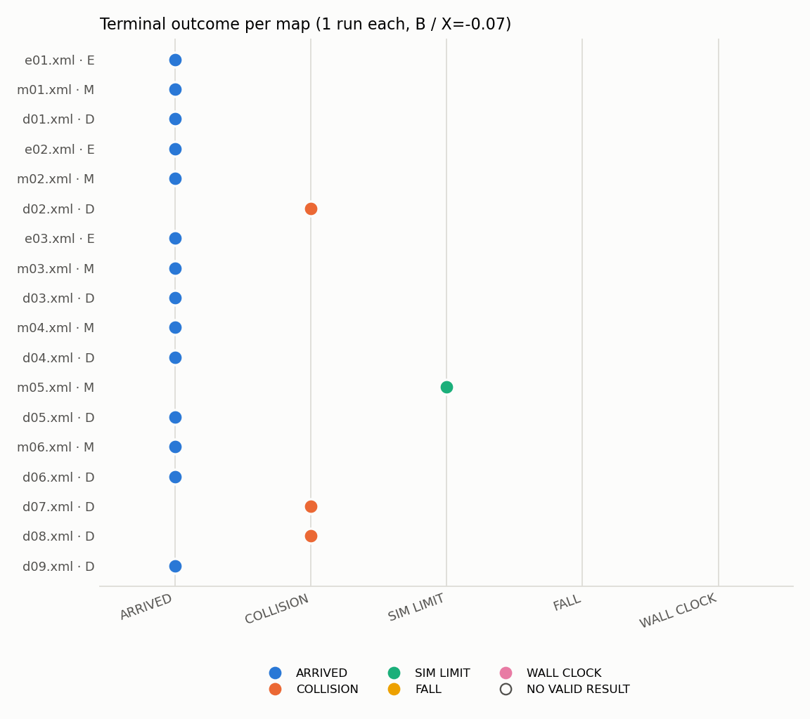
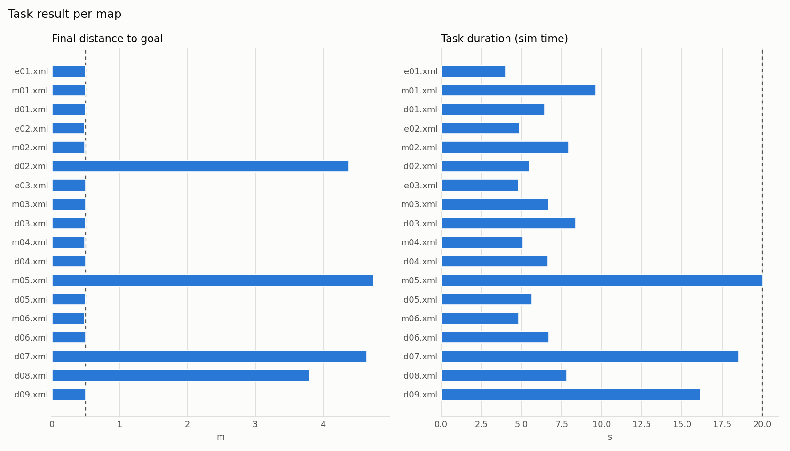
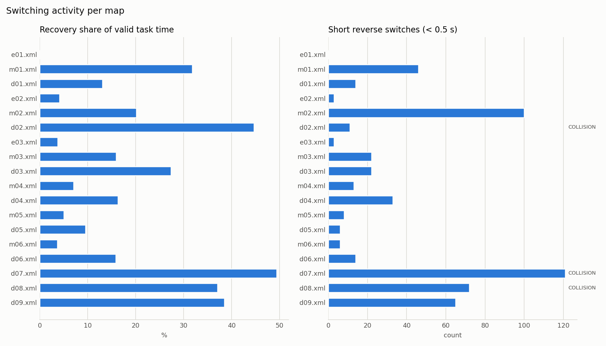

# T1 新版M2 18图B组无窗口单次诊断执行报告

**状态：本轮 18/18 计划项均有有效任务结果；批次 `COMPLETE`。T1 仍为唯一 ACTIVE，等待 Director 审阅。本批为非正式地图诊断，不用于成功率、阈值优劣或正式性能结论。**

## 1. 本轮范围与固定条件

执行依据：[18图试跑提示词](../../../T1_M2_18_MAP_SMOKE_PROMPT.md)。仅使用 `designs/M2/selected_v2/scene_index.csv` 与 `layouts.json` 的当前 18 图（e01–e03、m01–m06、d01–d09），串行顺序固定为 e01、m01、d01、e02、m02、d02、e03、m03、d03、m04、d04、m05、d05、m06、d06、d07、d08、d09。

| 项目 | 冻结值 |
|---|---|
| 组别 | 全部 B |
| 进入阈值 E | −0.05 |
| 退出阈值 X | −0.07 |
| 最小保持 | 关闭 |
| 目标 / 到达半径 | `(7.5, 0)` m / 0.5 m |
| 任务上限 | 20 仿真秒 / 120 墙钟秒 |
| 到达后站立观察 | 2 仿真秒 / 30 墙钟秒独立保护 |
| 每图次数 | 1 |
| 显示 | 隐藏 GLFW；`start_rviz:=false`；不拍图/录像 |

地图身份、目标、场地边界和物理侧边界 `x=[−0.5,8.0]`、`y=[−3,3]` 来自 selected_v2 元数据；每项 XML 哈希与生产 catalog 一致。未修改地图几何、障碍、控制/安全阈值、切换逻辑、启动增益或终止判据。未运行 216 次参数扫描，未使用留出集。

## 2. 最小接入与定向核验

### 2.1 生产诊断器的 M2 元数据接入

此前 `s1_run_diagnostic.py` 只对 `scene_id` 以 `m1` 开头的场景加载布局元数据；`m2v2_*` 场景会在没有场地边界、也不做目标/时限校验的情况下继续。为确保本次 18 图诊断不是静默降级，做了单点最小接入：

- 新增 `resolve_map_manifest()`，`m2v2_*` 场景按 `scene_id`/文件名唯一匹配 `designs/M2/selected_v2/layouts.json`；
- 校验 `m2-selected-development/2.1` 版本、easy/middle/difficult 标签、源地图、生产 catalog 的 `root_sha256`、`closure_sha256`、`model_fingerprint`、障碍数量、目标 `(7.5,0)`、20/120 秒时限和场地边界；
- 身份/目标不符在运动前以 `M2_SELECTED_SCENE_SETTINGS_REJECTED` 拒绝；
- 运行上下文记录正确的 `m2-selected-development/2.1`、难度、源数据集/源文件、旧别名、布局修订和声明边界；不再把 M2 记录写成 M1 版本；
- 场地边界继续通过 `ABS_FIELD_BOUNDS_*` 传入 MuJoCo，并在 RL 前做 base-bounds gate。

M1 路径行为不变。离线核验：18/18 新图绑定成功；M1 `dev01.xml` 仍绑定 `m1-mapset/1.0`；错误目标或时限在 M1/M2 两条路径均被拒绝；`build_env` 对 M2 场景正确传入场景 ID、边界和隐藏窗口变量。

`layouts.json` 中 m02、d01、d02、d03 的 `layout_revision` 为 `null`，本批如实记为 UNKNOWN，没有补造修订号；m01 记为 `m2dev04-r5-20261018`。

### 2.2 批次入口与显示

新增轻量可恢复 runner `scripts/manual_t1_m2_smoke_18.py`，逐项调用既有生产链 `manual_ab_compare.py` → `s1_run_diagnostic.py`。每项显式使用：

```text
--groups B --repeats 1 --entry-threshold -0.05 --exit-threshold -0.07
--standing-observation-sim-s 2 --sim-limit-s 20 --wall-cap-s 120
--goal-x 7.5 --goal-y 0 --no-window --disable-framebuffer-capture
--classification "新版M2 18图B组单次地图诊断，非正式实验"
```

未复用旧 400/144 项计划模板，未叠加历史恢复 flag 或写死旧 attempt 计数。计划、参数、初始状态、attempt 台账和图表位于[批次目录](../../../../../logs/01_T1_exit_threshold/m2_map_smoke_18/20261018_154940_m2v2_18/)。

### 2.3 版本记录

批次计划记录一次：Git `929c704bfcdb4429c138ea7a6aa658198015eaed`；`common/abs_scene_catalog.def` SHA-256 `1d3eeb59…`；MuJoCo 生产二进制 `librl_quadruped_controller.so`、ABS/Recovery 模型与选图索引的哈希。生产 MuJoCo 二进制包含全部 18 个 `m2v2_*` 身份；运行时版本 3.3.3。

### 2.4 编排修正（未创建场景）

本轮启动前出现两次 runner 侧编排错误，均在 MuJoCo/ROS 启动前退出，明确未创建场景，不消耗 18 次场景额度：

1. 首次调用误传 `--standing-observation-wall-cap-s`，`manual_ab_compare.py` 在参数解析阶段退出（退出码 2）；该错误已作为纯编排事件记入计划，未计为场景启动。
2. 修复后第二次恢复在重分类 helper 中触发 `NameError`，同样发生在预检/场景启动前；该次未持久化，属于第二次有界修正。

两次修正后正式批次从 e01 开始连续执行。正式批次确认场景启动 18 次、工程补做 0 次，未超过 20 次总上限。此后没有再次改代码；运行期间已固定的控制、安全、模型和地图语义未变。

## 3. 执行结果

18/18 计划项均有 `VALID_TASK_RESULT`，记录有效性均为 `VALID`；18 项均确认实际消费 `group=B`、`E=−0.05`、`X=−0.07`（float32 记录为 −0.070000000298）、`hold=false`。cycle 0 实测初态 18/18 捕获，首个活跃策略周期 18/18 精确持久化；策略周期缺口 0，无效时钟帧 0；任务窗口安全覆盖 18/18 完整；base_link 物理步边界观察 18/18 在声明边界内。

| 终局 | 数量 |
|---|---:|
| ARRIVED | 14 |
| COLLISION_TERMINATION | 3 |
| DIAGNOSTIC_SIM_TIME_LIMIT | 1 |
| FALL_TERMINATION | 0 |
| WALL_CLOCK_GUARD_INCOMPLETE | 0 |
| **有效任务结果合计** | **18** |







完整逐 run 指标见 [`run_results.csv`](run_results.csv)；契约/显示核验见 [`contract_and_display_check.csv`](contract_and_display_check.csv)；碰撞上下文见 [`collision_context.csv`](collision_context.csv)。

| # | 地图 | 难度 | 来源 | run_id | 终局 | 记录 | 到达距离m | 任务s | 路径m | 频率Hz | 周期缺口/无效钟 | Recovery进/出 | 占用% | 短反向 | 足端撞击 | 非足端碰撞 | 跌倒 | 越界步 | 覆盖 | 站立2s | 清理 |
|---|---|---|---|---|---|---|---|---|---|---|---|---|---|---|---|---|---|---|---|---|---|
| 1 | e01.xml | easy | M1:dev01.xml | 2a62f7489cf440209c0942cb7123c8f4 | ARRIVED | VALID | 0.489 | 4.02 | 7.31 | 50.26 | 0/0 | 0/0 | 0.0 | 0 | 0 | False | False | 0 | True | COMPLETE | True/True |
| 2 | m01.xml | middle | M2:m2dev04.xml | ecb6dc6c8eef4084aec6b61341951f7a | ARRIVED | VALID | 0.493 | 9.62 | 8.23 | 50.13 | 0/0 | 25/25 | 31.8 | 46 | 2 | False | False | 0 | True | COMPLETE | True/True |
| 3 | d01.xml | difficult | M2:m2dev03.xml | 75ef29a4b4a149bd810cdba6f96100a1 | ARRIVED | VALID | 0.493 | 6.44 | 7.80 | 50.18 | 0/0 | 8/8 | 13.0 | 14 | 1 | False | False | 0 | True | COMPLETE | True/True |
| 4 | e02.xml | easy | M1:dev12.xml | d9f1ba0503f7472f88835abcd8cc7839 | ARRIVED | VALID | 0.479 | 4.86 | 7.52 | 50.28 | 0/0 | 2/2 | 4.1 | 3 | 0 | False | False | 0 | True | COMPLETE | True/True |
| 5 | m02.xml | middle | M2:m2dev06.xml | 5df9fca6ff444dfd817aa08e2198df4a | ARRIVED | VALID | 0.487 | 7.94 | 7.63 | 50.15 | 0/0 | 51/51 | 20.2 | 100 | 0 | False | False | 0 | True | COMPLETE | True/True |
| 6 | d02.xml | difficult | M2:m2dev05.xml | bc38312bed064c85931bfb505a2aa1f1 | COLLISION_TERMINATION | VALID | 4.383 | 5.50 | 4.10 | 50.30 | 0/0 | 7/6 | 44.7 | 11 | 0 | True | False | 0 | True | NOT_REACHED_OR_UNKNOWN | True/True |
| 7 | e03.xml | easy | M1:dev22.xml | 5b28d70b3fb646d7aec3fee45d062dcc | ARRIVED | VALID | 0.496 | 4.80 | 7.67 | 50.25 | 0/0 | 2/2 | 3.7 | 3 | 0 | False | False | 0 | True | COMPLETE | True/True |
| 8 | m03.xml | middle | M1:dev13.xml | f4f6a8d0fcda40efad227d968c8f17da | ARRIVED | VALID | 0.499 | 6.66 | 7.72 | 50.20 | 0/0 | 12/12 | 15.9 | 22 | 0 | False | False | 0 | True | COMPLETE | True/True |
| 9 | d03.xml | difficult | M2:m2dev02.xml | 5ef759e319f24eedbc24d21dcd268173 | ARRIVED | VALID | 0.490 | 8.38 | 8.87 | 50.13 | 0/0 | 13/13 | 27.3 | 22 | 0 | False | False | 0 | True | COMPLETE | True/True |
| 10 | m04.xml | middle | M1:dev17.xml | 1ccd7a6339e2451f92372d8890a84432 | ARRIVED | VALID | 0.487 | 5.08 | 7.48 | 50.25 | 0/0 | 7/7 | 7.0 | 13 | 0 | False | False | 0 | True | COMPLETE | True/True |
| 11 | d04.xml | difficult | M1:dev03.xml | f4f07c86bec74622858cd5db007baeba | ARRIVED | VALID | 0.499 | 6.64 | 7.47 | 50.17 | 0/0 | 18/18 | 16.3 | 33 | 0 | False | False | 0 | True | COMPLETE | True/True |
| 12 | m05.xml | middle | M1:dev26.xml | 7e3bae4908a04eb5afb1c960fdba0a0a | DIAGNOSTIC_SIM_TIME_LIMIT | VALID | 4.742 | 20.02 | 3.46 | 50.07 | 0/0 | 5/5 | 5.0 | 8 | 0 | False | False | 0 | True | COMPLETE | True/True |
| 13 | d05.xml | difficult | M1:dev04.xml | f7dfab08bf9d4bed8da226e24f2ee55f | ARRIVED | VALID | 0.491 | 5.66 | 7.81 | 50.23 | 0/0 | 4/4 | 9.5 | 6 | 0 | False | False | 0 | True | COMPLETE | True/True |
| 14 | m06.xml | middle | M1:dev29.xml | af5e52581fe24cfeb033d920bd378593 | ARRIVED | VALID | 0.474 | 4.84 | 7.69 | 50.25 | 0/0 | 4/4 | 3.7 | 6 | 0 | False | False | 0 | True | COMPLETE | True/True |
| 15 | d06.xml | difficult | M1:dev08.xml | ab8014075052448383e00adc1805fab8 | ARRIVED | VALID | 0.495 | 6.70 | 8.30 | 50.17 | 0/0 | 8/8 | 15.8 | 14 | 0 | False | False | 0 | True | COMPLETE | True/True |
| 16 | d07.xml | difficult | M1:dev11.xml | 1afa93c4f34f43e0a0802320daea11bf | COLLISION_TERMINATION | VALID | 4.645 | 18.54 | 9.16 | 50.09 | 0/0 | 64/64 | 49.4 | 121 | 0 | True | False | 0 | True | NOT_REACHED_OR_UNKNOWN | True/True |
| 17 | d08.xml | difficult | M1:dev19.xml | 274a7a8d38a04695a1c9dcc8ae83e30b | COLLISION_TERMINATION | VALID | 3.798 | 7.82 | 4.64 | 50.17 | 0/0 | 37/37 | 37.1 | 72 | 2 | True | False | 0 | True | NOT_REACHED_OR_UNKNOWN | True/True |
| 18 | d09.xml | difficult | M1:dev24.xml | f877888ecc994a7583a741ddbfc45796 | ARRIVED | VALID | 0.497 | 16.14 | 10.98 | 50.08 | 0/0 | 35/35 | 38.4 | 65 | 2 | False | False | 0 | True | COMPLETE | True/True |

表中“到达距离”对未到达 run 是终止时距目标距离，不是到达；`占用%` 为 Recovery 有效任务时间占比。所有 18 项任务窗口碰撞/跌倒覆盖完整；`False` 只表示该覆盖窗口内未确认，不代表全采集或实机安全。

## 4. m01 修改版专项

m01 对应修改后的原 M2 dev04 r5（`layout_revision=m2dev04-r5-20261018`），本批实际完成：

- cycle 0 实测初态捕获，首个活跃策略周期精确持久化；
- 进入 RL 后连续运行，任务时长 9.622 仿真秒，路径 8.231 m，策略频率 50.13 Hz；
- 终局 `ARRIVED`，距目标 0.4931 m；
- 任务窗口碰撞/跌倒均为 False，覆盖完整；足端撞击 2 次；
- Recovery 进入/退出 25/25，Recovery 时间占比 31.8%，短反向 46 次；
- 到达后完成 2.000 仿真秒站立观察，controller 进入 FIXEDSTAND，进程清理确认。

这证明该修改图在本轮条件下可以正常起立、进入 RL 并运行到目标；单次结果不等于统计可达性，也不证明修改后的几何对所有阈值/初态都更安全。

## 5. 碰撞 run 的原始记录检查

三次碰撞均来自 PhysicsLoop 的机器人—障碍接触事件，任务窗口安全覆盖完整。下表用碰撞前最后一个策略帧和最近一次 Recovery→Agile 边沿描述上下文；策略帧与物理碰撞时刻相差 0–18 ms，存在采样错位，不能把相关性写成退出阈值因果。

| 地图 | 碰撞对象 / 机体 | 物理区间 (sim s / step) | 碰撞前最后策略帧 | 最后帧状态 | 最后帧 RA | RA≥E | 最近 Recovery→Agile | 距碰撞 | 该次最后一次退出时 RA |
|---|---|---|---|---|---|---|---|---:|---:|
| d02 | `ppt_obstacle_09` / `FL_hip` | 14.118–14.122 / 7059–7061 | 14.118 | RECOVERY | 0.355 | True | 12.318 | 1.802 s | −0.133 |
| d07 | `ppt_obstacle_01` / `RR_calf` | 25.270–25.276 / 12635–12638 | 25.252 | AGILE | −0.333 | False | 25.132 | 0.138 s | −0.538 |
| d08 | `ppt_obstacle_01` / `RL_calf` | 14.180–14.188 / 7090–7094 | 14.168 | AGILE | −0.837 | False | 13.626 | 0.554 s | −0.085 |

- d02：碰撞发生在 Recovery 状态内，RA 仍高于进入阈值；该段之前已有 124 个 Recovery 策略帧，不是“刚从 Recovery 退出”导致的碰撞。障碍 09 与 FL_hip 的接触需结合布局和 Recovery 动作复核。
- d07：碰撞前 0.138 秒刚从 Recovery 退出，退出时 RA=−0.538，最后帧 RA=−0.333，均低于 X=−0.07；同时该 run 有 64 次 Recovery 进入/退出和 121 次短反向，切换活动很高。时间上接近退出边沿，但不能据此断言退出阈值造成碰撞。
- d08：碰撞前 0.554 秒退出 Recovery，退出时 RA=−0.085（接近 X=−0.07 但未越过），最后帧 RA=−0.837；接触为 `ppt_obstacle_01` 与 RL_calf。

以上为单次运行的实际记录；未插值超出策略帧和物理步的精确模式，也不把“记录显示进入/退出”写成“MuJoCo 已消费命令”。

## 6. 2 秒站立观察、隐藏窗口与 RViz

- 15 个 run 记录了站立观察块（14 个 ARRIVED + m05 的受控仿真时限收尾）：请求 2.0 仿真秒，实测 2.000–2.016 仿真秒，全部 `complete=true`；3 个碰撞 run 为 `NOT_REACHED_OR_UNKNOWN`，不适用。
- 18/18 的 MuJoCo 日志均有唯一 `[MUJOCO-WINDOW] backend=GLFW requested=hidden visible=0` 行；renderer 为 Mesa Intel Graphics (RPL-P)。
- 18/18 的 ROS 启动命令实际包含 `start_rviz:=false`；批次未启动 RViz。
- 未生成 `live_panel.ppm`/`standing_hold.ppm`，未拍图或录像。
- 隐藏 GLFW 仍使用 `DISPLAY=:0`、`XAUTHORITY=/run/user/1000/gdm/Xauthority` 和 OpenGL context，不是真正无 X11 的 headless；GLFW 预检为 PASS，并与场景运行使用同一执行上下文。
- 保持原生产 PhysicsLoop、射线、碰撞/跌倒/越界累计、实时同步、频率和安全门；未采用全速物理循环或替代 probe。

## 7. 清理、存储与结论边界

- 最终 runner 已退出（PID 不再存在），MuJoCo、controller/ROS launch、RViz、采集器和查询/命令进程扫描为空；每个 run 的 `shutdown_complete` 与 `closeout_complete` 均为 True。
- 批次占用约 181 MB，低于 1 GiB 预算；文件系统可用约 54 GB，高于 15 GiB 保护线。未删除历史数据。
- 本批每图 1 次，不能估计可靠成功率；难度标签只是选图意图，不是测出的风险概率；不据此比较阈值、调整分层或自动删图。
- 初态不完全相同；命令发布/状态记录不等于 MuJoCo 消费确认；base_link 点边界不等于整机足迹始终在界内；静态参考通路不是运行可达性证明。

### 需要人工复核的地图

| 地图 | 原因 |
|---|---|
| d02.xml | 碰撞发生在 Recovery 内，RA=0.355 仍高于 E；接触 `ppt_obstacle_09`/FL_hip，需复核该布局与 Recovery 动作。 |
| d07.xml | 碰撞前 0.138 s 刚退出 Recovery；64/64 次进入/退出、121 次短反向，切换活动极高；接触 `ppt_obstacle_01`/RR_calf。 |
| d08.xml | 碰撞前 0.554 s 退出 Recovery，退出时 RA=−0.085 接近 X；接触 `ppt_obstacle_01`/RL_calf。 |
| m05.xml | 20 仿真秒时限，仅 3.46 m 路径、距目标 4.74 m；是否卡住或绕行过度需看原始轨迹。 |
| m01.xml | 修改后 r5 本轮可运行并到达，但 Recovery 25 次、短反向 46 次、足端撞击 2 次；01/08 间距约 0.514 m 低于原候选规则，需人工确认是否保留为 middle。 |
| m02.xml | 到达但短反向 100 次，是到达运行中最高（全部 18 项中 d07 为 121 次）；若后续用于切换分析需复核切换抖动。 |

未按成绩自动删除或重命名任何地图。是否冻结下一轮地图及 216 项局部扫描规则，交由 Director 决定。

## 8. 通俗总结

18 张新命名的 M2 地图各跑了一次，18 项都拿到了有效记录：14 张到达，3 张撞到障碍，1 张到 20 秒仿真时限仍未到达；没有跌倒，也没有墙钟超时。m01（改过的 dev04 r5）能正常起立、进入 RL 并到达。三次碰撞中，d02 是在 Recovery 状态里撞的，d07 和 d08 是刚退出 Recovery 不久后撞的；这只是时间上的记录，不能直接说就是退出阈值造成的。新接入的 M2 元数据让每张图都带着正确的版本、难度、来源和场地边界运行，没有把 M2 冒充成 M1。2 秒站立观察在 15 个适用的 run 中实测为 2.000–2.016 仿真秒；MuJoCo 窗口全部隐藏，RViz 全部关闭，但没有拍图/录像。所有仿真、ROS/controller 和辅助进程已核对退出；批次约 181 MB，磁盘余量约 54 GB。T1 保持 ACTIVE，等待审阅，不提交 Git，不自动开始 216 次实验。
