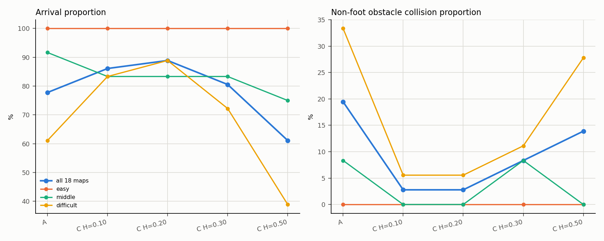
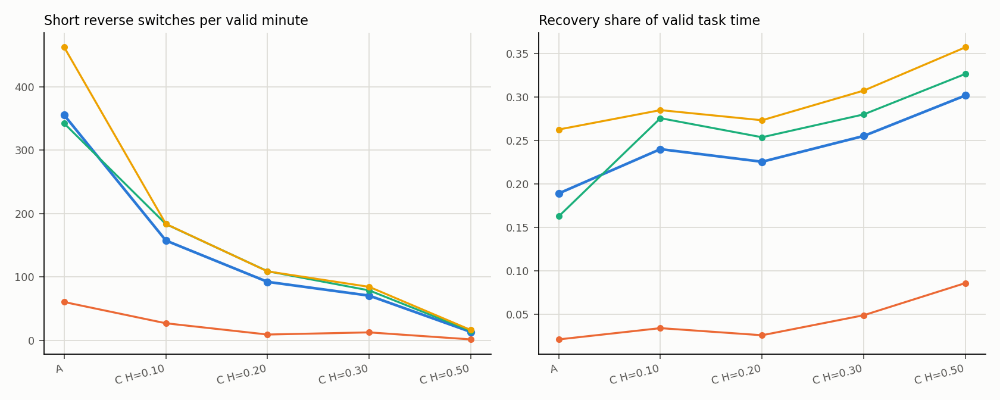
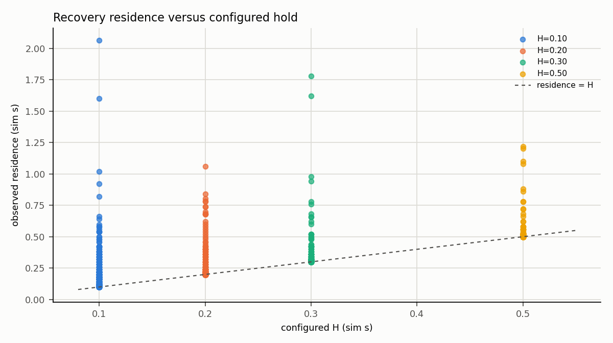

> **2026-10-19口径更新**：原碰撞差值“最不利”标签已纠正。H0.20保守差值−16.7pp、有利差值−19.4pp，候选不变；旧表图保留，见[独立重算说明](unknown_sensitivity_review_20261019/README.md)。

# T2 阶段3：18图×5档A/C最小保持时间180项扫描执行报告

**状态：180/180 计划项均有有效任务结果；实际场景启动181次（含1次已定位工程补做）；批次 `COMPLETE`。T2 仍为唯一 ACTIVE，等待 Director 审阅。本批为开发集预实验，不估计可靠成功率、不证明全局最优或一般环境分布。**

## 1. 范围与固定条件

执行依据：用户本轮180项授权、[T2任务](../../../tasks/T2.md)、[HOLD_TIME_PLAN](../../../designs/T2/HOLD_TIME_PLAN.md)、[SWITCH_CONTRACT](../../../SWITCH_CONTRACT.md)和[运行前冻结方法](FROZEN_METHOD_180.md)。

| 项目 | 固定值 |
|---|---|
| 地图 | 当前 M2 selected_v2：e01–e03、m01–m06、d01–d09，共18图 |
| 档位 | A无保持；C H=0.10、0.20、0.30、0.50仿真秒 |
| 次数 | 18图×5档×2次=180项；每档36项 |
| 组别规则 | A/C单阈值退出RA<−0.05；A无保持字段；C无exit_threshold |
| 目标/半径 | (7.5,0)m / 0.5m |
| 时限 | 20仿真秒 / 120墙钟秒 |
| 站立观察 | 到达后2仿真秒；独立墙钟30秒 |
| 显示 | 隐藏GLFW、`start_rviz:=false`、无截图/视频 |
| 调度种子 | 2026101803 |
| Bootstrap | 地图成簇，10000次，种子2026101804 |

18图为开发性有目的抽样，difficult占9/18；本批比例不代表一般环境。地图未因结果重新分层或删除，未使用留出集。

## 2. 准备与定向核验

- 复用生产链 `manual_ab_compare.py → s1_run_diagnostic.py`；新增180项runner和专用分析器，使用通用A/C读取函数，不再写死B组。
- A与四个C档各用独立overlay；A无`recovery_min_hold_s`，所有A/C overlay均无`exit_threshold`；实际消费记录为A `hold=false/H=0.0`，C `hold=true/H=0.10/0.20/0.30/0.50`。
- H=0.20补充检查：overlay配置校验通过；C++保持边界19项通过（未到期不提前退出、首个elapsed≥H且生产者状态为expired的周期按RA<E退出、到期RA≥E继续、无效时钟/segment不转换）。记录见 [`H020_BOUNDARY_CHECK.txt`](H020_BOUNDARY_CHECK.txt)。
- 既有C++ `s2_01_switch_config` 68项、`p1_07_switching` 292项、Python保持审计/配置检查均通过。
- 180项键（地图、重复、档位）唯一；每档36项；90个地图×档位格各2次；两轮各90项，第二轮逐图反转第一轮档序。完整计划与 `schedule.verification` 保存在批次目录。
- 每项显式使用 `--groups A/C --repeats 1 --entry-threshold -0.05 --exit-threshold -0.10 --hold-s <H或A回退0.30> --sim-limit-s 20 --wall-cap-s 120 --standing-observation-sim-s 2 --no-window --disable-framebuffer-capture`。A/C不写`exit_threshold`；CLI的X=−0.10和A的H=0.30只是现有入口校验回退值。

## 3. 执行与数据质量

- 计划180项，有效任务结果180项，记录`VALID` 180/180。
- 实际场景启动181次：1次已定位工程补做（第34项 d07/C H=0.20 attempt_01 `SYSTEM_SAFETY_ABORT`，attempt_02有效 `DIAGNOSTIC_SIM_TIME_LIMIT`）；工程补做1/4，未超过184上限；纯编排错误0。
- 第34项 attempt_01 的射线共享内存读取在整个16次重试/12.5 μs窗口内为 `odd_sequence_writer_in_progress`，控制器按安全门切PASSIVE；无碰撞/跌倒，清理完成。原始失败保留，未改代码/安全门；attempt_02补做未复发。
- 终局：**ARRIVED 142、COLLISION_TERMINATION 18、DIAGNOSTIC_SIM_TIME_LIMIT 19、FALL_TERMINATION 1、WALL_CLOCK_GUARD_INCOMPLETE 0**。
- 180/180 cycle0捕获、首个活跃策略帧精确持久化、周期缺口0、无效时钟0；任务窗口安全覆盖完整180/180；base_link物理步界内180/180、越界步0；shutdown/closeout 180/180确认。
- 隐藏MuJoCo窗口180/180 `visible=0`；ROS实际`start_rviz:=false` 180/180；未生成截图/录像。
- 批次约1.8 GB，低于4 GiB预算；可用磁盘约51 GB，高于15 GiB保护线。最终runner、MuJoCo、ROS/controller、RViz、记录器和辅助进程扫描为空。

## 4. 五档总体结果（18图地图等权）

| 档位 | 有效 | 到达 | 碰撞终止 | 跌倒 | 仿真时限 | 墙钟 | 到达率 | 非足端碰撞率(已知) | 短反向/有效分钟 | Recovery占比 | 辅助分 | 足端撞击 | 退出后0.5s重入 |
|---|---:|---:|---:|---:|---:|---:|---:|---:|---:|---:|---:|---:|---:|
| A（无保持） | 36 | 28 | 8 | 0 | 0 | 0 | 77.8% | 19.4% | 355.2 | 18.9% | 72.2 | 13 | 83.2% |
| C H=0.10 | 36 | 31 | 1 | 1 | 3 | 0 | 86.1% | 2.8% | 157.3 | 24.0% | 79.4 | 15 | 75.1% |
| **C H=0.20** | **36** | **32** | **1** | **0** | **3** | **0** | **88.9%** | **2.8%** | **92.1** | **22.6%** | **82.8** | **11** | **65.1%** |
| C H=0.30 | 36 | 29 | 3 | 0 | 4 | 0 | 80.6% | 8.3% | 70.4 | 25.5% | 77.9 | 12 | 55.0% |
| C H=0.50 | 36 | 22 | 5 | 0 | 9 | 0 | 61.1% | 13.9% | 13.1 | 30.2% | 66.3 | 6 | 31.9% |

## 5. 分层结果

| 层 | 档位 | 到达/有效 | 到达率 | 非足端碰撞率 | 跌倒 | 仿真时限 | 短反向/有效分钟 | Recovery占比 |
|---|---|---:|---:|---:|---:|---:|---:|---:|
| easy | A | 6/6 | 100% | 0.0% | 0 | 0 | 60.3 | 2.1% |
| easy | H=0.10 | 6/6 | 100% | 0.0% | 0 | 0 | 26.7 | 3.4% |
| easy | H=0.20 | 6/6 | 100% | 0.0% | 0 | 0 | 9.0 | 2.6% |
| easy | H=0.30 | 6/6 | 100% | 0.0% | 0 | 0 | 12.3 | 4.9% |
| easy | H=0.50 | 6/6 | 100% | 0.0% | 0 | 0 | 1.3 | 8.6% |
| middle | A | 11/12 | 91.7% | 8.3% | 0 | 0 | 342.1 | 16.3% |
| middle | H=0.10 | 10/12 | 83.3% | 0.0% | 0 | 2 | 183.2 | 27.6% |
| middle | H=0.20 | 10/12 | 83.3% | 0.0% | 0 | 2 | 108.9 | 25.4% |
| middle | H=0.30 | 10/12 | 83.3% | 8.3% | 0 | 1 | 78.6 | 28.0% |
| middle | H=0.50 | 9/12 | 75.0% | 0.0% | 0 | 3 | 14.5 | 32.7% |
| difficult | A | 11/18 | 61.1% | 33.3% | 0 | 0 | 462.3 | 26.3% |
| difficult | H=0.10 | 15/18 | 83.3% | 5.6% | 1 | 1 | 183.5 | 28.5% |
| difficult | H=0.20 | 16/18 | 88.9% | 5.6% | 0 | 1 | 108.6 | 27.3% |
| difficult | H=0.30 | 13/18 | 72.2% | 11.1% | 0 | 3 | 84.2 | 30.7% |
| difficult | H=0.50 | 7/18 | 38.9% | 27.8% | 0 | 6 | 16.0 | 35.7% |

完整3层×5档见 [`layer_summary_15.csv`](layer_summary_15.csv)；逐图×档90格见 [`map_level_90.csv`](map_level_90.csv)。

## 6. 相对A的差值与区间

地图成簇bootstrap，10000次，seed 2026101804；同一次重抽中A与各H使用同一地图集合。差值为百分点或每有效分钟次数，区间为95%。

| H | 到达差值(pp) | 区间 | 碰撞差值(pp，最不利) | 区间 | 短反向差值(/min) | 区间 | Recovery占比差值(pp) | 区间 | 辅助分差值 | 区间 |
|---:|---:|---|---:|---|---:|---|---:|---|---:|---|
| 0.10 | +8.3 | [−8.3, 22.2] | −19.4 | [−27.8, −11.1] | −197.9 | [−296.7, −119.2] | +5.1 | [2.5, 7.8] | +7.2 | [−3.4, 17.6] |
| **0.20** | **+11.1** | **[−5.6, 25.0]** | **−19.4** | **[−27.8, −11.1]** | **−263.1** | **[−364.9, −177.5]** | **+3.6** | **[0.4, 7.2]** | **+10.6** | **[0.9, 20.3]** |
| 0.30 | +2.8 | [−5.6, 11.1] | −13.9 | [−22.2, −5.6] | −284.8 | [−386.7, −201.0] | +6.6 | [4.5, 8.7] | +5.7 | [0.4, 11.5] |
| 0.50 | −16.7 | [−30.6, −2.8] | −8.3 | [−22.2, 8.3] | −342.1 | [−446.4, −253.9] | +11.3 | [8.1, 14.3] | −5.9 | [−17.3, 4.6] |

区间较宽（18个地图簇，easy仅3簇）；点估计过门槛不等于统计非劣效，未显著不等于等效。

## 7. 候选H与代表值

开发性规则：相对A到达下降≤5pp、非足端碰撞上升≤5pp、无任务期确认跌倒、安全UNKNOWN不作有利假设、短反向下降≥20%、逐图退化检查、优先最小有效H。

| 档位 | 到达pp | 碰撞pp | 短反向相对 | 跌倒 | 跌倒UNKNOWN | 资格 |
|---|---:|---:|---:|---:|---:|---|
| H=0.10 | +8.3 | −19.4 | −55.7% | 1 | 0 | 否（确认跌倒） |
| **H=0.20** | **+11.1** | **−19.4** | **−74.1%** | **0** | **0** | **是** |
| H=0.30 | +2.8 | −13.9 | −80.2% | 0 | 1 | 否（UNKNOWN，证据不足） |
| H=0.50 | −16.7 | −8.3 | −96.3% | 0 | 0 | 否（到达下降>5pp） |

**候选与代表值：C H=0.20仿真秒。** 它是唯一同时满足任务容忍度、无确认跌倒、无跌倒UNKNOWN且短反向下降≥20%的已测档；按“最小有效H优先”规则推荐。该结论只代表已测离散档和本开发集，不声称未测H或一般环境最优。

### H=0.20的代价

- 到达率88.9%（A 77.8%），非足端碰撞2.8%（A 19.4%），短反向92.1/min（A 355.2，−74.1%），辅助分82.8（A 72.2）。
- Recovery占比22.6%（A 18.9%，+3.6pp）；Recovery驻留中位数0.218s、P90 0.340s、均值0.248s（A中位数0.020s、P90 0.158s）。
- 仿真时限3次（A 0次）；足端撞击11次（A 13次）；到达时间地图等权8.63s（A 7.40s），成功子集不同；同图同轮共同到达配对时间差有正有负，不能宣称整体加速。
- 退出后0.5秒重入率65.1%（A 83.2%），退出次数379（A 970）；保持减少了退出次数和短反向，但部分原因是机械地延长单次Recovery。
- **m06 两张重复均仿真时限，到达0/2（A 2/2）**；H=0.20 的总体到达率提高掩盖了这张图的全失败。m06 两次Recovery占比约43%、路径约12m，属于绕行/未到达，而非碰撞或跌倒。
- middle 层到达率83.3%（A 91.7%，−8.3pp）；difficult 层88.9%（A 61.1%，+27.8pp）；easy 100%。总体改善主要由difficult层贡献，但middle层的m06退化和d07一次超时必须在解释中保留。
- H=0.20 的碰撞终止只有d02一次；该次为AGILE、碰撞前0.834s退出Recovery、退出RA=−0.344，碰撞前策略帧RA=−0.486；时间邻接仅作机制线索，不认定保持时间导致碰撞。

## 8. 保持episode审计

| 档位 | 有Recovery run | 无Recovery run | episode | 观察到退出 | 删失 | 时钟不完整 | H前提前退出 | 到期RA<E未及时退出 | 到期RA≥E继续 | 风险回升 | 入口时刻改变 | 违规 |
|---|---:|---:|---:|---:|---:|---:|---:|---:|---:|---:|---:|---:|
| H=0.10 | 33 | 3 | 582 | 581 | 1 | 0 | 0 | 0 | 221 | 82 | 0 | 0 |
| **H=0.20** | **32** | **4** | **379** | **377** | **2** | **0** | **0** | **0** | **93** | **104** | **0** | **0** |
| H=0.30 | 32 | 4 | 344 | 341 | 3 | 0 | 0 | 0 | 60 | 127 | 0 | 0 |
| H=0.50 | 32 | 4 | 296 | 288 | 8 | 0 | 0 | 0 | 23 | 113 | 0 | 0 |

- 没有H前提前退出；没有到期且RA<E却未及时退出的episode；没有时钟不完整或入口时刻重置。
- “到期RA≥E继续”表示H到期但风险未解除，保持没有强制退出；这些episode随后在RA<E的有效周期退出。
- 删失为任务终止/观察窗不足的未闭合episode；不视作未重入或保持成功。
- 无Recovery的run不是保持审计失败，也不能作为保持改善证据；已单独计数。
- 逐episode详情见 [`hold_episodes.csv`](hold_episodes.csv)，汇总见 [`hold_audit_summary.csv`](hold_audit_summary.csv)。

## 9. 安全、失败与UNKNOWN

### 确认跌倒

`d07.xml / C H=0.10 / repeat 2`（run_id `2547e48a82304e9ca0aac05ce518e92d`）为任务期 `FALL_TERMINATION`：任务时长2.84s、路径1.22m、距目标6.96m，9个Recovery episode、Recovery占比50.0%，保持审计`pass`。H=0.10因此不进入自动推荐。单次事件不宣布该H的真实风险概率。

### 跌倒UNKNOWN

`d08.xml / C H=0.30 / repeat 1`（run_id `559fef430128457b9ab9e28be6c84eb3`）终局为 `DIAGNOSTIC_SIM_TIME_LIMIT`，任务窗 `fall=UNKNOWN`，原因 `candidate_active_at_terminal_boundary`；25个Recovery episode、Recovery占比53.6%、路径10.06m，保持审计`pass`。H=0.30 不把UNKNOWN填False，也不进入自动推荐；这是H=0.30未获资格的直接原因。

### 碰撞与UNKNOWN

18次碰撞终止中，最后策略帧状态为AGILE 10次、RECOVERY 8次；11/18在碰撞前0.5s内有一次Recovery→Agile退出；没有“完全未触发Recovery”的碰撞。碰撞前策略帧与物理碰撞相差约0–18ms，只作时间邻接线索。

`d01.xml / A / repeat 1` 的非足端碰撞为UNKNOWN（终局碰撞终止、fall False、覆盖完整）；A的碰撞率最不利情景已计入该UNKNOWN。其余A/C碰撞字段为True/False。

### 站立观察与收尾

159个run完成2仿真秒站立观察；20个未到达/不适用（18碰撞+1跌倒+d08 H=0.30 timeout with fall UNKNOWN）；1个为 `INCOMPLETE`：`d07/C H=0.20/repeat1`（即第34项补做，run_id `8a6cbbe58c3a4ad0af10f0928fbb856e`）在20s仿真时限后站立观察0个样本、观察时长0.0s。该项仍为有效任务记录，但站立收尾未完成；不影响其任务终局和保持审计计数，必须在解释中保留。

## 10. 切换、驻留与重入

| 档位 | 总切换/run | Recovery退出/run | 退出总次数 | 重入可观察分母 | 0.5s重入率 | 删失 | 驻留中位s | 驻留P90 s |
|---|---:|---:|---:|---:|---:|---:|---:|---:|
| A | 53.9 | 26.9 | 970 | 963 | 83.2% | 7 | 0.020 | 0.158 |
| H=0.10 | 32.3 | 16.1 | 583 | 581 | 75.1% | 2 | 0.120 | 0.300 |
| **H=0.20** | **21.0** | **10.5** | **379** | **378** | **65.1%** | **1** | **0.218** | **0.340** |
| H=0.30 | 19.0 | 9.5 | 343 | 341 | 55.0% | 2 | 0.302 | 0.362 |
| H=0.50 | 16.2 | 8.0 | 293 | 293 | 31.9% | 0 | 0.518 | 0.522 |

保持档的短反向和退出次数大幅下降，但Recovery占比和单次驻留上升；不能把“不退出/少退出”直接称为稳定性改善。完整驻留见 [`recovery_residence.csv`](recovery_residence.csv)。

## 11. 到达时间

地图等权成功到达时间：A 7.40s、H=0.10 8.97s、H=0.20 8.63s、H=0.30 9.30s、H=0.50 9.57s。成功子集不同；同图同轮都到达的配对差见 [`paired_arrival_time_diff.csv`](paired_arrival_time_diff.csv)。H=0.20 的配对差有正有负（如d07 +5.02s、m05 +6.66s、d08 −3.12s、d05 −1.14s），不能删除失败run后宣称整体加速。

## 12. 初态、覆盖与收尾

- 180/180 cycle0实测初态捕获，含具名关节q/dq、姿态、位置/速度和同周期身份；重复号不等于严格初态重放，未声称确定性重放。
- 180/180记录`VALID`、实际配置来源确认；周期缺口0、无效时钟0、任务窗口安全覆盖完整、base_link物理步界内、shutdown/closeout确认。
- 隐藏GLFW仍依赖 `DISPLAY=:0` / `XAUTHORITY=/run/user/1000/gdm/Xauthority` / OpenGL context，不是真正无X11的headless；GLFW预检PASS，renderer为Mesa Intel (RPL-P)。
- 批次约1.8GB；最终进程扫描为空；未删除旧数据、未录视频/截图。

## 13. 结论与限制

- **推荐代表H=0.20仿真秒**：相对A，到达+11.1pp、非足端碰撞−19.4pp（最不利情景）、短反向−74.1%，且无确认跌倒、无跌倒UNKNOWN。它是唯一合格档，也是满足规则的最小H。
- H=0.20的代价：Recovery占比+3.6pp、驻留中位数0.218s（A 0.020s）、仿真时限3次（A 0）、到达时间8.63s（A 7.40s）、m06两重复均未到达、middle层到达−8.3pp。总体改善不能掩盖这些代价。
- H=0.10 有1次确认跌倒；H=0.30 有1次跌倒UNKNOWN；H=0.50 到达率61.1%（−16.7pp）且时限9次，均不自动推荐。
- 每图每档仅2次，不能估计可靠成功率或全局最优；bootstrap区间宽，点估计过门槛不等于统计证明；episode不是独立实验样本。
- 保持机制会机械地减少切换频率；本批同时报告了Recovery占用、驻留、超时、足端撞击和逐图退化，未把“切换少”单独当作成功。
- 碰撞/退出时间邻接只作机制线索；不宣布保持时间导致或避免了碰撞。UNKNOWN不填False/0；base_link界内不等于整机足迹界内；命令写出不等于MuJoCo消费。
- 本批完成后停止：不启动48项组合、追加扫描、留出验证、正式实验、训练或实机；不修改部署默认H；不提交Git。

## 14. 通俗总结

180项全部完成，180项有效：142次到达、18次碰撞、19次仿真时限、1次跌倒。A（无保持）到达率77.8%，H=0.20到达率88.9%、非足端碰撞2.8%、短反向比A少约74%，且没有确认跌倒或跌倒UNKNOWN，因此推荐H=0.20秒；它也是满足规则的最小H。代价是Recovery占比从18.9%升到22.6%、单次驻留中位数从0.02s升到0.22s、仿真时限从0次增到3次、到达时间从7.40s增到8.63s；最明显的问题是m06两次都超时未到达，middle层到达率从91.7%降到83.3%，总体改善掩盖了这张图的失败。H=0.10有一次确认跌倒，H=0.30有一次跌倒UNKNOWN，H=0.50到达率只有61.1%，都不自动推荐。第34项第一次因射线写读竞争触发安全中止，保留原记录后做了一次补做并成功；最终所有原始数据和UNKNOWN都保留，仿真、ROS/controller、RViz和辅助进程已退出。T2保持ACTIVE，等待Director审阅，不提交Git。
