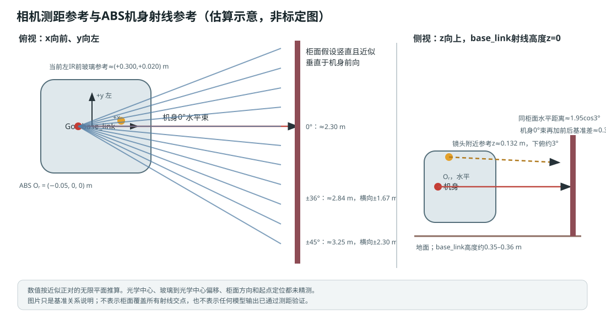

# D435i当前安装与ABS机身射线几何核对（2026-11-16）

## 结论

同一柜面上，操作者报告的镜头附近距离约1.95 m，不是ABS 0°射线距离。若暂按柜面竖直、柜面近似垂直于机身前向、测量线近似沿相机光轴，当前相机参考点 `x≈+0.300 m`、ABS射线起点 `x=-0.05 m`，下俯3°，则机身0°水平射线到该平面的距离约为：

`1.95 × cos(3°) + (0.300 - (-0.05)) ≈ 2.297 m`。

用保存记录的中心相机Z=1.952 m作同样投影，估算为约2.299 m。二者仅相差约2 mm，说明在上述假设下，主要基准差是相机参考点比射线起点前约35 cm；这不是可直接应用的常数校正。玻璃参考点不是已知光学中心，柜面角度/测量线也未精确测定，所以约2.30 m只用于解释基准，不能作为精确标签。

最近站立记录中补洞后0°输出medium=1.914 m、epoch3=2.661 m。它们分别比上述粗估值低约0.383 m、高约0.364 m。几何基准统一后两者仍明显不同；本核对不能把差异归因于某个单独参数，也不能判断哪个更准。

## 代码合同与模型训练几何

| 项目 | medium（基础与2026-06 medium微调） | epoch3候选（2026-11适配） | 当前安装候选 |
|---|---|---|---|
| 11束标签 | 共同合同：base_link水平面 `z=0`；起点 `(-0.05,0,0) m`；角度−45°至+45°、每9°；单位米，范围0.1–6 m | 同左 | 不变 |
| 相机原点/姿态 | 旧合成视图：`(0,0,0.27) m`，水平朝前，x/y/z为base局部坐标 | 壳体中心代理 `(0.305,0,0.140) m`；每个样本下俯3–5°；base高度样本0.350–0.360 m | 左IR前玻璃参考约`(0.300,+0.020,+0.132) m`；下俯约3°；base高度约0.350–0.360 m。z由简化URDF估算，均非精密外参 |
| 图像/内参 | 160×90，合成水平视场102°，无D435i原生K | 原生480×270，`fx=fy=244.134, ppx=245.186, ppy=134.22`，随后按原中心采样取到160×90 | 同epoch3记录的480×270及K；用户报告当前测距符合其阶段±2%接受标准 |

依据：`scripts/compare_ray_pred.py` 的 `RAY2D_X0/Y0`、`RAY2D_THETA_START/STEP`、`compute_geometric_ray_log()`定义了机身射线；`scripts/ray_predictor.py` 与medium数据集 `ABS/training/legged_gym/legged_gym/depth_data/mujoco_ray_pred/mujoco_ray_pred_medium_20260611/manifest.json`记录medium的旧相机位置/102°视场。epoch3训练清单 `logs/real_go2/20261115_d435i_ray_adaptation_data/adaptation_v1/summary.json`及训练manifest记录新相机候选、K、pitch/base高度范围和训练分割。

左右方向没有发现符号反转：代码中x向前、y向左；正束角沿+y、图像投影落向左侧，负角相反。相机俯角正值按 `camera_from_body()` 表示光轴下俯。标签不使用相机高度；相机局部z影响画面中地面/障碍投影。当前相机高度参考0.480 m与base高度估计给出的相对高度约0.120–0.130 m接近候选0.132 m，但前玻璃参考、base_link高度和结构偏移都带误差。

## 当前距离平面下的有限几何核对

只为计算建立一个理想平面：由镜头参考距离1.95 m与3°下俯估算，其机身前向位置约`x=2.247 m`。以ABS射线起点和方向求与无限竖直平面的交点，得到：

| 束角 | 机身射线到假设平面的距离 | 交点相对0°束横向位置 | 480×270相机内交点（epoch3名义4° / 当前3°） |
|---:|---:|---:|---|
| −45° / +45° | 3.249 m | ∓2.297 m | 画外 / 画外 |
| −36° / +36° | 2.840 m | ∓1.669 m | 画内 / 画内 |
| −27° / +27° | 2.578 m | ∓1.171 m | 画内 / 画内 |
| −18° / +18° | 2.416 m | ∓0.746 m | 画内 / 画内 |
| −9° / +9° | 2.326 m | ∓0.364 m | 画内 / 画内 |
| 0° | 2.297 m | 0 m | 画内 / 画内 |

这些命中点是**假设平面**上的几何点；画内不代表真实柜面宽到那里，也不代表整个障碍可见。比如±36°的交点横向已约1.67 m，普通柜面很可能不覆盖它。明细像素投影在[几何CSV](../../../logs/real_go2/20261116_current_mount_geometry_audit/ray_projection_comparison.csv)，所有假设在[摘要JSON](../../../logs/real_go2/20261116_current_mount_geometry_audit/geometry_summary.json)。投影复用了数据生成器所用的坐标方程；未启动MuJoCo渲染，因为当前Python环境未安装`mujoco`，且对单平面射线交点和针孔投影的解析核对不需要渲染器。

相机视场方面，按仓库manifest公式，D435i K对应水平视场约89.02°，半视场约44.51°；±45°只比边界多约0.49°，但加上相机在机身射线起点前方约0.35 m后，假设平面上的±45°束命中点会落到图像之外。medium训练的102°视场半角51°，同一几何平面命中点在理想旧视图中均可入画。epoch3训练使用D435i K，和当前视场一致。因此medium与epoch3不是同一相机几何下的权重对照。

相对epoch3名义几何，当前候选变化为前向−5 mm、左向+20 mm、局部高度−8 mm、pitch从代表值4°变为3°（3°落在训练采样范围内）。按约1.95 m目标距离，左向20 mm使像面水平投影约移动2.5个原图像素（约0.84个160×90采样格）；pitch变化与z变化合计使本例中心命中点约移动3.3个原图像素（约1.1个采样格）。这是几何变化量，不是网络误差预测，也不能证明其足以解释0°输出相差约0.75 m。

示意图中的距离均为上述理想竖直平面假设：

## 数据建议与剩余问题

**现有`adaptation_v1`不宜直接作为“当前安装几何匹配”的训练输入。**后续若决定继续适配，应保留旧数据和medium基线，另生成一个明确版本：用当前候选 `(0.300,+0.020,+0.132) m`、K不变、pitch名义3°（若保留3–5°扰动，应在数据记录中明确其依据），base高度沿用0.350–0.360 m；仍渲染480×270，再按现有中心采样，标签仍由同一base_link射线几何独立计算。可以复用既有场景、位姿列表、整布局train/validation/test分割、标签算法、空洞增强流程和评价口径；同一场景/位姿下机身射线标签理论上不变，但深度帧和画内/画外投影统计必须按新相机几何重生成。不要把相机Z或模型输出当标签。

此结论只支持“更新几何输入数据有理由”，不证明更新数据会使网络变准。若要评价真实11束距离，仍需相机装回后保持站立静止，在中心及左右目标上从base_link射线起点测到障碍表面；当前外壳/玻璃参考到光学中心偏移、base_link地面投影、柜面法向和左右目标交点仍未知。可先离线重生成小批几何数据，不需要启动机器人；要把新候选与实际机身束距离作定量比较，则需要一次静态机器人测量。

本轮没有运行训练、MuJoCo渲染、ROS/DDS、控制器或设备访问。未改模型、相机标定、生成器、仿真配置及R1 ACTIVE任务。唯一下一项建议：**新建一版只含小批样本的当前安装几何数据，并复核中心/左右束的独立投影与标签；暂不训练。**
