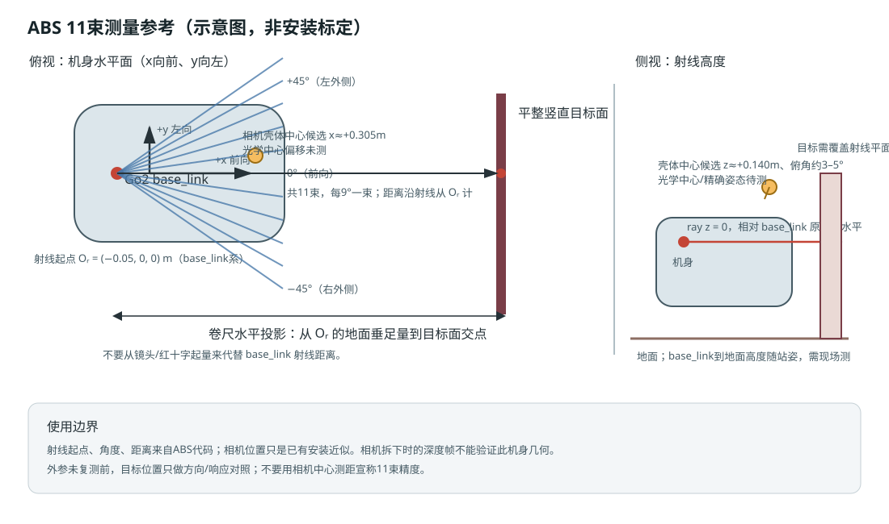

# D435i同帧双模型11束只读观察准备（2026-11-16）

## 目的与边界

扩展现有深度观察器，让下一次站立静态观察可以对同一帧分别运行medium和固定epoch3候选，并按ABS机身射线参考解释结果。本轮只做离线检查；相机当前从机器人拆下，已有深度帧只用于处理链和模型响应复算，不能验证安装状态下的11束物理精度。

没有训练、换权重、改控制配置或修改仿真。观察器不发布ABS协议，不写共享内存，不调用Go2接口；现场仍只是诊断，不是控制许可。epoch3在训练测试中近障高估尾部变差，仍不可接控制，见[固定预算训练报告](20261115_D435I_RAY_ADAPTATION_RUN.md)。

## 输入与输出约定

| 内容 | 采用的约定 | 依据与限制 |
|---|---|---|
| 实时ROS深度 | `16UC1`，480×270；按0.001 m/unit将整数转米 | observer拒绝其他编码/尺寸。ROS驱动仅在设备scale恰为0.001时原样发布Z16，代码位于`fix_depth_scale`；现场先核对实际profile与scale。 |
| 保存的离线帧 | SDK Z16小端文件，依`metadata.txt`的scale 0.001 m/unit转米 | 只读样本来自`20261116_d435i_102cm_static`，不是当前机器人安装帧。非零的65535仍按有效样本进入裁剪，超过6m后裁为6m；这里没有把它另判为无效码。 |
| SDK补洞 | 相机ROS驱动显式启用`hole_filling_filter.enable=true`、`hole_filling_filter.holes_fill=1`；mode 1为从邻居取最远深度。observer本身不再滤波 | 驱动先处理帧再发布图像；默认过滤器关闭。订阅话题名虽含`image_rect_raw`，不能据名称判断补洞状态，CSV/JSON记录`input_depth_stage`。现场若没有确认过滤器参数成功生效，不得把输入标为已补洞。参见[ROS wrapper参数](https://github.com/realsenseai/realsense-ros/blob/4.58.4/realsense2_camera/launch/rs_launch.py)、[过滤器调用链](https://github.com/realsenseai/realsense-ros/blob/4.58.4/realsense2_camera/src/base_realsense_node.cpp)和[SDK补洞模式](https://github.com/realsenseai/librealsense/blob/v2.58.4/doc/post-processing-filters.md)。 |
| 未知与6m占位 | 原始零值先作为未知；SDK补洞新增值属于滤波结果；滤波后仍为0的模型采样格只在显式`--unknown-fill-m 6.0`时临时填6m | 6m是诊断占位，不是测量值、不保证输出保守。单个补洞后Image不能还原补洞前的原始零值掩码，因此在线记录的是输入图全图/中央40×40零值比例和模型采样未知比例；补洞前未知及新增值比例留空。离线配对记录可分别计算三类像素。 |
| 模型预处理 | 与当前适配器一致：160×90中心像素采样、裁剪[0.1,6]m、log2、三通道复制 | 未用拉伸缩放；严格默认不变。未指定占位时，若采样中心有未知仍跳过推理。 |
| 模型输出 | TorchScript `(1,11)` log2(m)，`exp2`还原为米并限于[0.1,6]；顺序−45°、−36°、…、+45° | `--model`显式为medium，`--compare-model`显式为epoch3；不静默回退。两模型在同一回调、同一已预处理张量上依次推理，分别记录耗时。 |

`source_valid`只依据输入像素是否为0及有限性；SDK填补值不能冒充原始测量。在线没有第二份未滤波图像时，无法识别哪些非零值是滤波新填的，这一点由`pre_filter_raw_unknown_fraction=null`明确表示。相机发布端原始零值不会由observer内置补洞。

## 代码改动

扩展了[现有observer](../../../scripts/go2_depth_ray_observer.py)：

- 新增可选`--compare-model`，单模型用法和默认严格拒绝行为保留；两条模型路径都必须是实际存在的显式权重。
- 新增`--input-depth-stage`用于记录`raw`、`sdk-hole-filled`或`unspecified`。接收图像不做二次SDK处理。
- 双模型模式的CSV在同一行记录接收序号、header时间、尺寸、电脑单调接收/处理时间、处理时龄、输入零值比例、采样未知比例、两模型推理耗时和各自11束距离。两组值共享该行的receive index和header timestamp；处理与接收均不缓存旧模型输入，待处理槽只保留最新帧。
- 不保存图像；不写共享内存、不发布射线协议或控制数据。推理结果一律标注`prediction_valid_for_control=false`。

`image_rect_raw`在指定驱动下经过已启用的SDK过滤器后发布。mode 1参数来自SDK的`RS2_OPTION_HOLES_FILL`，ROS2动态参数名依过滤器名称与SDK选项注册；本机Humble launch将filter enable默认设为false。现场命令必须显式打开并在启动后读回`hole_filling_filter.enable`和`hole_filling_filter.holes_fill`，不得再在observer里重复补洞。

## 有限离线对照结果

输入是[2026-11-16静态记录](../../../logs/real_go2/20261116_d435i_102cm_static/capture/abs_20261116_102cm_data/)中帧0、120、240的原始`*_depth.u16`和实际SDK `*_filled.u16`配对。metadata给出480×270、scale=0.001、相机序列号238322070866。检查发现原始有效像素在SDK保存结果中均未改变。

原始三帧零值平均8.002%；SDK填入的像素占全图1.327%；补洞后仍未知6.675%。这三帧中央40×40区域原始和补洞后均无零值。离线脚本用medium与epoch3在raw及filled六个输入状态上各推理一次，得到6行逐帧CSV、每行两份11束及模型间逐束差：

- 同一补洞后输入上，epoch3相对medium的11束平均绝对变化0.328m，最大0.953m。
- 对相同帧，SDK补洞相对raw＋6m占位的射线输出平均绝对变化0.140m，最大0.423m（跨两模型和11束）。
- 补洞后输入的跨帧射线均值：medium中央束1.663m，epoch3中央束1.334m；11束整体均值分别1.488m、1.598m。
- 分束epoch3−medium均值（角度−45°→+45°）：`[+0.812,+0.363,+0.514,−0.143,−0.013,−0.329,+0.183,−0.222,−0.613,+0.019,+0.644] m`。

这些数值只说明模型和输入处理会改变响应，没有逐束独立障碍标签；不是射线误差、比较胜负或安全证据。柜前约1.02m用户读数起止点未确认，相机又已拆下，不能把本批结果当作机身射线准确度。

结果：[`paired_frame_model_outputs.csv`](../../../logs/real_go2/20261116_dual_model_observer_offline_check/paired_frame_model_outputs.csv)、[`summary.json`](../../../logs/real_go2/20261116_dual_model_observer_offline_check/summary.json)。输入数据和旧报告均未覆盖。

## ABS机身射线与测量基准

代码合同是base_link坐标的水平射线：起点`(-0.05, 0, 0) m`，角度−45°到+45°每9°，范围0.1–6m。对应依据：[`unitree_sdk2_bridge.h`](../../../unitree_mujoco/simulate/src/unitree_sdk2_bridge.h)；适配标签由[`compare_ray_pred.py`](../../../scripts/compare_ray_pred.py)和[`prepare_d435i_ray_adaptation_data.py`](../../../scripts/prepare_d435i_ray_adaptation_data.py)独立从几何计算。x向前、y向左，所以负角在右侧、正角在左侧。标签高度是base_link局部z=0；相对地面的实际高度随站姿，必须现场测量。Isaac训练代码中的`z=0.1`仅用于绘图辅助，不能替代射线标签高度。

现有相机安装记录只有近似壳体中心base前向+0.305m、上方+0.140m、俯角约3–5°；壳体中心不等于光学中心，且相机本轮拆下。这些值不够进行厘米级camera→base ray换算。测距应从base_link射线起点的地面垂足，沿相应射线方向量到障碍表面的交点；平整竖直板需覆盖base_link的射线高度。镜头到红十字的距离只能记录相机测点，不能当作ABS束标签。

## 下一次现场只读步骤

这项观察能比较当前安装下的输入响应、两模型同帧输出、数据时龄/处理覆盖和射线方向变化；若相机安装外参未重新量，不能定量判定每束距离是否准确，也不能证明模型可用于控制。可让障碍仅用于静态响应检查，Go2保持不运动，不运行策略或低层控制。

建议用同一块平整目标面依次摆在5个位置：中央0°、左右±27°、较外侧±36°；每个位置单独运行一次30秒观察，换位时Go2保持站立静止且相机不动。目标面应覆盖base_link的水平射线高度。距离只记录实际测得值，不要求“凑”到整数。布置每个位置时从射线起点地面垂足沿射线方位量到面交点；若现场不能定位该垂足，只作方向/响应定性比较，不记作精确射线距离。相机安装参数未复核前所有方向/距离对照均标为近似。±45°最外束贴近/略超当前约88.9°相机水平视场边界，遮挡或不可见时如实记录，不能要求训练输出补出图像看不到的信息。

实际运行前在电脑本地确认RealSense节点/USB占用、ROS环境及一个未占用的本机ROS domain；不要沿用历史跨机网卡、IP或domain。相机只开一个480×270@60深度＋双IR pipeline，RGB/IMU关闭，投射器开，SDK hole-fill mode 1只开一次；observer只订阅`/camera/camera/depth/image_rect_raw`和CameraInfo。命令及参数读回步骤在[脚本说明](../../../scripts/go2_depth_ray/README.md)。

完成条件：五个摆位分别保存独立目录；每行两组11束属于同一receive index/header；输入stage与驱动filter读回一致；记录处理/输入时龄与覆盖情况；正常关闭相机节点和observer并核对退出码。停止条件：topic/profile不符、filter参数未确认、输入无效/持续断流、处理错误，或操作者要求停止；先停止/结束当前相机采集，再调整目标；observer没有停止机器人或控制权交接能力。

## 仿真影响与验证边界

改动仅限只读观察脚本和文档、离线结果；不修改模型文件、默认控制配置、共享控制器、相机标定、R1、仿真设置或go2_navigation。离线语法检查、`--help`和四张既有ROS深度帧的双模型self-check均通过；未source ROS、未创建DDS、未运行在线观察。self-check的两模型输出均为11个有限值；最新帧合成检查收到1/2/3/4时处理1/4，覆盖计数2，无旧帧重放。

在线实际ROS回调、SDK过滤器在未来相机profile上的交付、Go2当前安装外参和障碍距离准确度尚未验证。**推荐下一步只有一项：相机装回后的静止多摆位双模型只读观察**，不接控制。
